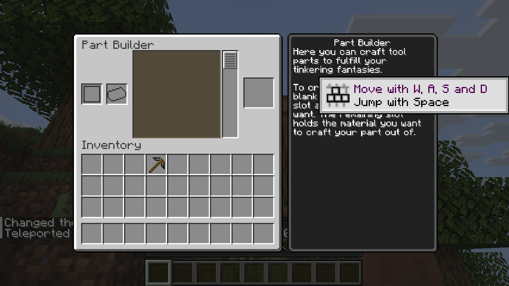
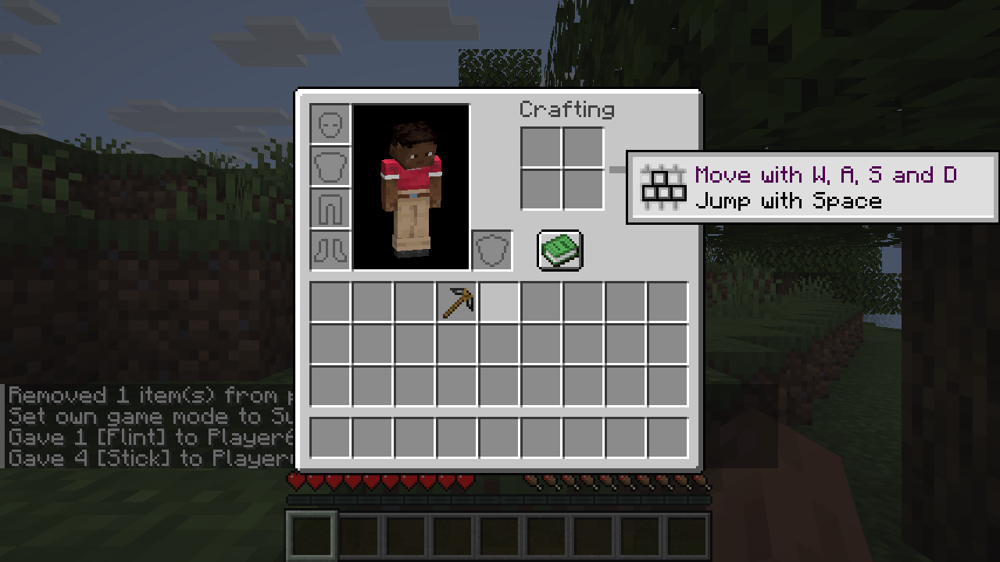

# Horizon Mods

**[Horizon](https://github.com/horizon-rust/horizon) 向けの Mod 群と、Fabric API 風ライブラリ。**

[English](README.md) · 日本語

## 収録プロジェクト

このリポジトリには4つのプロジェクトが入っています。すべての土台は、ゲームへの注入を一手に担う **PlutoLib** です。他の3つは通常の Mod として PlutoLib の公開 API を呼ぶだけで、自ら注入は行いません。

| | |
|---|---|
| **[PlutoLib](https://github.com/sofia-gros/horizon-mods/releases/tag/tconstruct-v1.0.0-beta)**（[API ページ](pluto-lib/docs/api/index.md)） | Horizon における Fabric API の counterpart：他の Mod から呼ばれる独立したライブラリ Mod。Fabric に倣った名前と挙動を持ち、Horizon のバージョンごとにリリースされます。 |
| **[Tinkers' Construct for Horizon](https://github.com/sofia-gros/horizon-mods/releases/tag/tconstruct-v1.0.0-beta)** | 原作 Java 版 Tinkers' Construct のクリーンな移植。PlutoLib の公開 API のみで書かれています：部品から道具を作り、金属を溶かして鋳造し、装備を改造できます。 |
| **[Pipes](https://github.com/sofia-gros/horizon-mods/releases/tag/pipes-v1.0.0-beta)** | クリーン実装のパイプ Mod：Tinkers の炉・タンク・チェストをつなぐアイテムパイプ。レッドストーン駆動の抽出に対応します。 |
| **[Stellarsky](https://github.com/sofia-gros/horizon-mods/releases/tag/stellarsky-v1.0.0-beta)** | 実在の星空を再現する Mod：実在の星カタログ、ESO パノラマによる天の川（暗黒帯まで）、黄道光と大気光、そして射手座A* のブラックホール。 |

## 現状：v1.0.0-beta リリース済み

**v1.0.0-beta** のプレリリースを公開しました（2026-11-25）：**[Tinkers' Construct](https://github.com/sofia-gros/horizon-mods/releases/tag/tconstruct-v1.0.0-beta)**、**[Pipes](https://github.com/sofia-gros/horizon-mods/releases/tag/pipes-v1.0.0-beta)**、**[Stellarsky](https://github.com/sofia-gros/horizon-mods/releases/tag/stellarsky-v1.0.0-beta)**。対象は Horizon `441f49d5` / Horizon Mixins `e59da909`（Rust 1.95.0）です。PlutoLib は `pluto-lib.hnmod` として、Tinkers' Construct と Pipes のリリースに必須の依存ファイルとして添付されています。

### beta のインストール

- 使いたい Mod の `.hmod` ファイルをダウンロードし、ゲームフォルダの **`horizon-mods/`** に置いてください。有効化は **`horizon-mods.txt`** に書く（`mod.tconstruct:true`、`mod.pipes:true`、`mod.stellarsky:true`）か、ゲーム内の Options > Mods から行います。
- Tinkers' Construct と Pipes にはネイティブ部分も必要です：各 `.hnmod` と `pluto-lib.hnmod` を、`horizon-mods/` の隣の **`horizon-native-mods/`** に置いてください。
- 初回起動時はネイティブ Mod の組み込みに約1分かかります。これは初回だけで、以降の起動は高速です。
- **インストールは `.hmod` パッケージで行ってください。フォルダコピーでは動きません** — コンテンツフォルダを手でコピーしても有効になりません。

### 検証状況と既知の差分

beta のツリーは、ローカルの guarded build 全チェーン（weave plan：154 injections / 141 modules / 3 states、ガード 13/13、native・API・consumer・game-entry・link の各チェック）と CI のテストスイートを通過しています。Mixins validation の CI ジョブ自体は現在、上流の `horizon-rust` 組織が GitHub にフラグされリポジトリが 404 を返すため入力を取得できません。そのため同じ検証を、ピン済みソースに対してローカルで実施しました。

beta は完成版ではありません。既知の差分は Issue [#1158](https://github.com/sofia-gros/horizon-mods/issues/1158)〜[#1171](https://github.com/sofia-gros/horizon-mods/issues/1171) で追跡しており、正式版 **v1.0.0** は「それらの修正を含めて原作と100%一致」と定義しています。Stellarsky の beta は静的な空レイヤーのみで、動的レイヤー（明るい星の瞬きと射手座A* 周辺の減光）は正式版で入ります。

先行マイルストーンの **[v0.0.1](https://github.com/sofia-gros/horizon-mods/releases/tag/tconstruct-v0.0.1)**（2026-11-23）も、タグから引き続き入手できます。

Sunrise 向けの PlutoLib 派生版（`pluto-lib-sunrise`）も準備中です。

ゲーム内での確認済み項目（Windows、v0.0.1 ビルド）：

- インベントリグリッドでの部品からのツルハシ製作と、Part Builder 画面。
- 溶解炉と精錬所：鉱石が液体に溶け、部品に鋳造し直せます。
- 道具は素材と改造（modifier）に応じて掘り、摩耗し、攻撃し、説明文が変わります。

  
  

## 次に読むもの

- **開発者向け：** [docs/development.md](docs/development.md)（ビルド、ローカルチェック、CI）と [docs/architecture.md](docs/architecture.md)。
- **計画：** [docs/roadmap.md](docs/roadmap.md)。
- **リリース手順：** [docs/releasing.md](docs/releasing.md)。
- **コントリビューターとエージェントの作業規則：** [AGENTS.md](AGENTS.md)。

## ライセンス

各ディレクトリ内のライセンスファイルをご覧ください。
