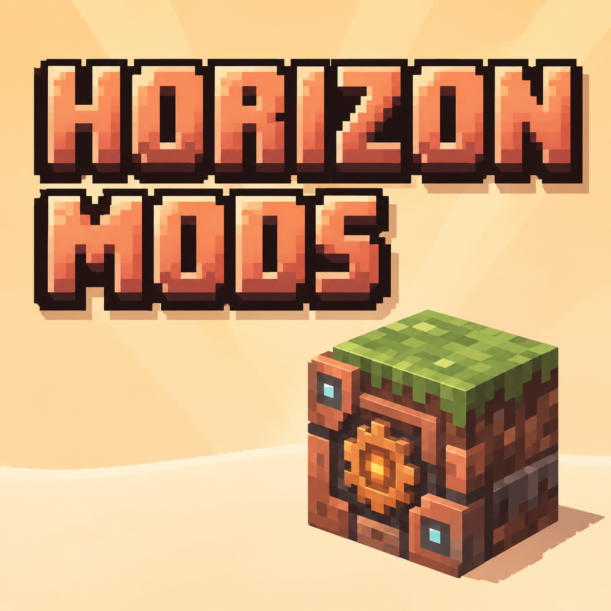
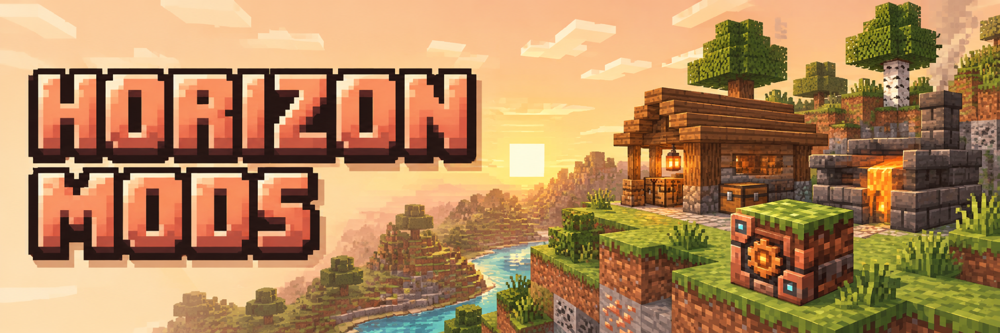
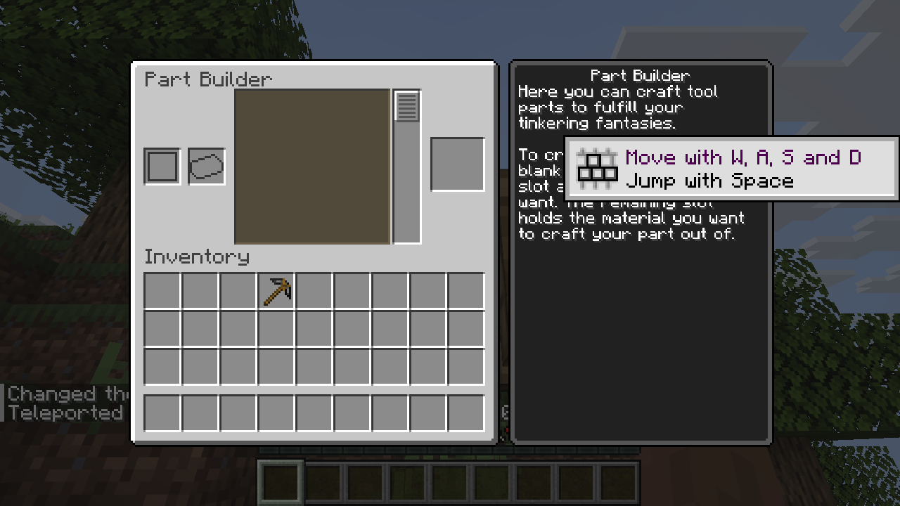
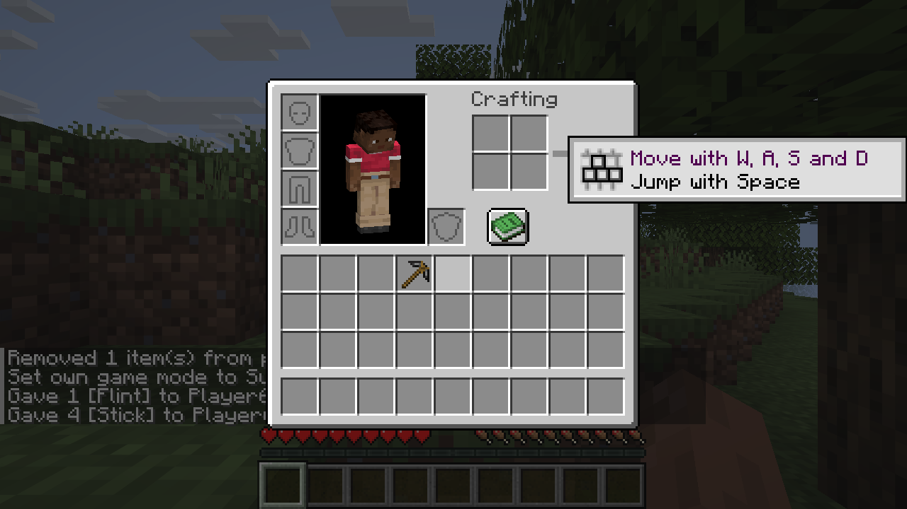

# Horizon Mods

**[Horizon](https://github.com/horizon-rust/horizon) 向けの mod と、Fabric API 風のライブラリ。**

[English](README.md) · 日本語

## このリポジトリにあるもの

| | |
|---|---|
| **[PlutoLib](pluto-lib/README.md)** | Horizon の Fabric API に当たるもの。他の mod が呼び出す独立した mod で、Fabric API に近い名前と動作を持ち、Horizon のバージョンごとにリリースします。 |
| **[Tinkers' Construct for Horizon](tconstruct/README.md)** | Tinkers' Construct の移植。部品から道具を作り、金属を溶かして鋳造し、装備を強化します。 |

## 現状: 復旧中

最新の公式 Horizon と Horizon Mixins に対して、PlutoLib を土台に作り直している最中です。**リリースはまだありません。**
実際のゲームで動かして確かめられていること(Windows、Horizon `ebcfa226`)は次のとおりです。

- mod を読み込んだ状態でゲームが起動し、サバイバルのプレイヤーが、部品から火打石のピッケルをクラフトできます。
- Part Builder ブロックの画面が開きます。

  
  

それ以外の機能の多くは、コードとしては存在しますが、ゲーム内では確かめていません。確認済みの範囲と未確認の範囲は、[Tinkers' Construct](tconstruct/README.md) に書いています。

## 次に読むもの

- **開発者向け**: [docs/development.md](docs/development.md)(ビルド、ローカルの確認、CI)と [docs/architecture.md](docs/architecture.md)。
- **計画**: [docs/roadmap.md](docs/roadmap.md) と [docs/migration/](docs/migration/)。
- **リリース**: [docs/releasing.md](docs/releasing.md)。
- **コントリビューターとエージェント向けの作業ルール**: [AGENTS.md](AGENTS.md)。

## ライセンス

各ディレクトリのライセンスファイルを参照してください。
