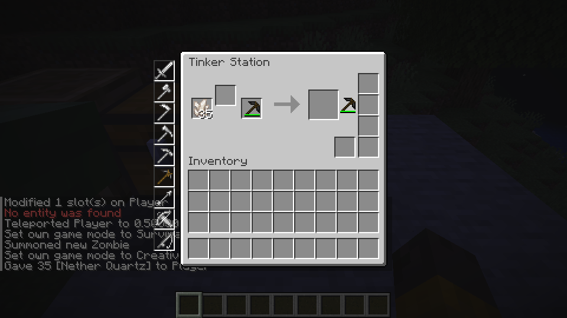

# Horizon Mods

This repository contains mods for [Horizon](https://github.com/horizon-rust/horizon), a Minecraft-compatible game written in Rust. Each mod has its own directory, resources, tests, and documentation.

## Mods

| Mod | Status | Guide |
| --- | --- | --- |
| Tinkers' Construct | Work in progress | [Tinkers' Construct](tconstruct/README.md) |

In the current Linux build, you can browse equipment in Creative, make parts,
assemble and repair supported tools, apply Sharpness and Swiftstrike, place a
selection of Tinkers blocks, melt and cast copper, and make a small Smeltery alloy. Many block and equipment behaviors are still in development.

*Add materials at the Tinker Station and take the resulting tool.*

## Get started

To try the current mod, follow the [Windows guide](tconstruct/docs/windows-playtest.md) or [Linux guide](tconstruct/docs/linux.md). The Windows launcher has not yet been verified on a Windows PC, and a reported startup error remains under investigation.

To work on a mod, start with the [development guide](docs/development.md).

## Shared library

[pluto lib](pluto-lib/README.md) provides shared mod functionality, starting with Creative tab registration.
