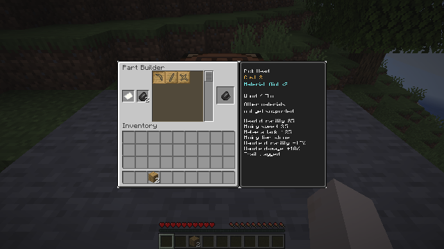

# Horizon Mods

A workspace for developing mods with the [Horizon](https://github.com/sofia-gros/horizon) fork. Horizon provides general APIs and hooks; code mods use them from a restricted WebAssembly environment rather than rewriting the engine. This work prioritizes permission boundaries, compatibility and long-term maintenance while testing the APIs in real games.

The screenshot shows the current Part Builder's three supported pickaxe parts and the flint information panel. Wood and flint are the implemented material subset; this is not the full original interface or material catalog.

## What works today

The [Tinkers’ Construct port](<Tinkers' onstruct/README.md>) is the main validation project. On this repository's `main`, it can make pick heads, handles and bindings from wood or flint, assemble a pickaxe and perform a limited single-material Station repair. Supported tools use the vanilla wooden-pickaxe carrier while the server mod applies mining, melee and durability behavior. The project aims for a complete TConstruct 1.20.1 port; that goal is not yet complete. Smeltery, the full tool and material catalog, many modifiers and original dynamic tool visuals remain unfinished.

The code and data live in the user-named `Tinkers' onstruct/` directory. The content and server components are separate `.hmod` packages. This repository is a development workspace, not the upstream Horizon mod registry, and is not a loader for Forge or Fabric `.jar` files.

## Try it or build a mod

Start with [building and trying the port](docs/playing-tconstruct.md) or the [documentation index](docs/README.md). Horizon's [mod guide](https://github.com/sofia-gros/horizon/blob/fc4848f4d7920390ea3aa8e6a5f804111f93a45d/docs/mods.md) explains the manifest and sandbox; the [generated API reference](https://github.com/sofia-gros/horizon/blob/fc4848f4d7920390ea3aa8e6a5f804111f93a45d/docs/api/mods-reference.md) lists the exact interfaces. Use a matching fork revision and run the tests for the package you build.

Mods run with declared capabilities and bounded host interfaces. These controls reduce exposure and make conflicts visible; they do not guarantee that every mod is safe or compatible. Malware has appeared in Minecraft mod distribution ([CurseForge incident notice](https://support.curseforge.com/en/support/solutions/articles/9000228509-june-2023-infected-mods-detection-tool/)). Future integration with trusted Horizon Mixins is an idea for extending missing host APIs while retaining Wasm mods; it is not implemented here, and trusted host extensions change the security boundary.

The original TConstruct textures shown here are distributed with their [MIT license and source notice](<Tinkers' onstruct/assets/tconstruct/source_notice.txt>); the pinned upstream revision and remaining attribution are recorded in [third-party sources](<Tinkers' onstruct/third_party/README.md>).
