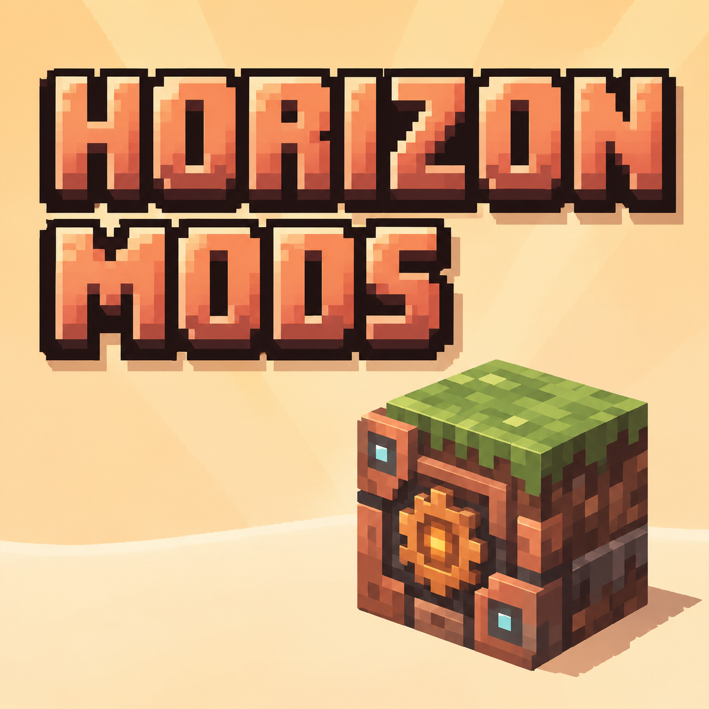
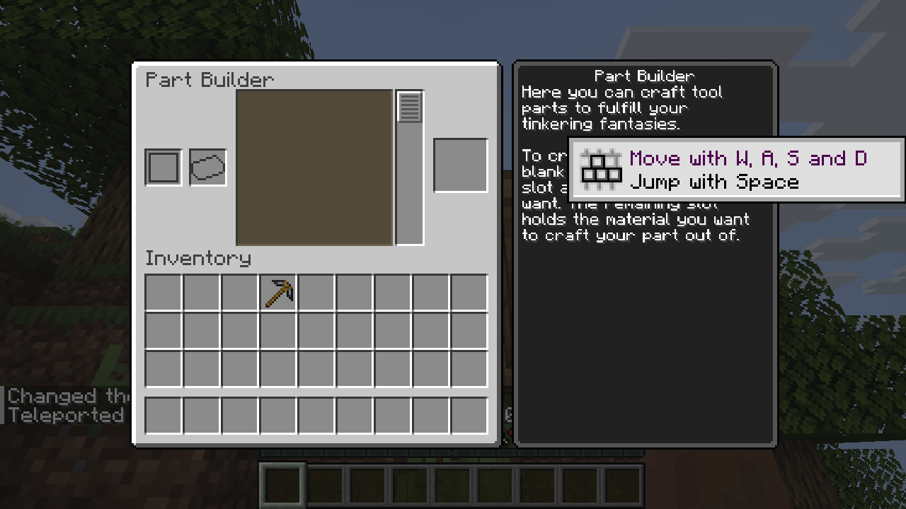

# Horizon Mods

**Mods and a Fabric-API-style library for [Horizon](https://github.com/horizon-rust/horizon).**

English · [日本語](README.ja.md)

## What is here

Four projects share this repository. Everything is built on **PlutoLib**, which owns all injection into the game; the other three are ordinary mods that call PlutoLib's public API and never inject anything themselves.

| | |
|---|---|
| **[PlutoLib](https://github.com/sofia-gros/horizon-mods/releases/tag/tconstruct-v1.0.0-beta)** ([API pages](pluto-lib/docs/api/index.md)) | Horizon's counterpart of the Fabric API: an independent library mod that other mods call, with Fabric-like names and behaviour, released per Horizon version. |
| **[Tinkers' Construct for Horizon](https://github.com/sofia-gros/horizon-mods/releases/tag/tconstruct-v1.0.0-beta)** | A clean port of the original Java Tinkers' Construct, written against PlutoLib's public API only: build tools from parts, smelt and cast metals, modify your equipment. |
| **[Pipes](https://github.com/sofia-gros/horizon-mods/releases/tag/pipes-v1.0.0-beta)** | A clean-implementation pipe mod: item pipes that connect Tinkers furnaces, tanks and chests, with redstone-powered extraction. |
| **[Stellarsky](https://github.com/sofia-gros/horizon-mods/releases/tag/stellarsky-v1.0.0-beta)** | A realistic-sky mod: a real star catalogue, the Milky Way from ESO's panorama with its dark lanes, zodiacal light and airglow, and a black hole at Sagittarius A*. |

## Status: v1.0.0-beta released

**v1.0.0-beta** prereleases are out (2026-11-25) for **[Tinkers' Construct](https://github.com/sofia-gros/horizon-mods/releases/tag/tconstruct-v1.0.0-beta)**, **[Pipes](https://github.com/sofia-gros/horizon-mods/releases/tag/pipes-v1.0.0-beta)** and **[Stellarsky](https://github.com/sofia-gros/horizon-mods/releases/tag/stellarsky-v1.0.0-beta)**, built for Horizon `441f49d5` and Horizon Mixins `e59da909` (Rust 1.95.0). PlutoLib ships as `pluto-lib.hnmod`, attached to the Tinkers' Construct and Pipes releases as their required dependency.

### Installing the beta

- Download the `.hmod` file for each mod you want and place it in your game folder's **`horizon-mods/`** directory. Enable each mod in **`horizon-mods.txt`** (`mod.tconstruct:true`, `mod.pipes:true`, `mod.stellarsky:true`) or from Options > Mods in game.
- Tinkers' Construct and Pipes also need their native parts: place their `.hnmod` files — and `pluto-lib.hnmod` — in **`horizon-native-mods/`**, beside `horizon-mods/`.
- The first launch builds the native mods into the game and takes about a minute; this happens once, and later launches are fast.
- **Install the `.hmod` package, not a folder copy** — copying a content folder into place by hand does not work.

### Verification and known gaps

The beta tree passed the full local guarded build chain — weave plan (154 injections, 141 modules, 3 states), guards 13/13, and the native, API, consumer, game-entry and link checks — as well as the CI test suites. The Mixins-validation CI job itself currently cannot fetch its inputs: the upstream `horizon-rust` organisation is flagged on GitHub and its repositories return 404, so the same validation was run locally against the pinned sources instead.

The beta is not the finished port. Its known gaps are tracked as issues [#1158](https://github.com/sofia-gros/horizon-mods/issues/1158)–[#1171](https://github.com/sofia-gros/horizon-mods/issues/1171), and the formal **v1.0.0** is defined as 100% parity with the original, including fixes for all of them. Stellarsky's beta contains its static sky layers only; the dynamic layer — the bright stars with twinkle and the darkening around Sagittarius A* — arrives with the formal release.

The earlier **[v0.0.1](https://github.com/sofia-gros/horizon-mods/releases/tag/tconstruct-v0.0.1)** release (2026-11-23) remains available under its tag.

A Sunrise-targeted variant of PlutoLib (`pluto-lib-sunrise`) is in preparation.

Verified in game (Windows, the v0.0.1 build):

- Crafting a pickaxe from its parts on the inventory grid, and the Part Builder screen.
- The melter and the smeltery: ores melt into fluids and cast back into parts.
- Tools dig, wear, hit and describe themselves by their materials and modifiers.

  
  

## Where to go next

- **Developers:** [docs/development.md](docs/development.md) (build, local checks, CI) and [docs/architecture.md](docs/architecture.md).
- **Plans:** [docs/roadmap.md](docs/roadmap.md).
- **Releases:** [docs/releasing.md](docs/releasing.md).
- **Working rules for contributors and agents:** [AGENTS.md](AGENTS.md).

## Licence

See the licence files in each directory.

The Pipes mod uses original BuildCraft pipe textures, unmodified, under the MMPL; see pipes/CREDITS.md.
