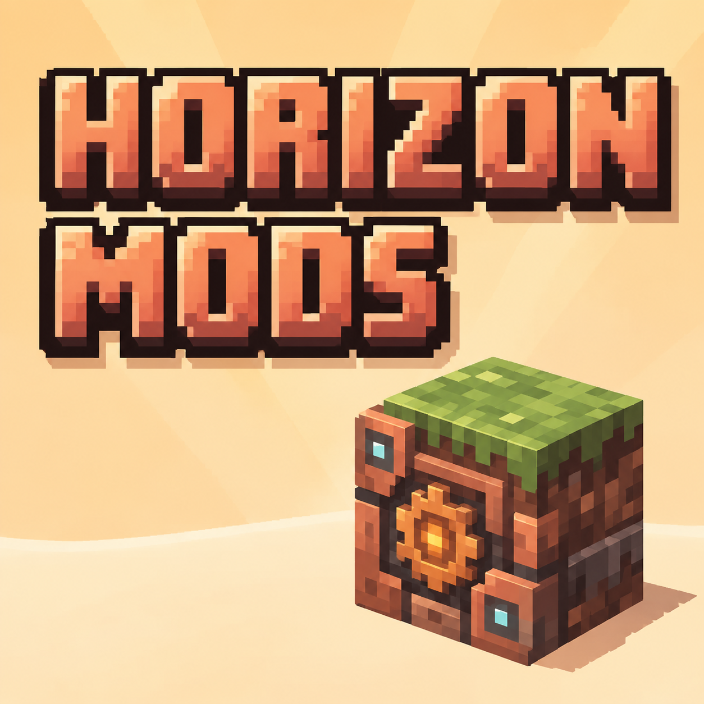
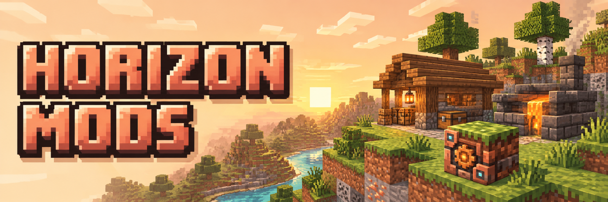
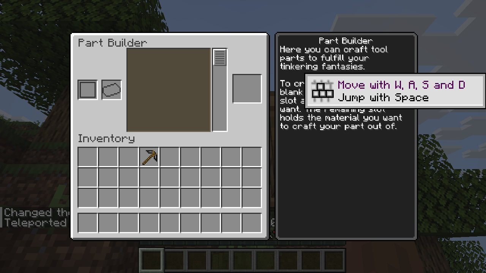
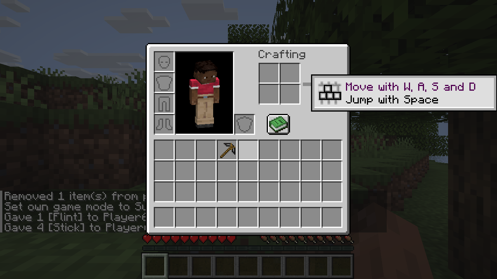

# Horizon Mods

**Mods and a Fabric-API-style library for [Horizon](https://github.com/horizon-rust/horizon).**

English · [日本語](README.ja.md)

## What is here

| | |
|---|---|
| **[PlutoLib](pluto-lib/README.md)** ([API pages](pluto-lib/docs/api/index.md)) | Horizon's counterpart of the Fabric API: an independent mod that other mods call, with Fabric-like names and behaviour, released per Horizon version. |
| **[Tinkers' Construct for Horizon](tconstruct/README.md)** | A port of Tinkers' Construct: build tools from parts, smelt and cast metals, modify your equipment. |

## Status: under recovery

The project is being rebuilt on PlutoLib against the latest official Horizon and Horizon Mixins. There is **no release yet**.
What has been run on a real game today (Windows, Horizon `ebcfa226`):

- The game starts with the mod loaded, and a survival player can craft a flint pickaxe from its parts.
- The Part Builder block opens its screen.
- Tools made on the original's library (`/tconstruct build`, `craft`, `upgrade`) dig, wear, hit and describe themselves by their materials and modifiers ([details](tconstruct/README.md#the-library-and-the-tools-made-on-it-new)).

  
  

Most other features are present as code but have not been exercised in game. [Tinkers' Construct](tconstruct/README.md) lists what is and is not verified.

## Where to go next

- **Developers:** [docs/development.md](docs/development.md) (build, local checks, CI) and [docs/architecture.md](docs/architecture.md).
- **Plans:** [docs/roadmap.md](docs/roadmap.md) and [docs/migration/](docs/migration/).
- **Releases:** [docs/releasing.md](docs/releasing.md).
- **Working rules for contributors and agents:** [AGENTS.md](AGENTS.md).

## Licence

See the licence files in each directory.
