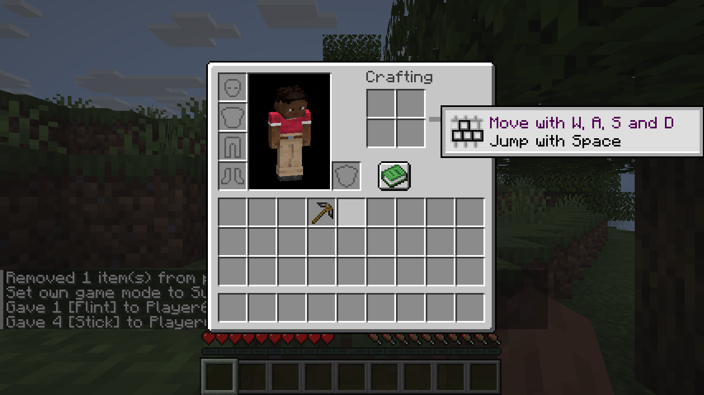

# Horizon Mods

**Mods and a Fabric-API-style library for [Horizon](https://github.com/horizon-rust/horizon).**

English · [日本語](README.ja.md)

## What is here

| | |
|---|---|
| **[PlutoLib](pluto-lib/README.md)** ([API pages](pluto-lib/docs/api/index.md)) | Horizon's counterpart of the Fabric API: an independent mod that other mods call, with Fabric-like names and behaviour, released per Horizon version. |
| **[Tinkers' Construct for Horizon](tconstruct/README.md)** | A port of Tinkers' Construct: build tools from parts, smelt and cast metals, modify your equipment. |

## Status: v0.0.1 released

**[Tinkers' Construct v0.0.1](https://github.com/sofia-gros/horizon-mods/releases/tag/tconstruct-v0.0.1)** is out (2026-11-23), with **PlutoLib 0.1.0** for Horizon `441f49d5` and Horizon Mixins `e59da909`. Pick the PlutoLib build that matches your Horizon and Mixins versions. From v1.0.0 on, PlutoLib and Tinkers' Construct are published as separate releases.

To install the mod on its own, download `tconstruct.hmod` from the release and place the single file in your mods folder — do not copy the content folder by hand. The first launch builds an overlay and takes about a minute; later launches are fast. A complete game bundle is attached to the v0.0.1 release as well.

Verified in game (Windows, the v0.0.1 build):

- Crafting a pickaxe from its parts on the inventory grid, and the Part Builder screen.
- The melter and the smeltery: ores melt into fluids and cast back into parts.
- Tools dig, wear, hit and describe themselves by their materials and modifiers.

  
  

Work toward **v1.0.0** — the complete port — is in progress. The formal release gates have not passed yet, so v0.0.1 ships as a bundle with its known gaps listed in the release notes.

## Where to go next

- **Developers:** [docs/development.md](docs/development.md) (build, local checks, CI) and [docs/architecture.md](docs/architecture.md).
- **Plans:** [docs/roadmap.md](docs/roadmap.md).
- **Releases:** [docs/releasing.md](docs/releasing.md).
- **Working rules for contributors and agents:** [AGENTS.md](AGENTS.md).

## Licence

See the licence files in each directory.
