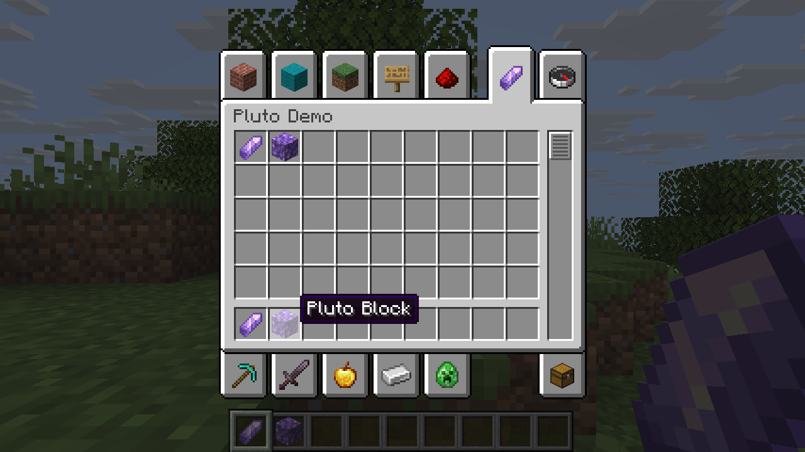

# PlutoLib

**Reusable Rust APIs for Horizon mods.**

Define items and blocks with a small Rust API, then make them available in the Creative inventory. PlutoLib builds on Horizon’s mod system; it is not a mod loader.



*Items and blocks registered by the PlutoLib demo, running in Horizon.*

## What works today

PlutoLib generates template-based item and block declarations and prepares Creative inventory data. The Creative paging adapter adds navigation when tabs exceed the screen's available positions. See [Creative paging](docs/creative-overflow.md).

## Start with a small example

```rust
use pluto_lib::Registry;
use std::path::Path;

let mut registry = Registry::new("my_mod")?;
registry.item("gem", "minecraft:amethyst_shard")?;
registry.block("gem_block", "minecraft:amethyst_block")?;
registry.write_to(Path::new("generated-content"))?;
# Ok::<(), Box<dyn std::error::Error>>(())
```

This writes content declarations. Include them with your mod’s manifest and assets, as shown in the demo.

[Get started](docs/getting-started.md) · [API guide](docs/api.md) · [Demo source](examples/demo.rs) · [Native Creative preparation](docs/native-creative.md)

## Compatibility

The unreleased `0.1.0` development version has been tested on Linux with pinned Horizon and Mixins commits. See [compatibility](docs/compatibility.md) for the verified combination, the initial demo's Mixins limitation, and development targets.

The existing Python Creative helper remains available; see its [guide](docs/creative-tabs.md).
