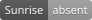

# Screens and menus for blocks

A block with item slots can open a menu when a player uses it. The slots come from the block entity (`BlockEntityType::item_slots`); a screen is the window around them: where the slots and the player's inventory sit, what is drawn, which presses are menu buttons, what the tooltips say and what the server does when a button is pressed.

Register the screen in your mod's `hooks()`, together with the block entity type. This page first walks through using screens, then lists every item in the [Reference](#reference).

## Basic Example

A screen is the window around a block's menu slots. The block entity declares the slots and the menu; the screen says where they sit and what is drawn:

```rust
use pluto_lib::{BlockEntityType, Identifier, ScreenHandlerRegistry, ScreenHandlerType, ScreenLayout};

let oven = Identifier::new("example", "oven").unwrap();
BlockEntityType::new(oven.clone()).item_slots(3).menu("minecraft:furnace"); // the menu type the game opens
ScreenHandlerRegistry::register(
    ScreenHandlerType::new(oven, ScreenLayout::new(176.0, 166.0).slot(56.0, 17.0).slot(56.0, 53.0).slot(116.0, 35.0))
        .on_draw(|draw| {
            let [x, y] = draw.origin;
            draw.canvas.text("Oven", [x + 8.0, y + 6.0], 0x404040, false);
        }),
);
```

## A Button That Reaches the Server

A press on the window is handled on the client first. `on_click` decides whether it is on one of your buttons and answers with an id; the game sends that id to the server, where `on_button` changes the block entity:

```rust
use pluto_lib::{Identifier, Nbt, ScreenHandlerRegistry, ScreenHandlerType, ScreenLayout};

ScreenHandlerRegistry::register(
    ScreenHandlerType::new(Identifier::new("example", "switch_box").unwrap(), ScreenLayout::new(176.0, 100.0))
        .on_click(|press| ((150.0..170.0).contains(&press.at[0]) && !press.right).then_some(1))
        .on_tooltip(|tip| {
            if (150.0..170.0).contains(&tip.at[0]) {
                tip.lines.push("Toggle".to_owned());
            }
        })
        .on_button(|press| {
            press.data.insert("on".to_owned(), Nbt::Byte(1));
        }),
);
```

## Reading the Machine's State

The draw, click and tooltip callbacks get the menu's *data slots*, the numbers the block entity shares with its menu (a flame and an arrow in a furnace). They are empty until the server's first values arrive, so read them with `get`:

```rust
use pluto_lib::{Identifier, ScreenHandlerType, ScreenLayout};

let window = ScreenHandlerType::new(Identifier::new("example", "oven").unwrap(), ScreenLayout::new(176.0, 166.0)).on_draw(|draw| {
    let flame = draw.data.first().copied().unwrap_or(0);
    draw.canvas.fill([draw.origin[0] + 57.0, draw.origin[1] + 37.0, 14.0, flame.min(14) as f32], 0xFFFF6600);
});
let _ = window;
```

> **Use with Caution.** The slot count of the menu type must match the block entity's `item_slots`. The window is drawn over the game's panel; set `with_own_background` on the layout if you draw your own.

## Dynamic Slot Positions

The ordinary `ScreenLayout` remains the static layout: its dimensions, inventory position, labels, background and initial slot positions are unchanged. Add `on_dynamic_slots` only when container-slot positions must respond to the menu's current data or item stacks. It runs after the client receives menu-slot or data-slot updates; return one position per container slot, or `None` to keep the static positions.

```rust
use pluto_lib::{Identifier, ItemSlot, ScreenHandlerType, ScreenLayout};

let window = ScreenHandlerType::new(
    Identifier::new("example", "bench").unwrap(),
    ScreenLayout::new(176.0, 166.0).slot(8.0, 8.0),
)
.on_dynamic_slots(|state| {
    let wide_part = state.items.first().and_then(Option::as_ref)
        .is_some_and(|stack| stack.item.to_string() == "example:wide_part");
    Some(vec![Some(if wide_part { [44.0, 8.0] } else { [8.0, 8.0] })])
});
let _ = ItemSlot::new(Identifier::new("example", "wide_part").unwrap(), 1);
let _ = window;
```

> **Use with Caution.** The dynamic resolver is called as synchronized menu contents change. Keep it quick and deterministic, and return exactly one position per container slot; an absent result, non-finite coordinates or a wrong-length result restores the static layout. Item slots include damage and custom data. Static screens never invoke a resolver.

The cursor passed to `on_button` and the stack passed to `on_quick_move` carry `ItemSlot` damage, max damage and custom data. Clone that slot when moving it; constructing a plain `ItemSlot::new` discards those fields. Cloning a received slot now carries an opaque source-stack snapshot across slots and cursor transfers, preserving native components rather than borrowing the destination's data. `ItemSlot::new` is plain, and changing the item identity discards captured components. A handled quick move writes back the complete remainder, including damage, max damage and custom data edits, not only its count. Returning `false` leaves both the original stack and the block entity unchanged. The production conversion fixture checks source-versus-destination metadata, public edits and component removal, plain replacement and rejected quick-move rollback. This change is source-ready only: native build/gameplay validation belongs to the integrated R2 domain, and authoritative recipe-result taking is not supplied by these callbacks.

## What the Slots Take

`on_slot_rule` decides what each slot of the menu takes and how many it holds. A result slot, which only gives, answers `may_place = false`; a fuel slot can take fewer. `on_quick_move` says where a shift-clicked stack goes, and `on_accepts` whether a hopper may put an item in:

```rust
use pluto_lib::{Identifier, ItemSlot, ScreenHandlerType, ScreenLayout};

let window = ScreenHandlerType::new(Identifier::new("example", "oven").unwrap(), ScreenLayout::new(176.0, 166.0).slot(56.0, 17.0).slot(56.0, 53.0).slot(116.0, 35.0))
    .on_slot_rule(|rule| {
        if rule.slot == 2 {
            rule.may_place = false; // the result slot only gives
        }
    })
    .on_quick_move(|moved| {
        // fuel goes to the second slot
        if moved.stack.item.to_string() == "minecraft:coal" && moved.items.get(1).is_some_and(|slot| slot.is_none()) {
            moved.items[1] = Some(moved.stack.clone()); // retain damage and custom data
            moved.stack.count = 0;
            return true;
        }
        false
    })
    .on_accepts(|put| put.item != "minecraft:dirt");
let _ = window;
```

> **Use with Caution.** The slot rule runs inside every click, drag and shift-click, several times for one, with no world or player at hand. Answer from the stack alone, and fast.

## Operations inside the menu

### `SlotAction`

 

The owned click kinds; other native operations remain delegated.

> The variants are the clicks a callback can own: `Pickup`, `QuickMove`, `Swap` and `Throw`. Drag,
> creative clone and pick-all are not among them — those operations stay on the native path, as do
> all other native operations.

```rust
use pluto_lib::SlotAction;
let action = SlotAction::Pickup;
```

### `SlotClick`

 

Callback context: `pos` is the block position; `player` is the acting player; `authoritative` distinguishes server effects; `slot`, `button` and `action` identify the click.

> Mutable `data` is saved block-entity data and `menu` accesses pending menu state. Neither grants
> a live player/world mutation scope.

```rust
use pluto_lib::SlotClick;
fn is_server_click(click: &SlotClick<'_>) -> bool { click.authoritative }
```

### `ScreenHandlerType::on_slot_click`

 

Owns one operation on one menu slot.

`on_slot_click(slot, action, handler)`

> Other slots and operations keep the native path. `SlotAction` is `Pickup`, `QuickMove`, `Swap`
> or `Throw`; drag, creative clone and pick-all remain native. The callback receives `SlotClick`:
> `pos`, `player`, `authoritative`, `slot`, `button`, `action`, mutable saved `data`, and a staged
> `menu`. It does not install a live player/world mutation scope.

```rust
use pluto_lib::{Identifier, ScreenHandlerType, ScreenLayout, SlotAction};

let window = ScreenHandlerType::new(
    Identifier::new("example", "single_slot_store").unwrap(),
    ScreenLayout::new(176.0, 166.0).slot(80.0, 35.0),
).on_slot_click(0, SlotAction::QuickMove, |click| {
    let Some(mut stack) = click.menu.stack(0) else { return };
    // One container slot followed by the player's slots in this menu.
    let end = click.menu.slot_count();
    if click.menu.move_stack(&mut stack, 1, end, true) {
        click.menu.set_stack(0, Some(stack)); // zero remaining count becomes empty
    }
});
let _ = window;
```

### `ScreenHandlerType::exclude_from_pick_all`

 

Use `exclude_from_pick_all(slot)` for a lazy recipe-result slot.

> It vetoes that slot when double-click collection scans candidates, including when the click
> started on another slot, and preserves every native refusal. It also excludes that slot from the
> native shift-double-click scan. It does not implement crafting, prevent ordinary pickup, or
> change storage slots unless explicitly declared.

```rust
use pluto_lib::{Identifier, ScreenHandlerType, ScreenLayout};
let window = ScreenHandlerType::new(
    Identifier::new("example", "workbench").unwrap(),
    ScreenLayout::new(176.0, 166.0).slot(80.0, 35.0),
).exclude_from_pick_all(0);
let _ = window;
```

### `MenuAccess`

 

Operates on the native menu's pending state, not directly on the live player inventory.

`MenuAccess`

> `slot_count` gives the number of menu slots, including the player's slots. `stack` clones the
> complete slot stack (`None` for empty or out-of-range) and `set_stack` replaces a staged slot —
> false out-of-range, zero count becomes empty — leaving recipe and placement rules to the
> callback. `swap_stack` clones hotbar 0..=8 or offhand 40 by swap-button numbering, and
> `set_swap_stack` replaces that staged target; the offhand works without a visible menu slot.
> `carried` clones the cursor stack and `set_carried` replaces the staged cursor.
> `same_item_and_components` compares two captured stacks natively after public edits, ignoring
> count, and `max_stack_count` is the native component-aware stack limit, zero for an empty stack.
> `move_stack` delegates to native transfer over `[start, end)`, respecting slot acceptance,
> components and limits, and leaves the remainder in `stack`. `crafting_remainder` resolves an
> item's crafting remainder as a fresh one-item stack. `give_stack` consumes an owned stack
> through native player-inventory insertion, dropping overflow, and `drop_stack` queues a drop
> through the native menu commit; neither removes a source slot itself.

```rust
use pluto_lib::{ItemSlot, MenuAccess};
fn return_remainder(menu: &mut dyn MenuAccess, remainder: ItemSlot) {
    menu.give_stack(remainder); // native insertion, then queued overflow drop
}
```

For a non-empty cursor, check both component identity and available capacity before accepting a result. This helper only calculates room; it neither transfers items nor crafts:

```rust
use pluto_lib::{ItemSlot, MenuAccess};
fn cursor_room(menu: &dyn MenuAccess, result: &ItemSlot) -> u32 {
    match menu.carried() {
        None => menu.max_stack_count(result),
        Some(cursor) if menu.same_item_and_components(&cursor, result) =>
            menu.max_stack_count(&cursor).saturating_sub(cursor.count),
        Some(_) => 0,
    }
}
```
## Which Sprites Resolve

A canvas `sprite` draw (and a native block-entity draw) names a sprite in the game's one unified atlas; a name the atlas does not hold draws nothing — the canvas call returns `false` and a block-entity face naming it is left out. The atlas packs the texture folders it walks (`gui`, `item`, `block`, `font`, `environment`, `misc`, `painting`, `entity`, `particle`, `mob_effect`, `map` of the `minecraft` namespace, and the `entity`, `mob_effect`, `particle` and `gui` folders of every content namespace) plus the sprites the atlas definitions name. Model textures are not gated by this: the terrain and item sprite system loads a model's texture file by name directly, so a texture can work on a block in the world and still not resolve on a screen.

A folder outside the walked set (Tinkers' `textures/fluid/` is one) reaches the atlas through an atlas definition. A content mod ships `assets/minecraft/atlases/<atlas>.json`; the game's content builder does not copy that file — it appends the file's `sources` to the base game's definition of the same name. This declares every namespace's `fluid/` texture folder as sprites of the blocks atlas, under the textures' own ids:

```json
{
  "sources": [
    {
      "type": "minecraft:directory",
      "source": "fluid",
      "prefix": "fluid/"
    }
  ]
}
```

Shipping the same file under the mod's own namespace (`assets/tconstruct/atlases/blocks.json`) does nothing: that definition is keyed separately, and only the `minecraft:blocks` and `minecraft:items` definitions contribute file sprites to the unified atlas. Animated textures (a strip with a `.png.mcmeta`) animate in the atlas wherever they come from. If a draw must degrade gracefully when a sprite is absent, draw an underlay first — the tank windows fill the fluid's colour under its tiles for exactly this reason.

## Reference

### `ScreenLayout`

 

Where things are in the window, in GUI pixels from its top left.

> `width` and `height` are the window's size (vanilla container windows are 176 wide), `slots`
> where each container slot is (`None` hides the slot, and it is not in the menu either, so
> shift-clicks skip it), `dynamic` which slots the dynamic-slot callback positions instead
> (parallel to `slots`, one entry per slot; such a slot is in the menu though the static layout
> has no position for it), `inventory_x` and `inventory_y` the player's inventory (vanilla's are 8
> and 84; the hotbar is 58 below), `own_labels` whether the screen draws the title and the
> "Inventory" label itself, `own_background` whether it draws its own background. `sources` says
> what backs each container slot (parallel to `slots`, one entry per slot) — see
> [`SlotSource`](#slotsource).

```rust
use pluto_lib::ScreenLayout;

let layout = ScreenLayout::new(176.0, 166.0);
assert_eq!((layout.width, layout.height), (176.0, 166.0));
assert!(layout.slots.is_empty());
assert!(layout.dynamic.is_empty());
assert!(layout.sources.is_empty());
assert_eq!((layout.inventory_x, layout.inventory_y), (8.0, 84.0));
assert!(!layout.own_labels && !layout.own_background);
```

### `ScreenLayout::new`

 

A window with no slots, the inventory at vanilla's place and the game drawing the panel and the labels.

`fn new(width: f32, height: f32) -> ScreenLayout`

> Add the slots afterwards with `ScreenLayout::slot` and its variants. Until a draw callback is
> given, nothing is drawn beyond the game's own panel and labels.

```rust
use pluto_lib::ScreenLayout;

let layout = ScreenLayout::new(176.0, 200.0);
assert_eq!(layout.height, 200.0);
```

### `ScreenLayout::slot`

 

One more container slot at `(x, y)`.

`fn slot(self, x: f32, y: f32) -> ScreenLayout`

> Slots are numbered in the order they are added, the same as the block entity's item slots.

```rust
use pluto_lib::ScreenLayout;

let layout = ScreenLayout::new(176.0, 166.0).slot(56.0, 17.0).slot(56.0, 53.0);
assert_eq!(layout.slots, vec![Some([56.0, 17.0]), Some([56.0, 53.0])]);
```

### `ScreenLayout::hidden_slot`

 

One more container slot that is hidden: it keeps its number but is not shown and shift-clicks skip it.

`fn hidden_slot(self) -> ScreenLayout`

> The slot keeps its number in the menu's numbering, so the slots after it keep theirs; it simply
> shows nothing, and shift-clicks skip it as if it were not there.

```rust
use pluto_lib::ScreenLayout;

let layout = ScreenLayout::new(176.0, 166.0).slot(8.0, 8.0).hidden_slot();
assert_eq!(layout.slots[1], None);
```

### `ScreenLayout::dynamic_slot`

 

One more container slot that the dynamic-slot callback (`ScreenHandlerType::on_dynamic_slots`) positions: the slot is in the menu — the server takes clicks on it and its item syncs like any other's — though the static layout has no position for it.

`fn dynamic_slot(self) -> ScreenLayout`

> Use it for slots whose place follows the menu's data or items.

```rust
use pluto_lib::ScreenLayout;

let layout = ScreenLayout::new(176.0, 166.0).slot(8.0, 8.0).dynamic_slot().hidden_slot();
assert_eq!(layout.slots, vec![Some([8.0, 8.0]), None, None]);
assert_eq!(layout.dynamic, vec![false, true, false]);
```

### `ScreenLayout::equipment_slot`

 

One more slot at `(x, y)` showing a piece of the opening player's own equipment (the original station windows' armor and offhand slots).

`fn equipment_slot(self, x: f32, y: f32, kind: EquipmentSlotKind) -> ScreenLayout`

> The slot is drawn from the player's live equipment; it is not one of the block entity's slots,
> so the menu's item sync and clicks do not reach it (see
> [`SlotSource::PlayerEquipment`](#slotsource)).

```rust
use pluto_lib::{EquipmentSlotKind, ScreenLayout, SlotSource};

let layout = ScreenLayout::new(176.0, 166.0).equipment_slot(8.0, 8.0, EquipmentSlotKind::Head);
assert_eq!(layout.source(0), SlotSource::PlayerEquipment(EquipmentSlotKind::Head));
```

### `ScreenLayout::neighbour_slot`

 

One more slot at `(x, y)` backed by the block entity at `offset` from the opened block (a melter's fuel slot, which is the heater below's own slot).

`fn neighbour_slot(self, x: f32, y: f32, offset: [i32; 3]) -> ScreenLayout`

> The window's menu type must declare `links` over its neighbour slots in the order they are
> declared here; the slot then is a real slot of the menu, filled from the neighbour's container
> (see [`SlotSource::NeighbourBlockEntity`](#slotsource)).

```rust
use pluto_lib::{ScreenLayout, SlotSource};

let layout = ScreenLayout::new(176.0, 166.0).neighbour_slot(8.0, 8.0, [0, -1, 0]);
assert_eq!(layout.source(0), SlotSource::NeighbourBlockEntity([0, -1, 0]));
```

### `ScreenLayout::linked_slot`

 

One more slot of the window's linked range: a slot the dynamic-slot callback positions, backed by the containers the window's menu-links callback names (see [`SlotSource::LinkedContainer`](#slotsource)).

`fn linked_slot(self) -> ScreenLayout`

> The window's menu type must declare `links` over the linked slots in the order they are declared
> here; a linked slot the callback positions nowhere (it answers `None` for it) is hidden, which
> is how a window shows only as many of them as the named containers hold.

```rust
use pluto_lib::{ScreenLayout, SlotSource};

let layout = ScreenLayout::new(176.0, 166.0).linked_slot();
assert_eq!(layout.slots, vec![None]);
assert_eq!(layout.dynamic, vec![true]);
assert_eq!(layout.source(0), SlotSource::LinkedContainer);
```

### `ScreenLayout::source`

 

What backs container slot `slot`; the block entity's own slots back any slot the layout does not declare a source for.

`fn source(&self, slot: usize) -> SlotSource`

> Any slot the layout does not declare a source for is backed by the block entity's own slots.
> Declare a source to back a slot with the player's equipment or a neighbour's container instead
> (see `SlotSource`).

```rust
use pluto_lib::{EquipmentSlotKind, ScreenLayout, SlotSource};

let layout = ScreenLayout::new(176.0, 166.0).slot(8.0, 8.0).equipment_slot(26.0, 8.0, EquipmentSlotKind::OffHand);
assert_eq!(layout.source(0), SlotSource::BlockEntity);
assert_eq!(layout.source(1), SlotSource::PlayerEquipment(EquipmentSlotKind::OffHand));
assert_eq!(layout.source(9), SlotSource::BlockEntity, "undeclared slots are the block entity's own");
```

### `ScreenLayout::inventory_at`

 

The player's inventory at `(x, y)`, its first row and left column.

`fn inventory_at(self, x: f32, y: f32) -> ScreenLayout`

> The rest of the player's inventory grid follows from that corner. Until you move it, the
> inventory sits at vanilla's place in the window.

```rust
use pluto_lib::ScreenLayout;

let layout = ScreenLayout::new(176.0, 200.0).inventory_at(8.0, 118.0);
assert_eq!(layout.inventory_y, 118.0);
```

### `ScreenLayout::with_own_labels`

 

The screen draws the title and the "Inventory" label itself.

`fn with_own_labels(self) -> ScreenLayout`

> Use it when the draw callback paints the window's text itself; without it, the game draws the
> title and the "Inventory" label for you.

```rust
use pluto_lib::ScreenLayout;

assert!(ScreenLayout::new(176.0, 166.0).with_own_labels().own_labels);
```

### `ScreenLayout::with_own_background`

 

The screen draws its own background; the plain panel and the slot frames are left out.

`fn with_own_background(self) -> ScreenLayout`

> Use it when the draw callback paints the whole window itself; with it set, the game leaves out
> both the plain panel and the slot frames.

```rust
use pluto_lib::ScreenLayout;

assert!(ScreenLayout::new(176.0, 166.0).with_own_background().own_background);
```

### `EquipmentSlotKind`

 

A piece of the opening player's own equipment, as a slot of a window can show it: `Head`, `Chest`, `Legs`, `Feet` or `OffHand`.

> The station windows of the original carry the player's armor and offhand slots beside the
> block's own slots (`TinkerStationContainerMenu`: "add armor and offhand slots, for
> convenience").

```rust
use pluto_lib::EquipmentSlotKind;

assert_eq!(EquipmentSlotKind::Head.host_slot(), 103);
assert_ne!(EquipmentSlotKind::Feet, EquipmentSlotKind::OffHand);
```

### `EquipmentSlotKind::host_slot`

 

The host's equipment index of this piece (the entity equipment numbering the host's own equipment access reads and writes: feet 100, legs 101, chest 102, head 103, offhand -106).

`fn host_slot(self) -> i32`

> The numbering is the host's own — feet 100, legs 101, chest 102, head 103, offhand -106 — and it
> is the index the host's own equipment access reads and writes, so a kind converts straight to
> the slot the host expects.

```rust
use pluto_lib::EquipmentSlotKind;

assert_eq!(EquipmentSlotKind::Feet.host_slot(), 100);
assert_eq!(EquipmentSlotKind::Legs.host_slot(), 101);
assert_eq!(EquipmentSlotKind::Chest.host_slot(), 102);
assert_eq!(EquipmentSlotKind::OffHand.host_slot(), -106);
```

### `SlotSource`

 

What a container slot of a window is backed by.

> `BlockEntity` is the opened block entity's own item slot of the same index.
> `PlayerEquipment(kind)` is a piece of the opening player's equipment, drawn from their live
> equipment; the host's menu model binds container slots to the opened block entity or to linked
> block containers only, so an equipment slot takes no clicks yet. `NeighbourBlockEntity(offset)`
> is a slot of the block entity at that offset from the opened block's position, in slot order
> among the layout's neighbour slots. `LinkedContainer` is a slot of the window's linked range,
> showing the containers the window's menu-links callback (`ScreenHandlerType::on_menu_links`)
> names, in order. Neighbour and linked slots ride the host's linked slots: the menu type declares
> `links` over them in order, and PlutoLib answers the host's menu-links question with the
> containers' positions, so what a player takes out of one leaves that container in the same step.

```rust
use pluto_lib::{EquipmentSlotKind, SlotSource};

assert_eq!(SlotSource::default(), SlotSource::BlockEntity);
assert_eq!(SlotSource::PlayerEquipment(EquipmentSlotKind::Chest), SlotSource::PlayerEquipment(EquipmentSlotKind::Chest));
assert_ne!(SlotSource::NeighbourBlockEntity([0, -1, 0]), SlotSource::LinkedContainer);
```

### `ScreenCanvas`

 

The surface a screen draws on, in GUI pixels: `fill(rect, argb)`, `sprite(name, src, dst) -> bool` (a part of a GUI texture into a rectangle), `text(text, at, rgb, shadow)` and `text_width(text) -> f32`.

> PlutoLib passes one to the draw callback; a test can implement it to check what a screen draws.
> The canvas also draws 3D scenes: `scene(&mut self, rect: [f32; 4], blocks: &[SceneBlock], view:
> &SceneView)` draws a scene of blocks into `rect` (`[x0, y0, x1, y1]` corner coordinates, unlike
> the flat draws' `[x, y, width, height]`), seen as `view` says. Each block is drawn with its
> model; a block carrying a `SceneEntity` is drawn by that block's block-entity renderer, with its
> baked entity-model layers, as in the world — how a screen shows a small structure (a book's
> multiblock page) or a dressed block entity (an armor stand wearing the piece being made).

```rust
use pluto_lib::ScreenCanvas;

struct Counting(u32);
impl ScreenCanvas for Counting {
    fn fill(&mut self, _: [f32; 4], _: u32) { self.0 += 1; }
    fn sprite(&mut self, _: &str, _: [f32; 4], _: [f32; 4]) -> bool { self.0 += 1; true }
    fn text(&mut self, _: &str, _: [f32; 2], _: u32, _: bool) { self.0 += 1; }
    fn text_width(&self, text: &str) -> f32 { text.len() as f32 * 6.0 }
}
let mut canvas = Counting(0);
canvas.fill([0.0, 0.0, 10.0, 10.0], 0xFF000000);
canvas.text("hi", [0.0, 0.0], 0xFFFFFF, true);
assert_eq!(canvas.0, 2);
assert_eq!(canvas.text_width("ab"), 12.0);
```
```rust
use pluto_lib::{BlockState, Identifier, SceneBlock, SceneView, ScreenCanvas};

struct Counting(u32);
impl ScreenCanvas for Counting {
    fn fill(&mut self, _: [f32; 4], _: u32) { self.0 += 1; }
    fn sprite(&mut self, _: &str, _: [f32; 4], _: [f32; 4]) -> bool { true }
    fn text(&mut self, _: &str, _: [f32; 2], _: u32, _: bool) {}
    fn text_width(&self, text: &str) -> f32 { text.len() as f32 * 6.0 }
}
let mut canvas = Counting(0);
let blocks = [SceneBlock { pos: [0, 0, 0], block: BlockState::new(Identifier::parse("minecraft:stone").unwrap()), entity: None }];
canvas.scene([0.0, 0.0, 32.0, 32.0], &blocks, &SceneView::default());
assert_eq!(canvas.0, 0, "the default canvas has no scene reach and draws nothing");
```

### `SceneBlock`

 

One block of a scene: its state, where it stands in the scene's own coordinates, and the block entity drawn with it, if any.

`struct SceneBlock { pos: [i32; 3], block: BlockState, entity: Option<SceneEntity> }`

> Give the block's state and where it stands in the scene's own coordinates; add a `SceneEntity`
> when the block's block entity should be drawn with it. A block without one is drawn with its
> model alone.

```rust
use pluto_lib::{BlockState, Identifier, SceneBlock};

let block = SceneBlock { pos: [1, 0, -2], block: BlockState::new(Identifier::parse("minecraft:stone").unwrap()), entity: None };
assert_eq!(block.pos, [1, 0, -2]);
assert!(block.entity.is_none());
```

### `SceneEntity`

 

The block entity a scene draws at a block: which block's entity it is, the data it renders from, and the items it holds, in its slot order (an armor stand's worn pieces).

`struct SceneEntity { block: Identifier, data: NbtCompound, items: Vec<Option<ItemSlot>> }`

> The data is what the block entity renders from, and the items are the ones it holds, in slot
> order — an armor stand's worn pieces, for example. The scene draws it by that block's
> block-entity renderer, with its baked entity-model layers, as in the world.

```rust
use pluto_lib::{Identifier, ItemSlot, NbtCompound, SceneEntity};

let stand = SceneEntity {
    block: Identifier::parse("minecraft:armor_stand").unwrap(),
    data: NbtCompound::new(),
    items: vec![Some(ItemSlot::new(Identifier::parse("minecraft:iron_chestplate").unwrap(), 1))],
};
assert_eq!(stand.items.len(), 1);
```

### `SceneView`

 

Where a scene is seen from.

`struct SceneView { center: [f32; 3], yaw: f32, pitch: f32, scale: f32 }`

> `center` is the scene point the rect's middle shows, `yaw` and `pitch` turn it in degrees
> (unturned, the scene is seen from the north; a positive pitch tilts its top towards the viewer),
> and `scale` is GUI pixels per block. The default centres one block at the origin, turned halfway
> round with its top tilted to the viewer at sixteen pixels a block.

```rust
use pluto_lib::SceneView;

let view = SceneView::default();
assert_eq!((view.center, view.yaw, view.pitch, view.scale), ([0.5, 0.5, 0.5], 45.0, 30.0, 16.0));
```

### `LivingPreview`

 

A living entity drawn as a screen preview (the station windows' armor stand, wearing the piece being made), drawn through `ScreenCanvas::living`.

> `kind` is the entity type drawn, such as `minecraft:armor_stand`; `item` the one item the figure
> wears or holds, if any; `yaw` the figure's turn, in degrees; `arms` whether an armor stand
> figure shows its arms; `base_plate` whether it shows its base plate. The host places the item by
> the item's own equipment slot, exactly as its smithing screen's preview does — a worn piece on
> its part of the figure, anything else in the left hand. Today the host has a renderer for the
> armor stand only; another `kind` draws nothing.

```rust
use pluto_lib::{Identifier, LivingPreview};

let preview = LivingPreview { kind: Identifier::parse("minecraft:armor_stand").unwrap(), item: None, yaw: 210.0, arms: true, base_plate: false };
assert_eq!(preview.yaw, 210.0);
assert!(preview.arms && !preview.base_plate && preview.item.is_none());
```

### `LivingPreview::armor_stand`

 

An armor stand preview holding or wearing `item`, standing as the smithing screen's preview stand stands: turned to 210 degrees, arms shown, no base plate.

`fn armor_stand(item: ItemSlot) -> LivingPreview`

> It is the ready-made form of `LivingPreview` for the common case: one item shown on a stand,
> standing as the smithing screen's preview stand stands while the piece is being made.

```rust
use pluto_lib::{Identifier, ItemSlot, LivingPreview};

let preview = LivingPreview::armor_stand(ItemSlot::new(Identifier::new("minecraft", "iron_chestplate").unwrap(), 1));
assert_eq!(preview.kind.to_string(), "minecraft:armor_stand");
assert_eq!((preview.yaw, preview.arms, preview.base_plate), (210.0, true, false));
assert!(preview.item.is_some());
```

### `ScreenLayoutContext`

 

What `ScreenHandlerType::on_dynamic_slots` receives.

> `data` are the menu's data slots; `items` are the block entity's current item slots only, in
> menu-slot order. Return positions in that same order.

```rust
use pluto_lib::{Identifier, ItemSlot, ScreenLayoutContext};

let item = ItemSlot::new(Identifier::new("example", "part").unwrap(), 1);
let state = ScreenLayoutContext { data: &[2], items: &[Some(item)] };
assert_eq!(state.data[0], 2);
assert_eq!(state.items[0].as_ref().unwrap().count, 1);
```

### `ScreenDraw`

 

What the draw callback receives.

> `origin` is the window's top left in GUI pixels, `data` the menu's data slots (what the block
> entity set; empty until the server's first values arrive, so read it with `get`), `mouse` the
> cursor in GUI pixels from the window's top left (negative in a sidebar left of or above the
> window; how a hover face is drawn), `items` the container items the client last saw synced, in
> menu-slot order (how a side panel reads the staged stacks), `canvas` where to draw.

```rust
use pluto_lib::{ScreenCanvas, ScreenDraw};

fn draw_bar(draw: &mut ScreenDraw<'_>) {
    let heat = draw.data.first().copied().unwrap_or(0) as f32;
    let [x, y] = draw.origin;
    draw.canvas.fill([x + 56.0, y + 36.0, heat.min(14.0), 14.0], 0xFFFF6600);
}
struct Null;
impl ScreenCanvas for Null {
    fn fill(&mut self, rect: [f32; 4], _: u32) { assert_eq!(rect, [156.0, 86.0, 10.0, 14.0]); }
    fn sprite(&mut self, _: &str, _: [f32; 4], _: [f32; 4]) -> bool { false }
    fn text(&mut self, _: &str, _: [f32; 2], _: u32, _: bool) {}
    fn text_width(&self, _: &str) -> f32 { 0.0 }
}
draw_bar(&mut ScreenDraw { origin: [100.0, 50.0], data: &[10], mouse: [0.0, 0.0], items: &[], canvas: &mut Null });
```

### `ScreenScroll`

 

What the scroll callback receives: the mouse wheel turned over the window.

> `at` is the cursor in GUI pixels from the window's top left, `delta` the roll (`delta[1]`
> positive is wheel up, the host's own sign) and `data` the menu's data slots. Scroll state is the
> window's own (client-side) business — no scroll reaches the server — so a window whose list
> scrolls keeps the offset itself, fed by its draw callback's view of the menu data.

```rust
use pluto_lib::ScreenScroll;

let roll = ScreenScroll { at: [10.0, 20.0], delta: [0.0, 1.0], data: &[3] };
assert!(roll.delta[1] > 0.0 && roll.data[0] == 3 && roll.at[1] == 20.0);
```

### `ScreenHandlerType::on_scroll`

 

Hears the mouse wheel over the window; returning true consumes the roll, so the game does not also scroll the hotbar.

`fn on_scroll(self, scroll: impl Fn(&mut ScreenScroll<'_>) -> bool + Send + Sync + 'static)`

> The callback receives a `ScreenScroll`: the cursor position, the wheel's roll and the menu's
> data slots. Scroll state is the window's own client-side business — no scroll reaches the server
> — so a window whose list scrolls keeps the offset itself.

```rust
use pluto_lib::{Identifier, ScreenHandlerType, ScreenLayout};

let id = Identifier::new("example", "wheel_list").unwrap();
let window = ScreenHandlerType::new(id, ScreenLayout::new(176.0, 166.0))
    .on_scroll(|roll| roll.delta[1] != 0.0);
```

### `ScreenHandlerType::on_char`

 

Hears each character typed while the window is open — the hearing of a text field, whose content is the window's own state to keep (a static of the mod's), because a menu button is the only road back to the server.

`fn on_char(self, typed: impl Fn(char) -> bool + Send + Sync + 'static)`

> Returning true consumes the character.

```rust
use pluto_lib::{Identifier, ScreenHandlerType, ScreenLayout};

let id = Identifier::new("example", "rename_field").unwrap();
let window = ScreenHandlerType::new(id, ScreenLayout::new(176.0, 166.0))
    .on_char(|c| c.is_alphanumeric());
```

### `ScreenHandlerType::on_key`

 

Hears each key press while the window is open, by its lower-cased game key name (`backspace`, `delete`, `enter`, `escape`, ...); returning true consumes it.

`fn on_key(self, pressed: impl Fn(&str) -> bool + Send + Sync + 'static)`

> The companion of `on_char` for the keys that are not characters.

```rust
use pluto_lib::{Identifier, ScreenHandlerType, ScreenLayout};

let id = Identifier::new("example", "rename_keys").unwrap();
let window = ScreenHandlerType::new(id, ScreenLayout::new(176.0, 166.0))
    .on_key(|key| key == "backspace" || key == "enter");
```

### `ScreenClick`

 

What the click callback receives: a left or right press over no slot.

> `at` is where, in GUI pixels from the window's top left (outside it too), `right` whether it is
> the right button, `data` the menu's data slots.

```rust
use pluto_lib::ScreenClick;

let press = ScreenClick { at: [120.0, 40.0], right: false, data: &[] };
let on_button = press.at[0] > 100.0 && !press.right;
assert!(on_button);
assert!(press.data.is_empty());
```

### `ScreenTooltip`

 

What the tooltip callback receives when the mouse is over no item.

> `at` is where, `data` the menu's data slots, `lines` the lines to show (push to add; legacy
> colour codes `§` work).

```rust
use pluto_lib::ScreenTooltip;

let mut lines = Vec::new();
let mut tip = ScreenTooltip { at: [10.0, 10.0], data: &[42], lines: &mut lines };
tip.lines.push(format!("Heat: {}", tip.data[0]));
assert_eq!(lines, ["Heat: 42"]);
```

### `MenuButton`

 

What the button callback receives on the server when a player presses a menu button.

> `pos` is the block entity's position, `id` the button (what the click callback answered), `data`
> the block entity's saved data, `items` its item slots and `carried` the stack on the pressing
> player's cursor, which the callback may change. `switch` is the menu switch the callback asked
> for with [`MenuButton::open_menu`](#menubuttonopen_menu), if any, read back by the transport
> once the callback returns. `fluid(index)` reads the block entity's own fluid tank of that index
> and `set_fluid(index, stack)` writes it (tanks live in the saved data, so no other reach is
> needed); a tank of another block — a melter's heater below, say — is out of this callback's
> reach.

```rust
use pluto_lib::{MenuButton, Nbt, NbtCompound};

fn toggle(button: &mut MenuButton<'_>) {
    if button.id == 1 {
        button.data.insert("lit".to_owned(), Nbt::Byte(1));
    }
}
let mut data = NbtCompound::new();
let mut items = Vec::new();
let mut carried = None;
toggle(&mut MenuButton { pos: [0, 64, 0], id: 1, data: &mut data, items: &mut items, carried: &mut carried, switch: None });
assert!(data.contains_key("lit"));
```

### `MenuButton::fluid`

 

Reads the block entity's own fluid tank of that index (the tanks live in its saved data, so no other reach is needed).

`fn fluid(&self, index: usize) -> Option<FluidStack>`

> A tank of another block — a melter's heater below, say — is out of this callback's reach.

```rust
use pluto_lib::{MenuButton, NbtCompound};

let mut data = NbtCompound::new();
let mut items = Vec::new();
let mut carried = None;
let button = MenuButton { pos: [0, 64, 0], id: 0, data: &mut data, items: &mut items, carried: &mut carried, switch: None };
assert!(button.fluid(0).is_none(), "an untouched tank reads empty");
```

### `MenuButton::set_fluid`

 

Writes the block entity's own fluid tank of that index; `None` empties it.

`fn set_fluid(&mut self, index: usize, stack: Option<FluidStack>)`

> Together with `fluid`, the pair a tank click trades through: read the tank, trade the carried
> container against it, write it back.

```rust
use pluto_lib::{FluidStack, Identifier, MenuButton, NbtCompound};

let mut data = NbtCompound::new();
let mut items = Vec::new();
let mut carried = None;
let mut button = MenuButton { pos: [0, 64, 0], id: 0, data: &mut data, items: &mut items, carried: &mut carried, switch: None };
button.set_fluid(0, Some(FluidStack { fluid: Identifier::new("minecraft", "lava").unwrap(), amount: 500, tag: None }));
assert_eq!(button.fluid(0).map(|stack| stack.amount), Some(500));
```

### `MenuButton::set_data`

 

Changes a synchronized menu data slot on the server.

`fn set_data(&mut self, index: usize, value: i32)`

> The content menu JSON must declare at least `index + 1` data slots. Indices 256 and above are
> ignored; values are clamped to the signed 16-bit wire range. The value is saved with the block
> entity and reaches drawing, clicking and dynamic-layout callbacks on all viewers; selection is
> shared by viewers of this block.

```rust
use pluto_lib::{MenuButton, NbtCompound};
let mut data = NbtCompound::new();
let mut items = Vec::new();
let mut carried = None;
let mut button = MenuButton { pos: [0, 64, 0], id: 2, data: &mut data, items: &mut items, carried: &mut carried, switch: None };
button.set_data(0, button.id);
```

### `MenuButton::open_menu`

 

Asks for the pressing player's menu to be switched to the menu of the block at `pos`: this menu closes and that block's opens in its place, keeping what the player carries (the original's `StationTabPacket`, which a tabbed table's tab sends).

`fn open_menu(&mut self, pos: BlockPos)`

> The switch is carried out after the callback returns; asking twice keeps the last position.

```rust
use pluto_lib::{MenuButton, NbtCompound};

let mut data = NbtCompound::new();
let mut items = Vec::new();
let mut carried = None;
let mut button = MenuButton { pos: [0, 64, 0], id: 100, data: &mut data, items: &mut items, carried: &mut carried, switch: None };
button.open_menu([0, 64, 2]);
assert_eq!(button.switch, Some([0, 64, 2]));
```

### `SlotRule`

 

What a slot of the menu takes.

> `slot` is the container slot counted from 0, `item` and `count` the stack being asked about, and
> `may_place` and `max_stack` come in with the menu's own answer; change them. `max_stack` is kept
> between 1 and 99.

```rust
use pluto_lib::SlotRule;

let mut rule = SlotRule { slot: 2, item: "minecraft:coal", count: 1, may_place: true, max_stack: 64 };
rule.may_place = false;
rule.max_stack = 16;
assert_eq!((rule.slot, rule.item, rule.count), (2, "minecraft:coal", 1));
assert!(!rule.may_place && rule.max_stack == 16);
```

### `QuickMove`

 

A shift-click on a slot.

> `pos` is the block entity's position, `slot` the menu's index (below `container_slots` the
> block's own slot, then the player's 27 main slots, then the hotbar), `container_slots` how many
> slots the block's container has, `stack` a copy of what the slot holds (take what you move out
> of it), `data` the saved data and `items` the item slots, which the callback may change.

```rust
use pluto_lib::{Identifier, ItemSlot, NbtCompound, QuickMove};

let mut stack = ItemSlot::new(Identifier::new("minecraft", "coal").unwrap(), 12);
let mut data = NbtCompound::new();
let mut items = vec![None, None];
let mut moved = QuickMove { pos: [0, 64, 0], slot: 30, container_slots: 2, stack: &mut stack, data: &mut data, items: &mut items };
moved.items[0] = Some(moved.stack.clone());
moved.stack.count = 0;
assert_eq!((moved.pos, moved.slot, moved.container_slots), ([0, 64, 0], 30, 2));
assert!(moved.data.is_empty());
assert_eq!(items[0].as_ref().map(|s| s.count), Some(12));
```

### `ContainerAccept`

 

A hopper, dropper or other block asks whether the container takes an item.

> `pos` is the block entity's position, `slot` where it would go, `item` and `count` the stack,
> and `face` the side it comes in from, if any.

```rust
use pluto_lib::{ContainerAccept, Direction};

let put = ContainerAccept { pos: [0, 64, 0], slot: 0, item: "minecraft:dirt", count: 1, face: Some(Direction::Up) };
assert_eq!((put.pos, put.slot, put.item, put.count), ([0, 64, 0], 0, "minecraft:dirt", 1));
assert_eq!(put.face, Some(Direction::Up));
```

### `MenuLinkContext`

 

What the menu-links callback receives: `pos` is the opened block entity's position.

> The containers around it are read through `Neighbours` (see [neighbours](neighbours.md)), whose
> scope the host holds open for the call, exactly as for a ticking block entity.

```rust
use pluto_lib::screen_handler_api_v1::MenuLinkContext;

let context = MenuLinkContext { pos: [3, 64, -2] };
assert_eq!(context.pos, [3, 64, -2]);
```

### `ScreenHandlerType::on_slot_rule`

 

Decides what each slot of the menu takes, through the `rule` callback.

`fn on_slot_rule(self, rule: impl Fn(&mut SlotRule<'_>) + Send + Sync + 'static) -> ScreenHandlerType`

> A slot that only gives answers `may_place = false`. The game asks the rule only for a menu type
> that a content mod adds (`data/<id>/horizon/menu/<name>.json`), not for a vanilla one such as
> the furnace.

```rust
use pluto_lib::{Identifier, ScreenHandlerType, ScreenLayout};

let window = ScreenHandlerType::new(Identifier::new("example", "oven").unwrap(), ScreenLayout::new(176.0, 166.0))
    .on_slot_rule(|rule| rule.max_stack = if rule.item == "minecraft:coal" { 16 } else { rule.max_stack });
let _ = window;
```

### `ScreenHandlerType::on_quick_move`

 

Says where a shift-clicked stack goes, through the `quick_move` callback.

`fn on_quick_move(self, quick_move: impl Fn(&mut QuickMove<'_>) -> bool + Send + Sync + 'static) -> ScreenHandlerType`

> Answer `true` when you handled it: the slot then holds what is left of `stack` and the game's
> own routing is skipped. Answer `false` and what you changed is undone.

```rust
use pluto_lib::{Identifier, ScreenHandlerType, ScreenLayout};

let window = ScreenHandlerType::new(Identifier::new("example", "oven").unwrap(), ScreenLayout::new(176.0, 166.0))
    .on_quick_move(|moved| moved.slot >= moved.container_slots && moved.stack.count == 0);
let _ = window;
```

### `ScreenHandlerType::on_accepts`

 

Says whether the container takes an item that a hopper, a dropper or another block puts in, through the `accepts` callback.

`fn on_accepts(self, accepts: impl Fn(&ContainerAccept<'_>) -> bool + Send + Sync + 'static) -> ScreenHandlerType`

> Players' clicks are the slot rules' business instead; this callback only hears about other
> blocks putting items in.

```rust
use pluto_lib::{Identifier, ScreenHandlerType, ScreenLayout};

let window = ScreenHandlerType::new(Identifier::new("example", "millstone").unwrap(), ScreenLayout::new(176.0, 166.0))
    .on_accepts(|put| put.item == "minecraft:wheat");
let _ = window;
```

### `ScreenHandlerType`

 

The window of a block's menu.

> `block` is the block it belongs to and `layout` its static layout; the callbacks are added with
> `on_draw`, `on_dynamic_slots`, `on_click`, `on_tooltip`, `on_button`, `on_slot_rule`,
> `on_quick_move` and `on_accepts`.

```rust
use pluto_lib::{Identifier, ScreenHandlerType, ScreenLayout};

let window = ScreenHandlerType::new(Identifier::new("example", "oven").unwrap(), ScreenLayout::new(176.0, 166.0));
assert_eq!(window.block.path(), "oven");
assert_eq!(window.layout.width, 176.0);
```

### `ScreenHandlerType::new`

 

A window for `block`'s menu; nothing is drawn beyond the game's panel until `on_draw` is given.

`fn new(block: Identifier, layout: ScreenLayout) -> ScreenHandlerType`

> Give the window its behaviour by chaining the `on_*` builders — draw, dynamic slots, click,
> tooltip, button and slot callbacks — then register it with `ScreenHandlerRegistry::register`.

```rust
use pluto_lib::{Identifier, ScreenHandlerType, ScreenLayout};

let window = ScreenHandlerType::new(Identifier::new("example", "oven").unwrap(), ScreenLayout::new(176.0, 166.0).slot(8.0, 8.0));
assert_eq!(window.layout.slots.len(), 1);
```

### `ScreenHandlerType::on_dynamic_slots`

 

The resolver receives the container's current items and data after menu updates.

`fn on_dynamic_slots(self, resolve: impl Fn(&ScreenLayoutContext<'_>) -> Option<Vec<Option<[f32; 2]>>> + Send + Sync + 'static) -> ScreenHandlerType`

> Return one position per container slot; `None`, non-finite coordinates or a vector of the wrong
> length restores the static layout. The static `ScreenLayout` still provides the initial
> positions and all other window geometry.

```rust
use pluto_lib::{Identifier, ScreenHandlerType, ScreenLayout};

let window = ScreenHandlerType::new(Identifier::new("example", "bench").unwrap(), ScreenLayout::new(176.0, 166.0).slot(8.0, 8.0))
    .on_dynamic_slots(|state| Some(vec![Some([8.0, 8.0 + state.items.len() as f32])]));
let _ = window;
```

### `ScreenHandlerType::on_menu_links`

 

Names the containers its linked slots show, through the `links` callback.

`fn on_menu_links(self, links: impl Fn(&MenuLinkContext) -> Vec<BlockPos> + Send + Sync + 'static) -> ScreenHandlerType`

> The host asks while the menu is open (each tick), with the neighbours' reach open, and passes by
> anything that is not a container, so a named position with nothing behind it simply holds
> nothing. A window with a links callback answers the host's question with the callback's
> positions alone; its declared neighbour slots (if any) are not also answered. Use it for a
> linked inventory the window has to look for (a station's neighbouring chest); a fixed neighbour
> (a melter's heater) is a neighbour slot instead.

```rust
use pluto_lib::{Identifier, ScreenHandlerType, ScreenLayout};

let window = ScreenHandlerType::new(Identifier::new("example", "table").unwrap(), ScreenLayout::new(176.0, 166.0).linked_slot())
    .on_menu_links(|ctx| vec![ctx.pos]);
let _ = window;
```

### `ScreenHandlerType::on_draw`

 

Draws the window each frame, through the `draw` callback.

`fn on_draw(self, draw: impl Fn(&mut ScreenDraw<'_>) + Send + Sync + 'static) -> ScreenHandlerType`

> The drawing runs over the panel and the slot frames and under the items and labels. The callback
> receives a `ScreenDraw`: the window's origin, its data slots, the mouse and the items the client
> last saw synced.

```rust
use pluto_lib::{Identifier, ScreenHandlerType, ScreenLayout};

let window = ScreenHandlerType::new(Identifier::new("example", "oven").unwrap(), ScreenLayout::new(176.0, 166.0)).on_draw(|draw| {
    let [x, y] = draw.origin;
    draw.canvas.fill([x + 8.0, y + 8.0, 20.0, 4.0], 0xFF808080);
    draw.canvas.text("Oven", [x + 8.0, y + 20.0], 0x404040, false);
});
let _ = window;
```

### `ScreenHandlerType::on_click`

 

Decides which menu button a press over no slot is on, through the `click` callback.

`fn on_click(self, click: impl Fn(&ScreenClick<'_>) -> Option<i32> + Send + Sync + 'static) -> ScreenHandlerType`

> Answer `Some(id)` and the press is sent to the server as button `id`; `None` leaves it to the
> game. The callback receives a `ScreenClick`: where the press landed, whether it was the right
> button, and the menu's data slots.

```rust
use pluto_lib::{Identifier, ScreenHandlerType, ScreenLayout};

let window = ScreenHandlerType::new(Identifier::new("example", "oven").unwrap(), ScreenLayout::new(176.0, 166.0)).on_click(|press| {
    // a button at x 150..170, y 20..40
    let inside = (150.0..170.0).contains(&press.at[0]) && (20.0..40.0).contains(&press.at[1]);
    (inside && !press.right).then_some(1)
});
let _ = window;
```

### `ScreenHandlerType::on_tooltip`

 

Adds lines when the mouse is over something of the screen's own and over no item, through the `tooltip` callback.

`fn on_tooltip(self, tooltip: impl Fn(&mut ScreenTooltip<'_>) + Send + Sync + 'static) -> ScreenHandlerType`

> The callback receives a `ScreenTooltip`: where the mouse is, the menu's data slots, and the
> `lines` to push to. Tooltips for hovering an item are not this callback's business.

```rust
use pluto_lib::{Identifier, ScreenHandlerType, ScreenLayout};

let window = ScreenHandlerType::new(Identifier::new("example", "oven").unwrap(), ScreenLayout::new(176.0, 166.0)).on_tooltip(|tip| {
    if (150.0..170.0).contains(&tip.at[0]) {
        tip.lines.push("Toggle the burner".to_owned());
    }
});
let _ = window;
```

### `ScreenHandlerType::on_button`

 

Runs on the server when a player presses a menu button, through the `button` callback.

`fn on_button(self, button: impl Fn(&mut MenuButton<'_>) + Send + Sync + 'static) -> ScreenHandlerType`

> The callback receives a `MenuButton`: the block entity's position, the button id the click
> callback answered, its saved data and item slots, and the stack on the pressing player's cursor,
> which the callback may change.

```rust
use pluto_lib::{Identifier, Nbt, ScreenHandlerType, ScreenLayout};

let window = ScreenHandlerType::new(Identifier::new("example", "oven").unwrap(), ScreenLayout::new(176.0, 166.0)).on_button(|press| {
    press.data.insert("burner".to_owned(), Nbt::Byte(press.id as i8));
});
let _ = window;
```

### `ScreenHandlerRegistry`

 

Registers windows (Fabric: `HandledScreens.register`).

> Windows are kept per block: `register` gives a block's menu its window, and `get` looks the
> window for a block id up again.

```rust
use pluto_lib::{Identifier, ScreenHandlerRegistry, ScreenHandlerType, ScreenLayout};

ScreenHandlerRegistry::register(ScreenHandlerType::new(Identifier::new("example", "plain").unwrap(), ScreenLayout::new(176.0, 166.0)));
```

### `ScreenHandlerRegistry::register`

 

Gives `handler.block`'s menu its window.

`fn register(handler: ScreenHandlerType)`

> Registering the same block again replaces the earlier window.

```rust
use pluto_lib::{Identifier, ScreenHandlerRegistry, ScreenHandlerType, ScreenLayout};

let block = Identifier::new("example", "swapped").unwrap();
ScreenHandlerRegistry::register(ScreenHandlerType::new(block.clone(), ScreenLayout::new(100.0, 100.0)));
ScreenHandlerRegistry::register(ScreenHandlerType::new(block, ScreenLayout::new(200.0, 100.0)));
assert_eq!(ScreenHandlerRegistry::get("example:swapped").unwrap().layout.width, 200.0);
```

### `ScreenHandlerRegistry::get`

 

The window registered for a block id such as `example:oven`, or `None`.

`fn get(block: &str) -> Option<ScreenHandlerType>`

> The answer is the window `register` stored for that block, or `None` when no window was
> registered for it.

```rust
use pluto_lib::ScreenHandlerRegistry;

assert!(ScreenHandlerRegistry::get("example:no_window").is_none());
```

### `ScreenHandlerRegistry::set_menu_equipment`

 

Registers `menu`'s equipment: the player's armor and offhand slots the window carries beside the block's own, in layout order.

`fn set_menu_equipment(menu: &'static str, first: usize, kinds: &'static [&'static str])`

> `first` is the layout index the equipment starts at, `kinds` the pieces' names (`"head"`,
> `"chest"`, `"legs"`, `"feet"`, `"offhand"`). Registering the same menu again replaces the
> earlier entry.

```rust
use pluto_lib::ScreenHandlerRegistry;

ScreenHandlerRegistry::set_menu_equipment("example:station", 5, &["head", "chest", "legs", "feet", "offhand"]);
assert_eq!(ScreenHandlerRegistry::menu_equipment("example:station"), Some((5, vec!["head", "chest", "legs", "feet", "offhand"])));
```

### `ScreenHandlerRegistry::menu_equipment`

 

The equipment registered for `menu`, if any: the layout index it starts at and the pieces in layout order.

`fn menu_equipment(menu: &str) -> Option<(usize, Vec<&'static str>)>`

> It answers what `set_menu_equipment` recorded for the menu: the layout index the equipment
> starts at and the pieces in layout order, or nothing when the menu has no registered equipment.

```rust
use pluto_lib::ScreenHandlerRegistry;

assert!(ScreenHandlerRegistry::menu_equipment("example:no_equipment").is_none());
```

### `BlockEntityType::menu`

 

The menu the game opens when the block is used; its slots are the block entity's item slots.

`fn menu(self, menu_type: &str) -> BlockEntityType`

> One of `minecraft:furnace`, `minecraft:blast_furnace`, `minecraft:smoker` (3 slots),
> `minecraft:hopper` (5), `minecraft:generic_3x3` (9), `minecraft:generic_9x1` to
> `minecraft:generic_9x6` (9 to 54), or a menu type of the mod's content; the slot count must
> match.

```rust
use pluto_lib::{BlockEntityType, Identifier};

let kind = BlockEntityType::new(Identifier::new("example", "crate").unwrap()).item_slots(27).menu("minecraft:generic_9x3");
let _ = kind;
```

### `NativeMenuClicked`

 

A click in a menu a mod opened (a native menu), which moved nothing: `player` is the player who clicked, `window` the window the click was in, `slot` the menu slot clicked (the menu's own slots first, then the player's inventory, -999 outside), `button` the button used, and `mode` the click's mode (the `ClickType` id).

> The fields name the click completely: the player who clicked, the window it was in, the slot in
> the menu's own numbering (the menu's slots first, then the player's inventory, -999 outside),
> the button used and the mode, the `ClickType` id.

```rust
use pluto_lib::NativeMenuClicked;

let click = NativeMenuClicked { player: 7, window: 1, slot: 0, button: 0, mode: 0 };
assert_eq!(click.slot, 0);
assert_eq!(click.window, 1);
```

### `NativeMenuClosed`

 

A menu a mod opened closed, for any reason (the player closed it, the server, a mod or another menu did, or the player died or left): `player` is the player whose menu closed and `window` the window that closed.

> Whatever closed it — the player, the server, a mod, another menu, or the player dying or leaving
> — the event reports only that this player's window closed.

```rust
use pluto_lib::NativeMenuClosed;

let closed = NativeMenuClosed { player: 7, window: 1 };
assert_eq!(closed.window, 1);
```

### `NativeMenuInputClosed`

 

The input slots of a menu a mod opened as the player left them, on its closing: `player` is the player whose menu closed, `window` the window that closed, and `slots` the menu's input slots, in order, riding a `RefCell` — the slots a handler takes (`Option::take`) are what the mod keeps, and what stays goes back to the player.

> Heard before the menu's close event for the same window.

```rust
use pluto_lib::NativeMenuInputClosed;
use std::cell::RefCell;

let closed = NativeMenuInputClosed { player: 7, window: 1, slots: RefCell::new(vec![None]) };
assert_eq!(closed.slots.borrow().len(), 1);
```

### `NativeMenuEvents`

 

Clicks in menus a mod opened, and their closings: `CLICKED`, `CLOSED` and `INPUT_CLOSED`.

> `CLICKED` carries a `NativeMenuClicked`, `CLOSED` a `NativeMenuClosed` and `INPUT_CLOSED` a
> `NativeMenuInputClosed`; subscribe to the ones you need.

```rust
use pluto_lib::NativeMenuEvents;

NativeMenuEvents::CLICKED.register(|click| println!("slot {}", click.slot));
```

### `NativeMenuEvents::CLICKED`

 

A click in a menu a mod opened, which moved nothing (see `NativeMenuClicked`).

> The payload is a `NativeMenuClicked`: the player who clicked, the window, the slot, the button
> and the click's mode.

```rust
use pluto_lib::{NativeMenuClicked, NativeMenuEvents};

NativeMenuEvents::CLICKED.register(|click| println!("slot {}", click.slot));
NativeMenuEvents::CLICKED.invoke(&NativeMenuClicked { player: 7, window: 1, slot: 0, button: 0, mode: 0 });
```

### `NativeMenuEvents::CLOSED`

 

A menu a mod opened closed, for any reason (see `NativeMenuClosed`).

> The payload is a `NativeMenuClosed`: the player whose menu closed and the window that closed.

```rust
use pluto_lib::{NativeMenuClosed, NativeMenuEvents};

NativeMenuEvents::CLOSED.register(|closed| println!("window {}", closed.window));
NativeMenuEvents::CLOSED.invoke(&NativeMenuClosed { player: 7, window: 1 });
```

### `NativeMenuEvents::INPUT_CLOSED`

 

The input slots of a menu a mod opened as the player left them, on its closing (see `NativeMenuInputClosed`).

> Heard before the close event for the same window.

```rust
use pluto_lib::{NativeMenuEvents, NativeMenuInputClosed};
use std::cell::RefCell;

NativeMenuEvents::INPUT_CLOSED.register(|closed| println!("{} input slots", closed.slots.borrow().len()));
NativeMenuEvents::INPUT_CLOSED.invoke(&NativeMenuInputClosed { player: 7, window: 1, slots: RefCell::new(Vec::new()) });
```
