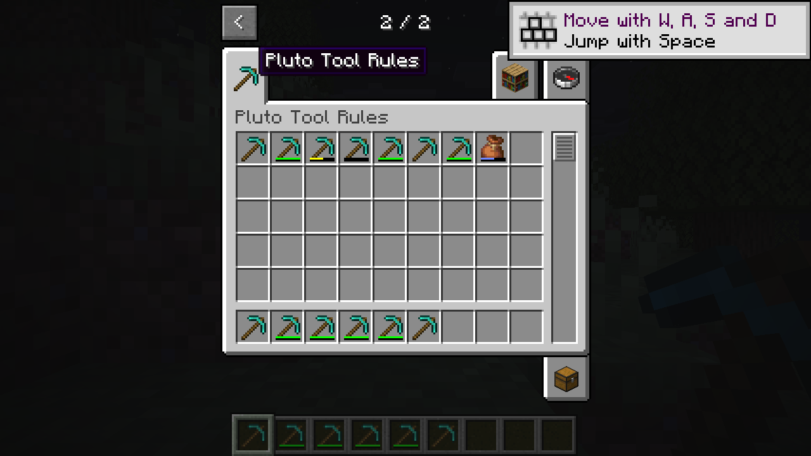

# Stack durability bars

The experimental `pluto_component_bar` native bundle draws a standard durability bar using an item's own `minecraft:max_damage` and current damage. A stack with damage 30 and max damage 60 uses Horizon's existing half-worn bar calculation. The bundle changes display only; it does not alter durability loss, item breakage, mining or tooltips.

Stage `mixins/pluto_component_bar` alongside the consuming native mod with official Horizon Mixins. Give the stack a positive integer `minecraft:max_damage` component and the normal damage value. A missing, invalid or non-positive maximum leaves the host's existing bar unchanged. Unbreakable stacks and the host's bundle fullness bar are also left alone. For an eligible stack, Horizon's own `hud_overlays::damage_bar` determines visibility, width and color, including the undamaged case.

The adapter runs at the start of the official `native_item_bar` hook, at Mixins priority 1000, before the hook dispatches ordinary native callbacks. A consumer can use that official callback to replace or hide the proposed bar. Other Mixins targeting the same hook run in priority order; a higher-priority callback that runs before this adapter can be overwritten. Coordinate that order when combining independent bundles. An overlay drawn later by a consumer may also cover the bar; coexistence with Tinkers has not been tested.

The independent demo was built and run on Linux with Horizon `b2e71aca04c7f62f24eefd7dd0324bae9c04954f` and Mixins `ddd9700b21997c95d95ac6ee5ecafe3830cf622a`. From left to right, its first row shows max damage 60 with damage 0, 1, 30 and 59; a vanilla pickaxe; an unbreakable stack; an invalid maximum; and a filled bundle. The tooltip adapter was staged with the same host target for the check and displayed `30 / 60` on the half-worn stack.

The [demo preparation script](../examples/component-bar/prepare.py) replaces the Tool Rules demo tab in a disposable resource overlay with these examples. Generate that overlay as described in [Tool rules](tool-rules.md), then run `python3 examples/component-bar/prepare.py /path/to/overlay/creative-inventory.json` before launching it. The script changes the provided file in place; use an isolated overlay.

Full launcher installation, Windows and Tinkers integration remain unverified. In particular, the Overslime drawing interaction has not been tested. The separate [tooltip adapter](component-transport.md) remains unchanged.
