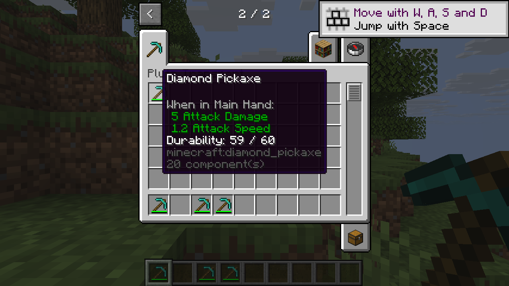
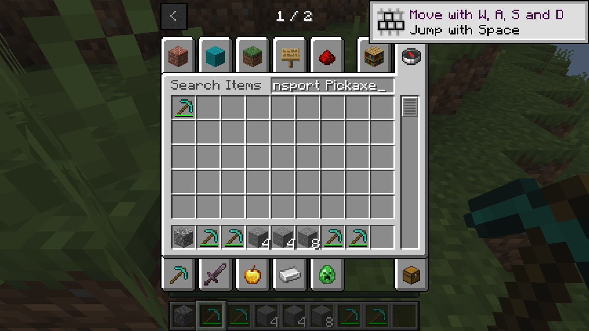

# Item component transport

Horizon already carries custom data, lore and item models in its native stack conversion. PlutoLib does not add a second codec for these fields on the newer host. The older [item behavior demo](item-behaviors.md) still targets its original Horizon version and retains its original adapters; it has not been ported to the newer host.

## Independent demo

On Linux, the [demo](../examples/transport-demo/mixins/pluto_transport_demo/demo.rs) was built with Horizon `5197790e5846a82cfc84d9703e37c4c1b75be09c` and Mixins `ddd9700b21997c95d95ac6ee5ecafe3830cf622a`. A LAN guest received a prepared pickaxe’s actual Tool, max-damage and custom-data components, mined stone, and retained the components and updated damage after the world was saved and reloaded. The guest also split and recombined a Tool-bearing stack, reconnected with its count and components intact, and found the demo item through Creative search. A vanilla cobblestone drop was observed. These checks cover representative accepted values; they do not cover arbitrary future components or unprepared saved stacks.

For the proposed stack-specific durability bar, see [stack durability bars](component-bar.md).

The separate experimental tooltip bundle showed `59 / 60` for a stack with damage 1 and max damage 60. It replaces an existing advanced tooltip line; it does not change the durability bar, durability enforcement or mining rules. The host’s mining path still uses item-definition rules, so mining stone does not establish that it used the stack’s Tool rules. TConstruct uses the shared transport on the earlier tested pair, with representative Chest component persistence; arbitrary component and old-save cases remain unverified. The new target, full launcher installation and Windows remain unverified.



*The prepared pickaxe in the independent demo, with the tooltip bundle enabled.*



*The LAN guest finds the same prepared stack through Creative search.*

The [codec fixture](../fixtures/stack_transport_3a.rs) and a separately supplied Tinkers fixture at commit `45497078ea4d3359c6b383bcca70f11674cfb373` were also checked against the earlier `3a264943` host. Without the adapter, its encoder omitted per-stack `minecraft:max_damage` and `minecraft:tool`; the fixture separates that from decoder behavior. The older adapters do not independently repair this gap. Do not combine cancellable adapters on the same conversion boundary without a coexistence check.

## Prepare a Tool component

When reading an older saved stack without a block registry, normalize its Tool
shape first:

```rust
let canonical = horizon_client::pluto_tool_codec::normalize_tool_shape(
    r#"{rules:[{blocks:"stone"}]}"#,
)?;
```

This returns a new canonical SNBT string and never changes the input. It
normalizes omitted namespaces, holder-set form, defaults and numeric types to
match the wire representation. Repeating it is stable. Malformed SNBT and
unsupported fields return an error, so retain the original value on failure.
Shape normalization does **not** check that a block exists. Validate against
the actual registry with `prepare_tool` before treating IDs as resolved or
sending a stack. It does not automatically migrate saved inventories.

When staging `pluto_transport_3a` with the native mod, call its entry before registering or changing a Tool component:

```rust
let canonical = horizon_client::pluto_tool_codec::prepare_tool(
    r##"{rules:[{blocks:"#minecraft:mineable/pickaxe",speed:2.0f}]}"##,
    |block_id| lookup_block_id(block_id),
)?;
// Store `canonical` as the item's `minecraft:tool` SNBT.
```

The callback resolves an explicit block ID against the current host registry and returns `None` when absent; tag-only rules need no numeric lookup. `lookup_block_id` stands for the consuming mod’s registry adapter. The result and errors are host-independent strings and `ToolError`; invalid SNBT, an unresolved block ID and unsupported fields are errors before registration. The borrowed input is never modified: prepare the result before replacing the original component or consuming recipe inputs, and retain the original stack on error. Apply the same entry when a Tool changes; a damage-only change need not rebuild it. Store the returned canonical value so the sender and receiver use the same stack and search identity.

The experimental transport contract covers Tool values accepted by this entry with the current registry, together with standard `max_damage` and `damage`, on the pinned Horizon and Mixins pair. It does not claim support for unprepared external values or arbitrary future component patches. Callers must prepare a replacement before committing a Tool change; normal damage-only changes do not need a new Tool value.

This entry is experimental and exists only in the staged native client; it is not in the released package. It does not discover or migrate existing saved stacks. A common load boundary with access to the correct registry has not been established; callers must not assume existing inventory, container or dropped stacks were normalized.

## Prototype limits

The Tool wire fields are `rules`, `default_mining_speed`, `damage_per_block`, and `can_destroy_blocks_in_creative`. Each rule contains `blocks` and optional `speed` and `correct_for_drops`. Block sets may be a tag, one block ID, or a list of block IDs. Explicit IDs must resolve in the connection’s block registry. Integer and floating NBT numbers are accepted for speeds; integer NBT numbers are accepted for damage. Missing optional values use the host’s defaults.

Tool identity is based on the host’s saved NBT, while the wire format does not distinguish one block ID from a one-element block list or omitted defaults from explicit defaults. The experimental `prepare_tool` entry validates and converts both forms to the wire-equivalent saved form before a stack is created or registered. Fixtures verify that these canonical forms have the same stacking and Creative search key. Block tags remain distinct from explicit block lists. Omitted namespaces in block IDs and tags are normalized to `minecraft:` before registry lookup and storage. The automatic transport hook cannot mutate the source stack; it warns when that stack is noncanonical, so an unprepared stack may change identity on receipt.

Unknown fields, malformed values, oversized identifiers, and unresolved block IDs are not encoded. The adapter reports an error to stderr and falls back to the host, which may omit `minecraft:tool`; that is **not** a successful transfer. The injected encoder returns `Option<Stack>`, where `None` means an empty slot, rather than a recoverable error, so it cannot safely reject the send at this boundary. A production API needs a fallible, user-visible send boundary or an upstream host change. A changed server-origin stack invalidates the host’s cached patch. The prototype warns when this happens, but the host re-encoder can lose unrecognised additions or removals; it cannot yet guarantee safe retransmission. The original patch is retained while only the count changes. Do not use this experimental adapter as a production transport guarantee.

## Run the fixture

Use a disposable pristine source checkout at Horizon `cabe8b5de7d0b45541c923c4a6b3c5cb3e3686c7`; these commands add an example to that checkout. From `pluto-lib/`, set `HOST` to the checkout’s absolute path:

```sh
HOST=/path/to/disposable-horizon
mkdir -p "$HOST/crates/horizon-client-lib/pluto-fixture/fixtures" \
         "$HOST/crates/horizon-client-lib/pluto-fixture/mixins/pluto_transport_3a"
cp fixtures/stack_transport_3a.rs "$HOST/crates/horizon-client-lib/pluto-fixture/fixtures/"
cp mixins/pluto_transport_3a/{max.rs,tool_codec.rs,tool_encode.rs,tool_decode.rs} \
   "$HOST/crates/horizon-client-lib/pluto-fixture/mixins/pluto_transport_3a/"
cat >> "$HOST/crates/horizon-client-lib/Cargo.toml" <<'TOML'

[[example]]
name = "pluto_stack_transport_fixture"
path = "pluto-fixture/fixtures/stack_transport_3a.rs"
TOML
(cd "$HOST" && cargo run --locked --offline --profile fast --no-default-features \
    -p horizon-client-lib --example pluto_stack_transport_fixture)
```

Use a fresh checkout so the example is added only once. Omit `--offline` if the checkout’s dependencies have not been cached. Append `-- /path/to/cases.json` to inspect consumer stacks: the file contains a `cases` array with `id` and SNBT `snbt` fields. The fixture checks the helpers independently of Mixins; a plan alone does not establish that the transformed client compiles or runs.

The baseline fixture above intentionally runs on a **pristine** host: it asserts that the host encoder omits the two components before applying the helpers. Do not point it at an already transformed library. For a library built with the transport bundle, use the separate [applied-host fixture](../fixtures/stack_transport_applied.rs): it requires exactly one max-damage and one Tool wire component, decodes the actual Tool rules, and checks count and damage. Run it as an example of the transformed `horizon-client-lib` source, using the same method as above but without copying or manually applying the helpers. These are distinct checks; neither establishes a live LAN result on its own.
