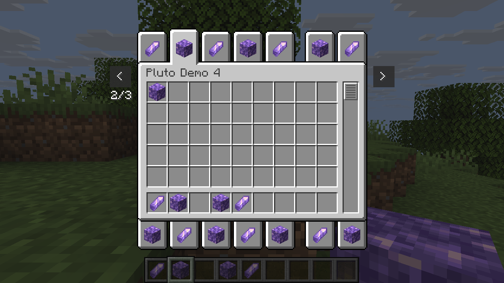
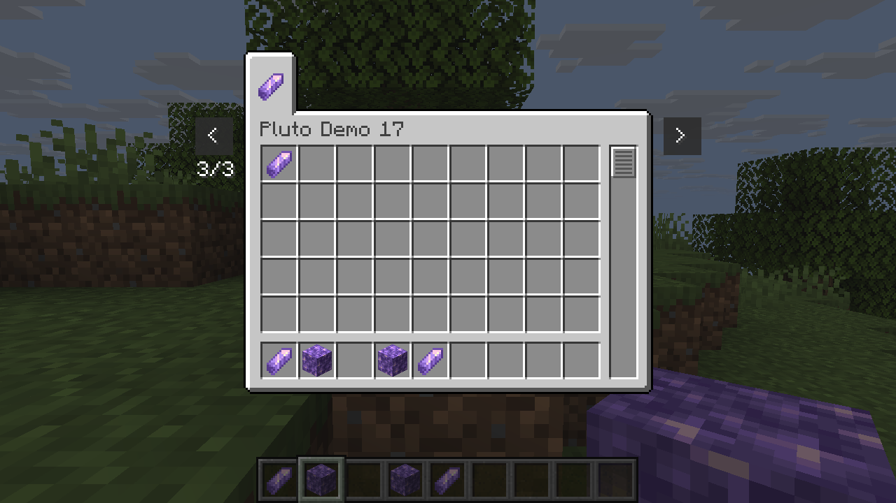

# Creative tabs beyond one screen

`add_paged_creative_tabs` appends tabs without asking the mod author to choose screen positions. It requires the bundled native Mixins adapter: without it, the additional tabs overlap. The existing `add_creative_tabs` API and its collision checks are unchanged.

```rust
use pluto_lib::{add_paged_creative_tabs, PagedCreativeTab};
let updated = add_paged_creative_tabs(&inventory, &[PagedCreativeTab {
    id: "example:tools",
    title: "Example Tools",
    icon: "{count:1,id:\"example:hammer\"}",
    items: vec!["{count:1,id:\"example:hammer\"}"],
}])?;
```

The adapter divides visible tabs into pages of up to 14. Arrow buttons move one page at a time; each page remembers its selected tab while the Creative screen is alive. Existing vanilla tabs also participate, and their screen positions may change when paging is active. The input data is copied. The API checks IDs and titles but does not parse SNBT or register items.

The `demo` example accepts `--overflow` to add 17 tabs with alternating gem and block entries. Generate it into a new directory as in the [getting-started guide](getting-started.md), appending `--overflow` after the resource path. Apply the bundle under `mixins/pluto_creative` using official Horizon Mixins at `ddd9700b21997c95d95ac6ee5ecafe3830cf622a` against Horizon `b6c936f82b08798057161bdfa577e3aac53fb91e` before building the client. Use the generated Creative inventory in a separate resource overlay and load the demo content. On Linux, this combination displayed 29 visible tabs across three pages. The demo exercised forward and backward navigation, selected-tab restoration, item collection from each page, page-end buttons and the existing Creative search. The pages hold at most 14 tabs each; registration itself has no fixed tab count. The adapter remains under development; other platforms and revisions are unverified.



*Returning to page 2 restores the selected tab.*



*The final page reaches the seventeenth demo tab.*
