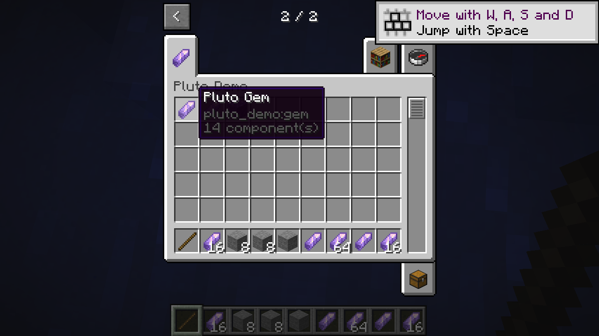
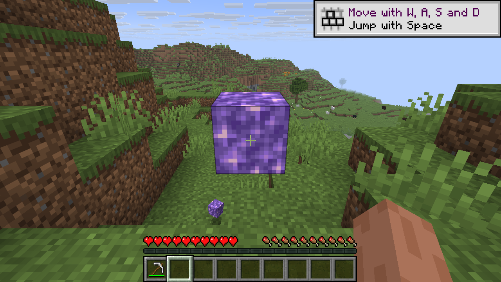

# Make a first content mod

The demo creates two gems, four example blocks and a Creative tab using PlutoLib's Rust API. Horizon registers the generated content; the Creative tab is added to a prepared resource file before launch. These are separate steps.

## Generate the demo

You need Rust and a prepared Horizon 26.3 resource directory for the [target revision](../README.md#compatibility). From `pluto-lib/`, choose a new output directory under `.work`:

```sh
mkdir -p .work
cargo run --locked --example demo -- .work/demo /path/to/horizon-resources/creative-inventory.json --native-pages
```

The output contains `horizon-mod.toml`, item and block declarations, models, names, and a modified `creative-inventory.json`. It references Minecraft textures already present in the game resources; it does not distribute them. Create the parent directory first, as shown above; the output directory itself must not already exist. The `--native-pages` option uses the target Horizon version’s built-in page controls. The standalone preparation step uses the older pinned parser for stack identity; see [native Creative preparation](native-creative.md).

## Run it

On a system that supports symbolic links, create an overlay without changing the original resource directory:

```sh
python3 tools/creative_overlay.py /path/to/horizon-resources .work/demo/creative-inventory.json .work/resources
```

Use the generated directory as a Horizon content mod (`--dev-mod <absolute path to .work/demo>`). The generated Creative JSON must also replace `creative-inventory.json` in a **separate prepared-resource overlay** passed to the client; placing that file in a content mod does not install the tab. Preserve the original resource directory. For example, with a client built from the target Horizon revision, run from a dedicated game home:

```sh
HORIZON_HOME="$PWD/.work/game-home" /path/to/horizon-client \
  --resources "$PWD/.work/resources" --dev-mod "$PWD/.work/demo" \
  --world PlutoDemo --creative
```

Open the Creative inventory, advance to the next tab page, and select the Pluto Demo tab. Move the gems and block into the hotbar, then select and place the block. The paths passed to the client should be absolute.

The **Pluto Demo** tab contains a 16-stack gem, a second gem that inherits its template limit, and blocks with explicit and inherited properties. On the pinned Linux host, 17 of the first gem split into 16 and 1; 65 of the inherited gem split into 64 and 1. The items retained those counts after a host save/reload and a LAN guest reconnect. A previous demo also checked block placement. The block demo supplies its own pickaxe tag and loot tables; Registry does not generate those assets. On the pinned Linux host, the tool-required block dropped with an iron pickaxe but not by hand; the otherwise comparable block without that requirement dropped by hand. The host accepted hardness -1 and the block survived a three-second pickaxe attempt. Explosion resistance and template inheritance were checked in the generated host data. In a TNT test with otherwise matching blocks at equal distances, the resistance-0 block was destroyed and the resistance-1200 block remained. These items use vanilla template appearance and are independent of Tinkers. The demo source is [examples/demo.rs](../examples/demo.rs).

## Use it in your mod

Create a `Registry` with your mod namespace, add declarations, and write them into a new directory as in the [overview](../README.md). Supply your own manifest and assets. `CreativeTab` takes a title, icon and ordered SNBT stacks; `add_creative_tabs` returns a changed copy of the inventory document. Register those item IDs separately. See [API notes](api.md) for collisions and constraints.


*The block placed from the demo tab in the Linux test world.*



*The demo tab and the 16- and 64-item stacks in the hotbar.*



*The configured block and a dropped demo block in the Linux test world.*
