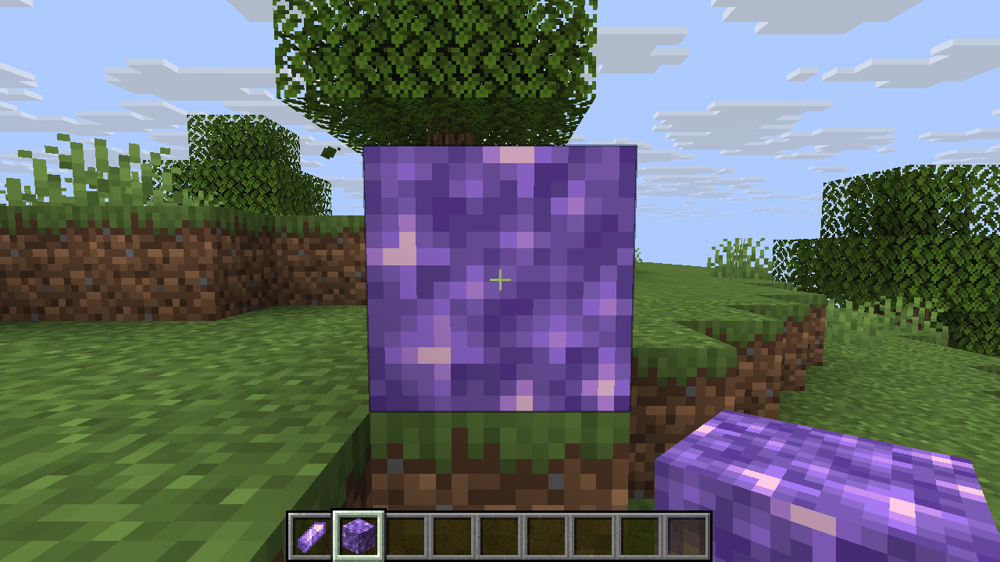

# Make a first content mod

The demo creates a gem, a block and a Creative tab using PlutoLib's Rust API. Horizon registers the generated content; the Creative tab is added to a prepared resource file before launch. These are separate steps.

## Generate the demo

You need Rust and a prepared Horizon 26.3 resource directory for the [target revision](../README.md#compatibility). From `pluto-lib/`, choose a new output directory under `.work`:

```sh
mkdir -p .work
cargo run --locked --example demo -- .work/demo /path/to/horizon-resources/creative-inventory.json
```

The output contains `horizon-mod.toml`, item and block declarations, models, names, and a modified `creative-inventory.json`. It references Minecraft textures already present in the game resources; it does not distribute them. Create the parent directory first, as shown above; the output directory itself must not already exist. The example uses the top-row position 5, which must be free of visible non-hotbar tabs.

## Run it

On a system that supports symbolic links, create an overlay without changing the original resource directory:

```sh
python3 tools/creative_overlay.py /path/to/horizon-resources .work/demo/creative-inventory.json .work/resources
```

Use the generated directory as a Horizon content mod (`--dev-mod <absolute path to .work/demo>`). The generated Creative JSON must also replace `creative-inventory.json` in a **separate prepared-resource overlay** passed to the client; placing that file in a content mod does not install the tab. Preserve the original resource directory. For example, with a client built from the target Horizon revision, run from a dedicated game home:

```sh
HORIZON_HOME="$PWD/.work/game-home" /path/to/horizon-client \
  --resources "$PWD/.work/resources" --dev-mod "$PWD/.work/demo" \
  --world PlutoDemo --creative
```

Open the Creative inventory and select the gem tab near the top right. Drag the gem and block into the hotbar, then select and place the block. The paths passed to the client should be absolute.

The **Pluto Demo** Creative tab contains a gem and a placeable block. On Linux, the tab was selected, both items were moved to the hotbar, and the block was placed using the target Horizon revision. The gem and block use vanilla template behavior and appearance, and are independent of Tinkers. The demo source is [examples/demo.rs](../examples/demo.rs).

## Use it in your mod

Create a `Registry` with your mod namespace, add declarations, and write them into a new directory as in the [overview](../README.md). Supply your own manifest and assets. `CreativeTab` takes a title, icon and ordered SNBT stacks; `add_creative_tabs` returns a changed copy of the inventory document. Register those item IDs separately. See [API notes](api.md) for collisions and constraints.



*The block placed from the demo tab in the Linux test world.*
