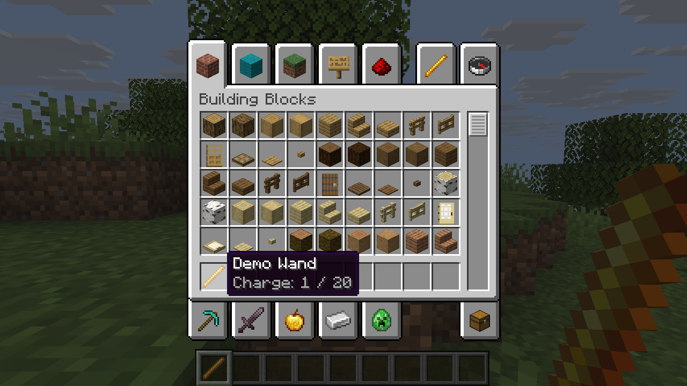
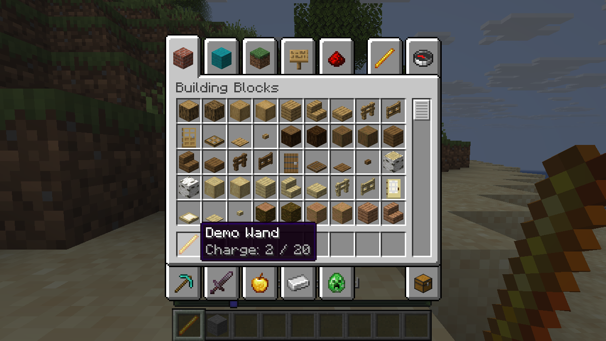

# Give an item a behavior

The experimental item API lets a native mod register a handler for a namespaced item ID. The independent [wand demo](../examples/wand/mixins/pluto_wand/behavior.rs) increments its own charge on use and displays that value in the tooltip:

```rust
use pluto_item_api::{ItemBehavior, ItemData, UseOutcome};

struct Counter;
impl ItemBehavior for Counter {
    fn on_use(&self, data: &mut ItemData) -> UseOutcome {
        data.set("example:uses", data.get("example:uses").unwrap_or(0) + 1);
        UseOutcome::Handled
    }
}
pluto_item_api::register("example:wand", Counter)?;
```

Register each ID once in the shared native `pluto-item-api` crate before its hooks run. The demo's Mixins bundle calls its registration function before use, remote use and tooltip hooks. The library exposes the same contracts as `pluto_lib::item` for Rust consumers; native handlers must use the shared staged `pluto-item-api` instance. The API currently stores named signed 64-bit integers. It does not define a mana system or a magic effect.

`Pass` runs standard Horizon behavior and discards the handler's staged data changes. `Handled` consumes the use and commits them. `Cancel` consumes the use without committing. Duplicate registration is rejected. Tooltips receive read-only data. The adapter stores fields under `plutolib:data` in the stack's `minecraft:custom_data`, preserving other fields; unknown data types in that reserved compound cause the use to fail rather than being overwritten. Treat the reserved compound as owned by PlutoLib.

The handler is intended to run in the host's item-use path, including a LAN guest's action as processed by the host. The remote-side hook identifies a registered item as usable; it does not run the handler or predict a data change. Custom-data network adapters derive from the Tinkers port; see [their notice](../mixins/pluto_items/NOTICE.md). On Linux with the pinned combination, the wand's value survived host save and reload. A LAN guest used it, received the updated value, disconnected and reconnected with that value retained. A guest also placed a vanilla stone block successfully. The adapter sends no custom packet: it uses Horizon's existing item-use packets and custom-data component. Its network hooks only intercept stacks containing the reserved `plutolib:data` field; coexistence with other native mods intercepting the same hooks remains unverified. The API is experimental; other platforms and broader multiplayer cases are unverified.

## Prepare the demo

From `pluto-lib/`, generate a new content directory with a prepared Horizon resource file:

```sh
mkdir -p .work
cargo run --locked --example wand_demo -- .work/wand-demo /path/to/horizon-resources/creative-inventory.json
```

The demo uses Minecraft's existing blaze-rod texture and creates its own item declaration. The native build needs both `mixins/pluto_items` and `examples/wand/mixins/pluto_wand` staged as sibling bundles, using the pinned Horizon and Mixins commits in [compatibility](compatibility.md). The generated Creative inventory must be used in a separate resource overlay, as in [getting started](getting-started.md). The [compatibility page](compatibility.md) identifies the verified commits and platform. In the demo, use the wand and inspect its tooltip. Each use increases charge by one; the demo cancels at 20. A negative charge is reserved for a `Pass` test fixture.




*The local tooltip reflects the value saved on the item.*



*The guest sees charge 2 after using the wand and reconnecting.*
