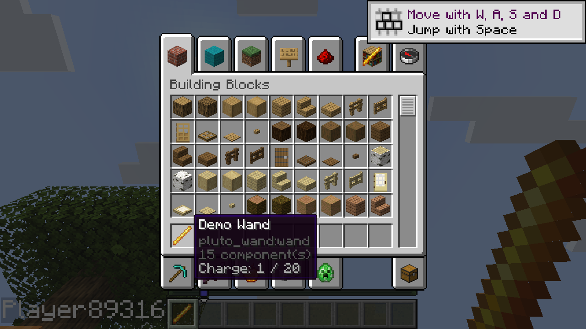

# Handle a short item use

The experimental native item bundle lets an item respond to a short use on the server. The independent wand increments its own charge and shows it in a tooltip:



A behavior can keep the existing `on_use` implementation and opt into context or block use when it needs them:

```rust
use pluto_api::item::{ItemBehavior, ItemData, UseOutcome};

struct Wand;
impl ItemBehavior for Wand {
    fn on_use(&self, data: &mut ItemData) -> UseOutcome {
        let charge = data.get("example:charge").unwrap_or(0);
        if charge >= 20 { return UseOutcome::Cancel; }
        data.set("example:charge", charge + 1);
        UseOutcome::Handled
    }
    fn tooltip(&self, data: &ItemData) -> Vec<String> {
        vec![format!("Charge: {} / 20", data.get("example:charge").unwrap_or(0))]
    }
}
```

Register the behavior once with `pluto_api::item::register("example:wand", Wand)`. `Pass` leaves the standard use and data unchanged; `Handled` commits staged integer data to the same held stack; `Cancel` discards edits and returns a failure without a success swing. `on_use_with_context` adds actor, hand and item information. `on_use_on_block` receives a block position and face and defaults to Pass. A block Pass allows the host's normal item-use fallback; the two callbacks represent distinct phases.

Stage `mixins/pluto_items_b2` and the consumer's native bundle using official Mixins. The [wand example](../examples/wand-b2/mixins/pluto_wand_b2/behavior.rs) registers its handler before use and tooltip calls. Its item declaration and resources can be generated with the existing [wand demo](item-behaviors.md). Do not stage the older `pluto_items` bundle at the same time.

On Linux with Horizon `b2e71aca04c7f62f24eefd7dd0324bae9c04954f` and Mixins `ddd9700b21997c95d95ac6ee5ecafe3830cf622a`, the demo was built and checked locally and with a LAN guest. Main and offhand uses, block Pass followed by item use, all three outcomes, foreign custom data, tooltip and save/reload were checked. The adapter reaches `use_tool` after the block and some built-in item handlers, so it cannot intercept every earlier use. Long presses, attack, world actions, Windows, Tinkers integration and coexistence with other native hooks are not established by these checks.

The shared native API bundle must be enabled alongside the item adapter. Both Creative and short-use handlers use the same `pluto_api` crate; older experimental imports require updating.

The consolidated `pluto_api` import has passed unit tests and a Mixins plan; a game build with this import is still pending. Earlier game results used the previous experimental crate name.

Migration from the earlier native experiment: replace `pluto_item_api_b2::` imports with `pluto_api::item::` and enable the shared native API bundle. The root crate’s legacy `pluto_lib::item` has separate types and a separate registry; do not mix the two in one runtime.
