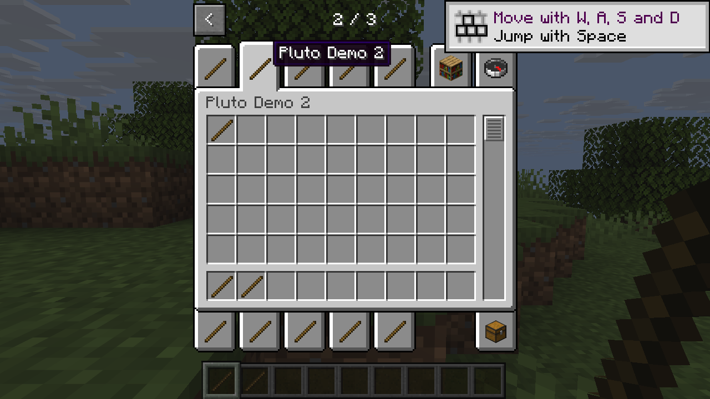

# Prepare Creative tabs for native Horizon paging

The experimental `pluto-creative-api` crate adds component-bearing stacks to an already prepared Creative inventory document. It targets Horizon's own page controls. It does not inject drawing, clicking or page state, and must not be staged with PlutoLib's older `pluto_creative` paging adapter.

```rust
use pluto_creative_api::{register_tabs, Entry, Tab};

let tabs = [Tab {
    id: "example:tools".into(),
    title: "Example Tools".into(),
    icon: "{count:1,id:\"minecraft:stick\"}".into(),
    items: vec![Entry {
        snbt: "{count:1,id:\"minecraft:stick\",components:{\"minecraft:custom_data\":{level:1}}}".into(),
        searchable: true,
        permissions_only: false,
        search_lines: vec!["Example Wand".into()],
        search_tags: vec![],
    }],
}];
let updated = register_tabs(&inventory, &tabs, stack_identity)?;
```

`stack_identity` is a caller-supplied function `Fn(&str) -> Result<String, String>`. It validates SNBT and returns the same key exactly when the target Horizon considers two stacks equal by item and components; count must not affect the key. The native demo uses the target host's item parser and canonical stack encoder after setting count to one. The public crate exposes no Horizon types. Callers are responsible for verifying that their identity function matches their host's comparison, and for registering item IDs and assets separately.

For this target, a native caller can implement the callback using the host's internal adapter:

```rust
fn stack_identity(raw: &str) -> Result<String, String> {
    let mut stack = horizon_items::item_data::parse_stack(raw)?
        .ok_or("empty stack")?;
    stack.count = 1;
    Ok(horizon_items::item_data::canon_stack(Some(&stack)))
}
```

This adapter is version-specific. The caller must verify its key agrees with `same_item_same_components` for the stacks it accepts; the shared API does not inspect host types.

The function returns a changed copy and leaves its input untouched, including on error. It validates IDs and positions, rejects duplicate tab IDs and invalid or overlapping positions, and reserves existing positions even when a tab may currently be hidden. It assigns new tabs to pages starting at 1, ten per page in columns 0–4. Horizon owns the page buttons and the right-hand tabs. All supplied item stacks stay in order and keep their full SNBT. `permissions_only` records item indexes; `searchable` selects items for search. Search lines and tags are supplied by the caller. Existing search entries and their metadata remain first; equal stacks are included once. Conflicting permission flags for an equal stack are rejected instead of silently widening access. Existing search metadata shorter than its stack list is padded with empty entries; metadata longer than it is rejected. If searchable entries are supplied, a valid SEARCH tab is required. The crate does not infer tags, verify registered item IDs, or generate mod assets.

## Native integration

Stage `mixins/pluto_native_creative` as a native Mixins bundle. Its `[[crate]]` declaration adds `pluto-creative-api` to `horizon-client`; the bundle itself installs **no hooks**. A mod's native startup module can then call `pluto_creative_api::register_tabs` with a loaded document. Run it exactly once after all other producers of that document have finished; if the host's own content merge runs later, it can add duplicate entries. Publish the resulting document in a separate overlay, not into the source resource tree. A caller must finish mod-specific stack, stat and trait generation before registration, so both the displayed tab and search receive the same final stack. This API rejects a second registration of the same tab ID; it does not refresh earlier search copies. Do not combine this path with the old PlutoLib page adapter or register the same tabs again through Horizon's content-tab loader.

The [independent demo](../examples/native-creative/mixins/pluto_creative_demo/demo.rs) uses a native entry hook and the shared crate to create a fresh Linux resource overlay with 12 tabs. It uses vanilla item textures and a component-bearing stick; it contains no Tinkers rules or assets. The [standalone Rust wrapper](../examples/native_creative_prepare.rs) runs the same initializer without Python for inspection:

```sh
mkdir -p .work
PLUTO_DEMO_RESOURCES=/path/to/prepared-resources \\
PLUTO_DEMO_OVERLAY="$PWD/.work/native-creative-demo" \\
  cargo run --locked --example native_creative_prepare
```

The output must not exist and must be separate from the source; its parent must exist. It uses Unix symbolic links for unchanged resources. The standalone wrapper links the older Horizon parser pinned by `pluto-lib`; use the target host parser when staging the native bundle.

To run the native demo, stage both `mixins/pluto_native_creative` and `examples/native-creative/mixins/pluto_creative_demo` as sibling bundles and build the fixed Horizon client with official Mixins. Set the same two environment variables when starting that client, and pass the overlay path as `--resources`. The demo's entry hook creates the overlay before the client loads it; use a fresh overlay path for each preparation.

On Linux with the [verified host and Mixins](compatibility.md), the demo showed its 12 tabs over two mod pages. A component-bearing stack was obtained from a tab and from search; the original vanilla search entries and metadata remained intact. The target's standard page controls performed the page changes. Windows and combined Tinkers integration remain unverified.



*The second demo tab and its component-bearing stack, using Horizon's page controls.*

The generic [fixture runner](../examples/native_creative_fixture.rs) reads a JSON object with an `inventory` and `groups` for integration checks. It uses the standalone library's older pinned parser and is a test tool, not the native startup adapter. A representative fixture from the Tinkers port at `9b657daf9454df7d35e120c0909791e228807c58` retained the input group IDs, icons, ordered stacks, material components and existing search metadata. That fixture does not prove its later stat enrichment or game behavior; integration must pass the enriched final stacks.
