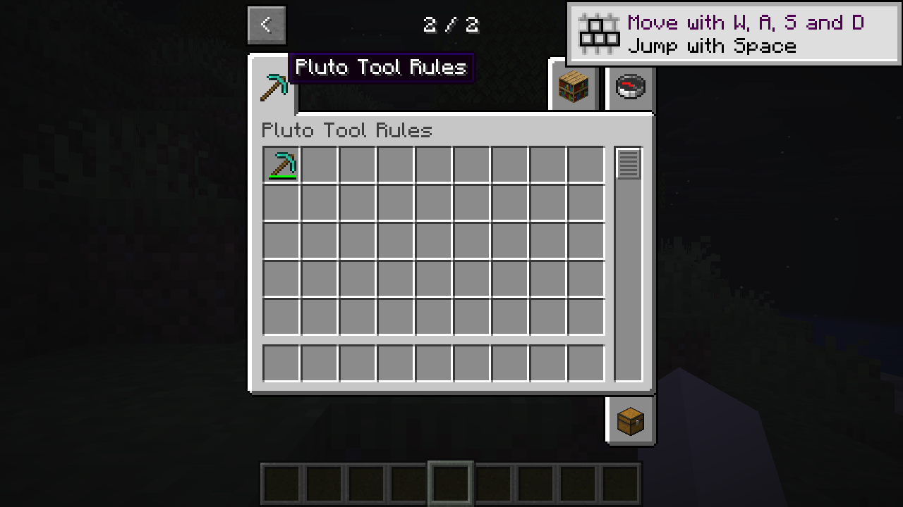

# Evaluate a Tool's rules

A Tool component can give each item stack its own mining rules. PlutoLib evaluates the rules in order and falls back to Horizon's item definition when the stack has no Tool component. The independent demo was previously built and checked on Linux with Horizon `aa60eb76ea82bd66c29fea352e3ab5771e62ab26` and Mixins `ddd9700b21997c95d95ac6ee5ecafe3830cf622a`, including a representative LAN transfer. The currently staged bundles target `fd6cfda6bdef59a53aee830009f78c14832b0308` and passed representative material-tool assembly and mining in a joint TConstruct Linux test. Their earlier `cabe8b5de7d0b45541c923c4a6b3c5cb3e3686c7` demos were run together on Linux; see [candidate integration](../experiments/unified-target/README.md).

The reusable evaluator accepts plain Rust data and a callback that matches a block ID or `#`-prefixed tag against the block being mined:

```rust
use horizon_items::items::pluto_tool_rules::{evaluate, Rule};

let rules = [
    Rule { blocks: vec!["#example:mineable".into()], speed: None, correct_for_drops: Some(false) },
    Rule { blocks: vec!["minecraft:stone".into()], speed: Some(2.0), correct_for_drops: Some(true) },
];
let result = evaluate(&rules, 1.0, |name| {
    name == "#example:mineable" || name == "minecraft:stone"
});
assert_eq!(result.speed, 2.0);
assert!(!result.correct_for_drops);
assert_eq!(result.speed_rule, Some(1));
assert_eq!(result.drops_rule, Some(0));
```

The first matching rule that supplies a speed wins. The first matching rule that supplies drop correctness wins independently, so the answers can come from different rules. With no matching speed, the component's default speed is used; with no matching drop answer, the result is `false`. The corresponding zero-based rule index is `None` when no rule supplies that value.

To evaluate a Tool already stored as SNBT, use `parse_tool(Some(snbt))?` and then call `tool.evaluate(matches)`. `parse_tool(None)` returns `Ok(None)` for an absent component; malformed SNBT or unsupported component fields return a `ToolParseError`. The parsed `Tool`, `Outcome` and errors do not expose Horizon types. Parsing checks names and defaults omitted namespaces to `minecraft:`; registry membership still comes from the match callback. For registration or modification, use the separate fallible [Tool preparation](component-transport.md) entry to check explicit block IDs and produce the canonical stored value.

The native adapter reads the actual `minecraft:tool` component and uses Horizon's block and tag matching. With no component, or a component it cannot parse, it leaves Horizon's result in place. The parser rejects unsupported component or rule fields. Use [Tool preparation](component-transport.md) before registering or changing a component. The adapter covers speed and drop correctness; it does not apply a per-stack `damage_per_block` value. Horizon reads `can_destroy_blocks_in_creative` from the stack separately. The adapter contains no material, modifier or broken-tool rules. TConstruct uses this evaluator on the earlier tested pair; coexistence with other native mods intercepting these methods remains unverified.

The [independent demo](../examples/tool-rules-demo/mixins/pluto_tool_rules_demo/demo.rs) prepares a pickaxe with two matching rules: the first denies drops and the second supplies speed 2. In a Linux game, this pickaxe broke stone without a drop; a vanilla diamond pickaxe without the component broke stone faster and dropped cobblestone in a preliminary check.



## Try the demo

Stage `mixins/pluto_native_creative`, `mixins/pluto_transport_3a`, `mixins/pluto_component_display_3a`, `mixins/pluto_tool_rules`, and `examples/tool-rules-demo/mixins/pluto_tool_rules_demo` as sibling bundles with official Mixins. Build the pinned Horizon client, then set `PLUTO_DEMO_RESOURCES` to prepared resources and `PLUTO_DEMO_OVERLAY` to a new path outside them. Launch the client with `--resources` pointing to that overlay, as in the [native Creative demo](native-creative.md). The older bundle directory names are retained; their manifests identify the actual target revision.

Select **Pluto Tool Rules** in Creative, obtain the pickaxe, and compare its mining speed and drops against the same item without the per-stack Tool component. In the Linux LAN check, a guest moved a pickaxe with Tool rules, maximum durability 60 and damage 1 between inventory slots; those values survived saving and reconnecting. Its advanced tooltip displayed 59 / 60 durability. This check does not establish compatibility with Tinkers or other native hooks.

For the LAN hook check, set `PLUTO_DEMO_TEST_CREATIVE_GUARD=1` on the host. This demo-only guard rejects a creative update that would put count 4 in slot 44; it leaves the same count in other slots unchanged. Seed slot 44 with a stack of eight, then try splitting it and compare the server-corrected slot with an allowed split in another slot. In the Linux game check, the server restored the eight in slot 44 but the guest retained four on its cursor and could place them in another slot; the resulting extra items remained after reconnecting. The hook cancels one slot update; it does not make the entire split atomic. Do not use this guard as an inventory transaction. The guard is absent from the reusable Tool rules bundle.
