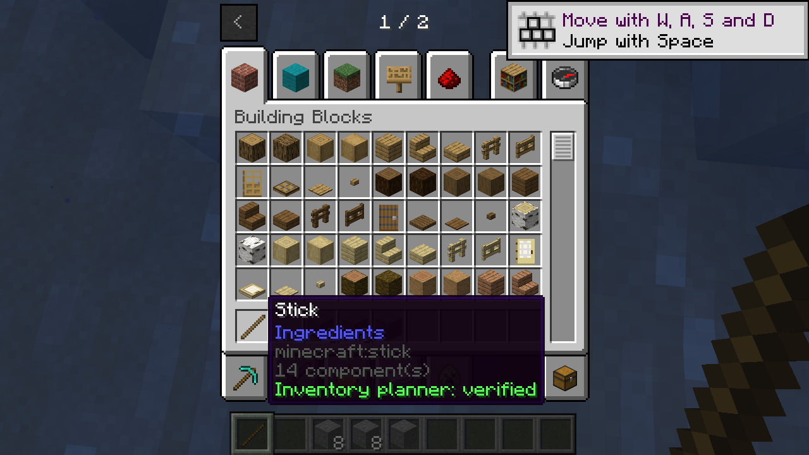

# Inventory planner demo

This native demo uses the shared planner with real Horizon item stacks. It stages changes on a copy and commits them only after checking the snapshot. It checks an empty destination, a partial merge at limit eight, different custom data, rejected input and a same-slot request. It is demo code, not a GUI or a networking API.

Build the [single PlutoLib native bundle](../../docs/native-installation.md), and stage its extracted Mixins bundle alongside `examples/inventory/mixins/pluto_inventory_demo`. Both target the revisions in [compatibility](../../docs/compatibility.md). The demo's server-side module and game adapter share `horizon_client::pluto_inventory`.

In a disposable world with commands enabled, set up the hotbar with:

```text
/item replace entity @s hotbar.0 with minecraft:stick
/item replace entity @s hotbar.1 with minecraft:stone[minecraft:custom_data={"example:marker":1}] 10
/item replace entity @s hotbar.2 with minecraft:stone[minecraft:custom_data={"example:marker":1}] 6
/item replace entity @s hotbar.3 with minecraft:air
/item replace entity @s hotbar.4 with minecraft:stone[minecraft:custom_data={"example:marker":2}] 1
/item replace entity @s hotbar.5 with minecraft:air
```

Use the stick once. On success, slot 1 is empty, slots 2 and 3 each hold eight stones with marker 1, slot 4 still holds the different marker 2 stack, and slot 5 remains empty. On the local host, hover over the stick in the inventory to see the success line. This demo-only indicator is process-local and is not synchronized to a LAN guest. The hook only runs for the demo stick and leaves the transaction unchanged if the setup does not match.

On Linux with the pinned Horizon/Mixins pair, the checks succeeded locally and for a LAN guest. The local and guest inventory results were checked independently and retained their counts and custom data after a host save/reload and guest reconnect. The local tooltip does not establish the guest result. This exercises the host’s existing synchronization; it is not a networking API.



*The local host shows the two eight-item stacks and its process-local success tooltip.*
