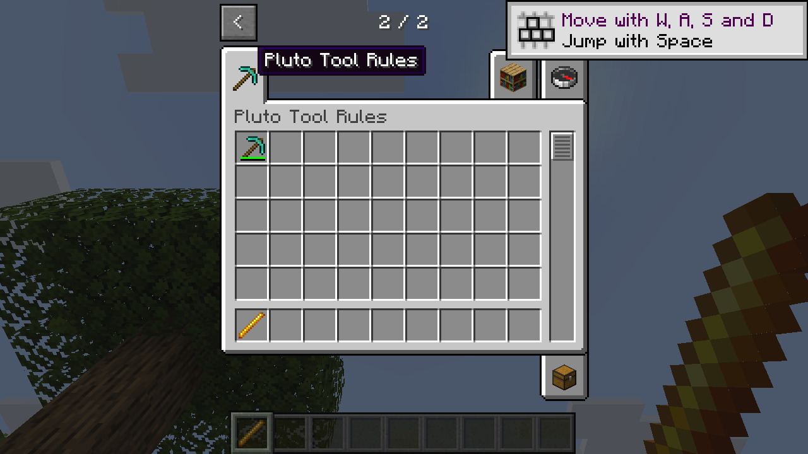

# Candidate native integration

This records an experimental Linux integration for Horizon `cabe8b5de7d0b45541c923c4a6b3c5cb3e3686c7` and Mixins `ddd9700b21997c95d95ac6ee5ecafe3830cf622a`. The demos were built and run together; other platforms and consumers remain unverified. See [compatibility](../../docs/compatibility.md) for the combinations actually built and run.

The candidate stages `pluto_native_creative`, `pluto_transport_3a`, `pluto_tool_rules`, `pluto_component_display_3a`, `pluto_component_bar`, and `pluto_items_b2`. Their manifests target this pair. The transport source includes the shape-normalizer originally developed at commit `b57d342177f49b36c7ac4d33d236f6c2dd201b67`; this helper does not migrate old saves. Do not install the old Creative paging adapter or old item network adapters alongside these bundles.

An official Mixins plan succeeded with these six bundles (9 injections, 4 modules, 2 crates). A second plan with the existing Tool rules and wand demos also succeeded (13 injections, 6 modules, 2 crates). The demo's optional Creative cancellation probe must remain disabled for normal use. The official transformation and Linux client build also passed. The demo showed both registered items, Creative page and search, the Tool tooltip and bar, a Tool mining result, wand short uses and a vanilla water-bucket use. A LAN guest received both stacks and retained their components after save and reload. A normal 64-item Creative slot move survived reconnection; the new native-item limit above 99 was not tested.

## Imports today

| Task | Current entry |
| --- | --- |
| Build Creative tabs | `pluto_creative_api::{register_tabs, Entry, Tab}` |
| Prepare or normalize Tool SNBT | `horizon_client::pluto_tool_codec::{prepare_tool, normalize_tool_shape}` |
| Evaluate Tool rules | `horizon_items::items::pluto_tool_rules::{parse_tool, Tool, Rule, Outcome, evaluate}` |
| Register short item behavior | `pluto_item_api_b2::{register, ItemBehavior, ItemData, UseContext, UseOutcome}` |
| Standard component tooltip and bar | Stage the display and bar bundles; no consumer import is needed |

These are the current staged paths, not a completed stable facade. In particular, the item crate name contains a host suffix and Tool APIs are exposed inside host crate paths. A future compatibility-preserving public entry must hide those paths before consumers can rely on identical imports across target revisions. No broad rename is proposed in this planning unit.

## Ordering and verification

At `native_tooltip`, the wand demo registers at priority 200, the component tooltip runs at 100, then the item tooltip runs at 100 (mod ID order). At `use_tool`, wand registration runs at 200 and the item adapter at 100. At the stack encoder, the max-damage and Tool RETURN hooks run in that order, each retaining an already present or removed component. The standard component bar is proposed at priority 1000 before ordinary `native_item_bar` dispatch; another Mixins injection can still override or be overridden according to its priority. A plan establishes ordering, not semantic compatibility with arbitrary mods.

The experiment does not establish Tinkers integration, Windows or full launcher installation. Tool stack counts above 99 and interactions with arbitrary native mods remain unverified.

A possible small public boundary is a host-independent `pluto_api` crate containing the existing shared data types and traits, with the Creative, Tool and item APIs re-exported there. Version-specific host adapters would depend on that crate and the host; the facade would not depend on `horizon-client` or the adapters. The precise crate split and a migration path for existing imports still need design and verification; this integration does not rename the current entry points.
