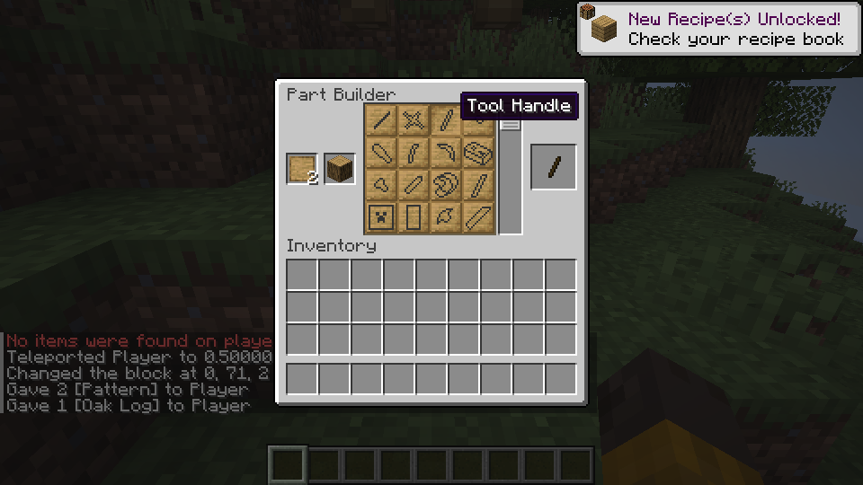
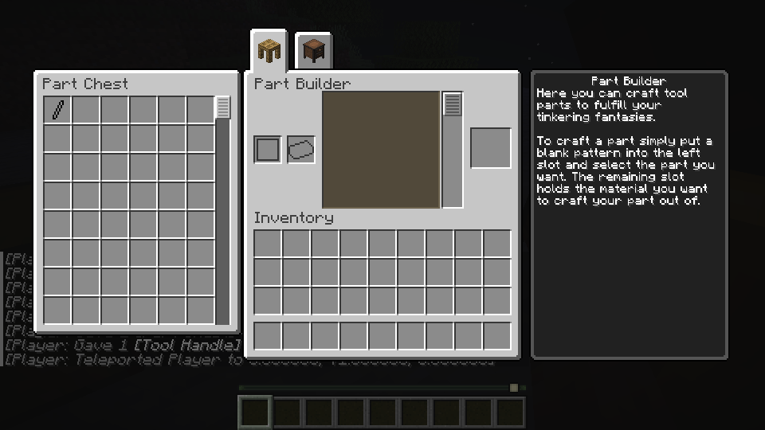

# Tinkers’ Construct for Horizon

**Build, repair, modify, melt, and cast.**

Bring Tinkers’ Construct’s tool-building and material progression to Horizon. Combine parts, maintain your equipment, and build a workshop around melting and casting.

[**Play Guide**](docs/playing.md) · [**Survival Route**](docs/survival-progression.md) · [**Linux Setup**](docs/linux.md) · [**Windows Setup**](docs/windows-playtest.md) · [**Progress**](docs/roadmap.md)

*Choose a pattern and material to make a tool part.*

> **v0.5 release target:** The formal release requires verification of the final main build and distribution. Some effects and synchronization paths remain unavailable or unverified, including durability prevention and armor wear; see [current limitations](docs/provisional.md) before playing.

## What you can do

- **Build tools from parts.** Make components at a Part Builder and assemble supported tools at a [Tinker Station or Anvil](docs/anvil-assembly.md).
- **Repair, swap parts, and apply modifiers.** Maintain and customize supported equipment; the [play guide](docs/playing.md) describes tested examples.
- **Melt materials, create alloys, and cast parts.** Start a workshop with [melting and casting](docs/melter-casting.md), then explore [Smeltery alloys](docs/smeltery.md).
- **Store parts and materials beside your workstations.** Use the [Part Chest and Tinker’s Chest](docs/tinker-part-chests.md) beside a Part Builder. Local Crafting Station transactions have representative checks; representative Linux recipe-book placement and rejection checks passed locally and for a LAN guest after a prior item-loss failure; Windows and every click combination remain unverified.
- **Browse recipes and materials in the in-game guide.** Open [Materials and You](docs/materials-and-you.md) for the original English first guide.
- **Track guide acquisition.** The first two [guide advancements](docs/book-acquisition-advancements.md) and the initial [workstation advancements](docs/workstation-advancements.md) use source inventory criteria; the remaining progression is incomplete.

*A LAN guest stores a part beside the Part Builder.*

## Start playing

Follow the [Linux setup guide](docs/linux.md) or [Windows setup guide](docs/windows-playtest.md) to prepare Horizon and a separate test world. Windows gameplay remains unverified, and a reported startup error is unresolved.

### Experimental native bundles

A manually run Mixins validation workflow can produce an Actions artifact containing `tconstruct.hnmod` and `tconstruct.hmod`. Install the native bundle through a compatible desktop Horizon Launcher, and install and enable the content mod in the instance’s `horizon-mods/` directory. See the [official native-mod guide](https://github.com/horizon-rust/horizon/blob/374b50d48f0968bd08f7026c7fabb117c8ecb8a6/docs/native-mods.md).

**Native installation and startup resource preparation are experimental and unverified.** The current development branch also requires the matching unified PlutoLib native bundle; its installation alongside TConstruct has not yet been verified. See the [development guide](docs/development.md) for the bundle. See [PlutoLib native installation](../pluto-lib/docs/native-installation.md). The official native build documentation does not establish a smartphone build path; smartphone installation and gameplay remain unverified. The Linux and Windows guides describe the manual preparation path.

## Compatibility

The current verified Linux combination uses development version `0.1.0` with pinned Horizon and Mixins commits. See [compatibility](docs/compatibility.md) for the exact revisions, test scope, and update target.

## Development status

This port is under active development. See the [progress guide](docs/roadmap.md) for implemented features, known gaps, and verification coverage.

For building and testing, see the [development guide](docs/development.md). The port reuses original TConstruct, Mantle and Forge assets under their respective licenses: [TConstruct](third_party/tconstruct/LICENSE), [Mantle](third_party/mantle/LICENSE), and [Forge](third_party/forge/LICENSE).
