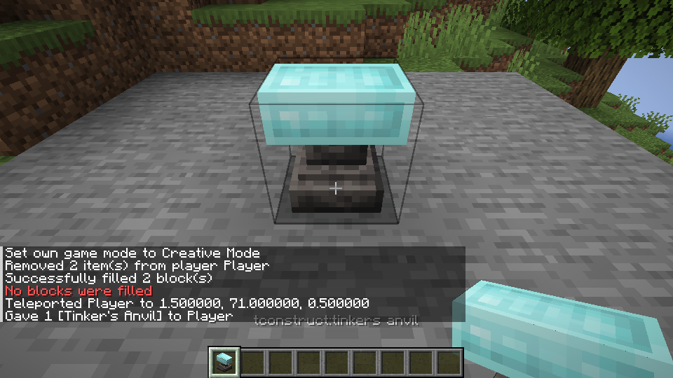
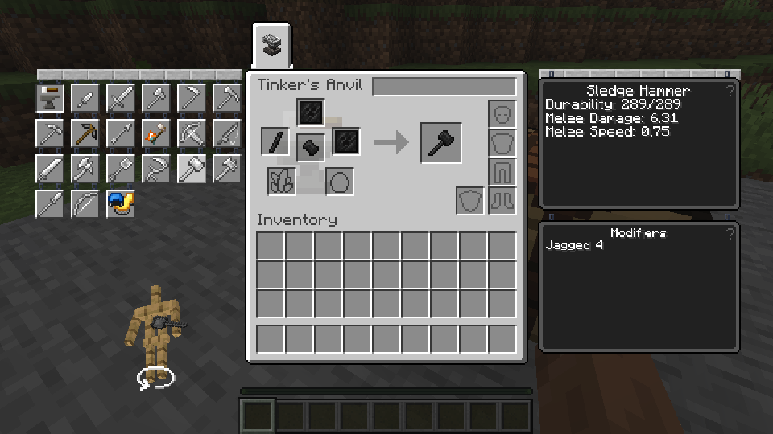

# Tinker’s Anvil and Scorched Anvil

*A Tinker’s Anvil made with Slimesteel blocks.*

Craft either Anvil with three alloy blocks across the top, one seared or scorched block in the center, and three matching-category blocks across the bottom. Matching alloy blocks give the Anvil their appearance; mixed alloys use the fallback appearance. Use seared blocks for the Tinker’s Anvil and scorched blocks for the Scorched Anvil. Supported alloy blocks include Slimesteel, Amethyst Bronze and Manyullyn; Netherite blocks also work.

Open the Anvil and choose a tool layout. Make its parts at a Part Builder, then place them in the displayed slots and take the result. Large tools such as the Sledge Hammer need four parts and require an Anvil. Place an existing tool in the tool slot to repair it or exchange a part; the Anvil also lets you name the resulting tool.

A Linux test built and placed both Anvils, made Sledge Hammer parts in the Part Builder, assembled them, repaired and renamed a hammer using the fifth input, and checked the Station’s smaller layout. A Slimesteel Anvil retained its appearance through save/reload and its material when mined. A LAN guest saw the alloy, assembled a Sledge Hammer, exchanged a part and received an excess shard from an upgrade. Matching compatibility alloy blocks were also checked; mixed compatibility materials were rejected. Windows and a complete survival playthrough remain untested.
