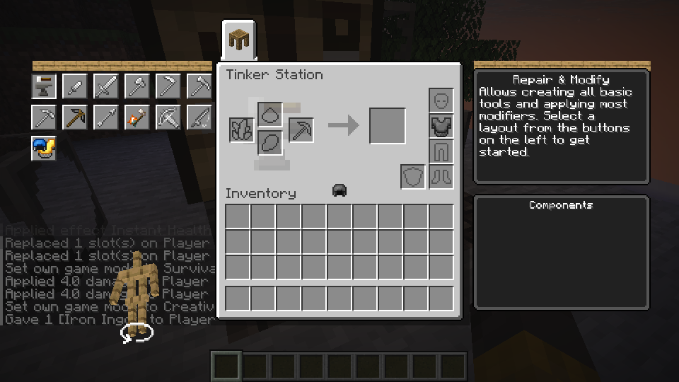

# Tinker’s Anvil and Scorched Anvil

*The Station screen shown above uses the same tool and material workflow. The Anvil has five input slots.*

Craft either Anvil with three matching alloy blocks across the top, one seared or scorched block in the center, and three matching-category blocks across the bottom. Use seared blocks for the Tinker’s Anvil and scorched blocks for the Scorched Anvil. Supported alloy blocks include Slimesteel, Amethyst Bronze and Manyullyn; Netherite blocks also work.

Open the Anvil and choose a tool layout. Make its parts at a Part Builder, then place them in the displayed slots and take the result. Large tools such as the Sledge Hammer need four parts and require an Anvil. Place an existing tool in the tool slot to repair it or exchange a part; the Anvil also lets you name the resulting tool.

The Anvil implementation is under review. Its GUI, recipes, server transactions, save and LAN behavior have not yet been verified in a game; do not treat this guide as a completed acceptance test. The selected alloy is not yet preserved on the crafted or placed Anvil, so its top still uses the fallback texture.
