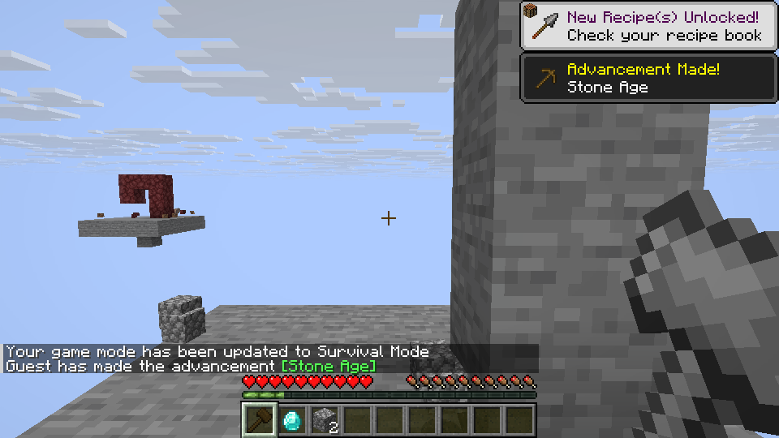

# Sledge Hammer and Excavator area mining

Sledge Hammers and Excavators mine a 3×3 plane aligned to the face hit, using
source-effective block and harvest-tier rules. Additional blocks must be
breakable and meet the original hardness limit relative to the center block.
Each block goes through the existing player break, drop and tool-wear path; the
area stops when the tool breaks. The original source checked here does not
suppress this area when sneaking.

Get these four-part tools from the Tinkers tools Creative tab. Survival
assembly requires the unfinished higher-tier Station and remains part of the
v0.5 progression work. Existing tools created before the harvest-rule update
must be regenerated or have a part replaced to obtain the synchronized rules.
Vein, tree and Scythe mining and area expansion modifiers are not included.

## Representative Linux checks

Both tools were obtained from Creative and used on all six faces. Each full
3×3 broke nine eligible blocks, used nine durability points and produced nine
physical drops. Both also passed an in-frame representative check; a vanilla
iron pickaxe still broke one block, with one wear point and one drop.

A mixed wall left ineffective dirt, too-hard stone and bedrock intact while
mining the six eligible blocks, including while sneaking. For a deterministic
break test, a temporary test command reduced a tool's custom maximum so only
three durability points remained: three blocks broke, the broken tool was
retained, and six blocks remained.

An ordinary hosted LAN guest mined the full 3×3 with nine drops and nine wear;
both players saw the result, which persisted after save/reload. A non-operator
on a dedicated test server mined across a spawn-protection boundary: three
protected blocks remained and only the six allowed blocks dropped and caused
wear. A test-only TCP proxy inserted an early STOP immediately after START using the
same unmodified product binary. The resulting area and protection were checked,
but the server’s internal delayed-destruction branch was not directly measured.
The saved world and existing accepted dedicated-test configuration were reused.

These are representative checks, not exhaustive material or multiplayer
coverage. Windows has not been tested.

