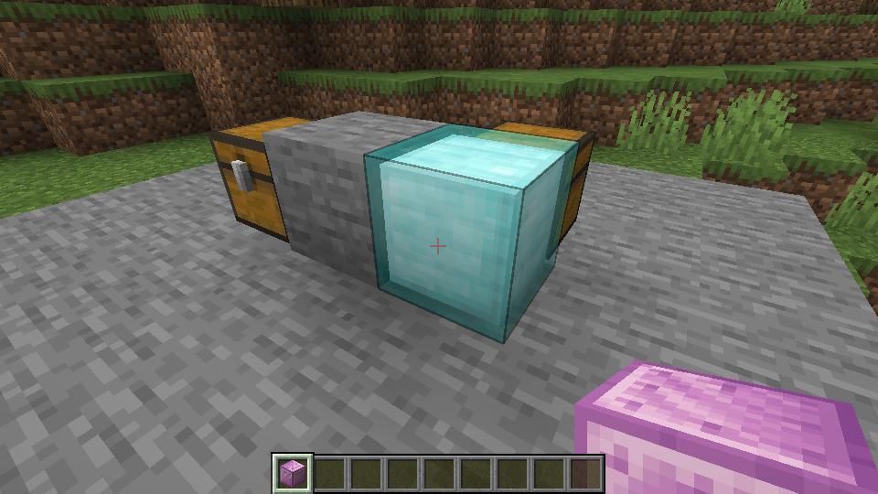

# Block registration

This work adds the original Tinkers' Construct blocks to Horizon in groups that share placement and rendering behavior. The first goal is to place, see, break, recover and save the registered blocks, including in a LAN world.

The source pack has separate blockstate files for some fluids, wall-mounted forms and other variants. The [source blockstate list](../content/reference/tconstruct-blockstates-list.txt) records the 435 distinct file names at source revision `e14bb5f1794f561ff164f88f84b8b095191c8ecf`; these files are not a count of unique inventory items. Registration will distinguish block IDs, item IDs and state variants, and reuse existing Minecraft resources and recipes where they already provide the same material.

The scope includes decorative and storage blocks; wood shapes such as slabs, stairs, fences and doors; glass and panes; and the appearance and placement of workstations and machines. Original assets and current Horizon shapes are used where they support the source block. Representative tests will cover placement and orientation, appearance and collision, drops, save and reload, and LAN synchronization.

A registered machine is not necessarily functional. Smelting, casting, alloying, their interfaces, fluid behavior, plant growth and world generation are separate work. Any shape or action that Horizon cannot yet represent will be identified rather than presented as working.

## Current work

The registration data currently covers grout, selected seared and scorched building shapes, slimy wood shapes and logs, several solid metal storage blocks, nahuatl, blazewood, and two lamps. On Linux, representative blocks were obtained in Creative and placed, with LAN synchronization; a seared brick was mined for its drop and survived save/reload before mining. A source wood door was opened in a LAN test. The three layered slime-metal blocks were displayed using their original layer textures. The full registered list has not been individually tested. In particular, stripped logs do not yet establish that axe stripping works.

*This Linux test shows the translucent outer layer around the inset metal block.*

[Connected glass and panes](connected-glass.md) are being prepared for game testing. Crafting Station and Modifier Worktable have placement and appearance data, but their menus and storage are not implemented. Their current collision uses a full cube and does not yet reproduce the table legs. Slime crystal blocks use an amethyst sound template; their source-specific chimes are not connected.

The three layered slime-metal models use ordinary inset and translucent geometry; their bounce and piston behavior are not implemented. Congealed slime uses the matching inset collision shape; its bounce behavior is not implemented. Tinkers' chests and material-dependent anvils need their own storage or material handling.
