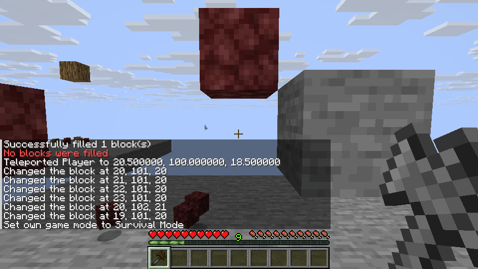
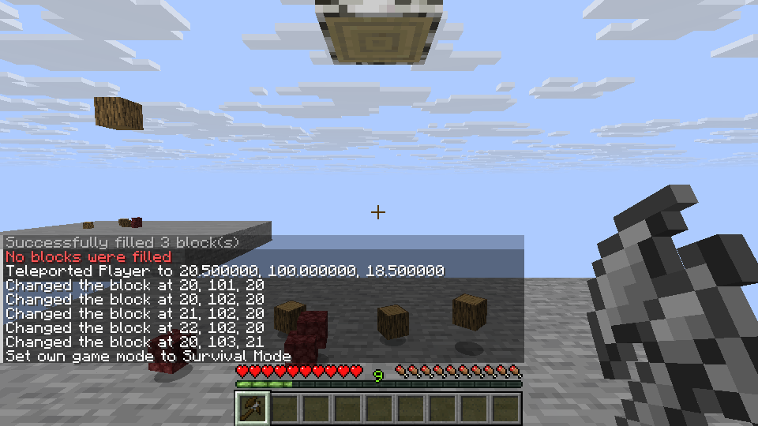

# Vein Hammer and Broad Axe mining

This draft implements the source Vein Hammer's same-block, distance-two vein
traversal and Broad Axe's source tree and non-tree traversal. It extends the
existing authoritative per-block break, drops, wear and spawn-protection paths.
Creative supplies these four-part tools for now; survival assembly remains a
v0.5 progression requirement. Expanded modifiers are not included.

The chain stops when the held tool breaks or changes, preventing extra blocks
from being destroyed without their expected drops.

The current implementation uses the source six-direction, same-block BFS with a
maximum distance of two for Vein Hammer. Broad Axe follows the source's
one-column trunk and bounded branch traversal for blocks in the source tree-log
tag; other effective blocks use the source upward box. These iterators feed the
existing player break path. Spawn protection is checked with the existing server
policy for all candidate columns, including branches beyond the original 3×3.

Lightweight tests cover traversal ordering, blocked branches, distant spawn
protection and source-tag projection without changing vanilla tags. Linux tests
used the official Mixins revision `a2af5c0dd4117d51ecd70066ba7a00b4a2c10dab`.
Creative-obtained tools were used because four-part survival assembly is not yet
available. Representative checks covered:

- Vein Hammer's connected distance-two blocks, with distance-three, different
  block and diagonally disconnected blocks retained.
- Broad Axe's trunk and unsupported branch, and six vertically aligned non-tree
  blocks with a seventh retained.
- Hosted LAN for both tools, including test-only remaining durability of one
  and three; each removed block produced a drop and consumed durability.
- A dedicated non-operator's Vein Hammer at the spawn boundary: one protected
  distance-two block remained while four permitted blocks dropped and wore the tool.

These are representative Linux results, not exhaustive material, tree shape or
multiplayer coverage. Expanded modifiers and Scythe actions remain unimplemented;
Windows is unverified. The test-only proxy sent an early STOP during the spawn
case, but the server's internal delayed-destruction branch was not directly
measured.

