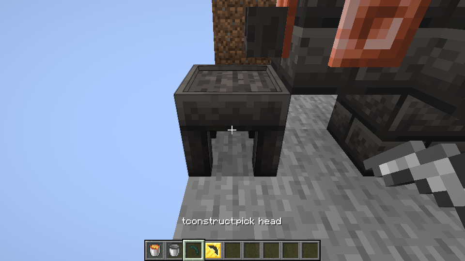

# Composite material casting

A composite recipe pours fluid over an existing material part and consumes that part to make the same kind of part with a different material. It is separate from pouring metal into a reusable or single-use cast. The source recipe sets the input material, output material, fluid amount per part cost and temperature; the result retains its output material identity.

For example, a copper pick head and 500 mB of water match the original oxidized-copper recipe. A wood tool handle and 250 mB of molten obsidian match the original Nahuatl recipe. A string bowstring and 90 mB of molten Rose Gold match the source Rose Gold recipe, provided that material is supported for the item. The retained original composite recipes do not include a Cobalt-input transformation; Cobalt parts are not claimed to gain an additional composite recipe. The copper and Nahuatl examples have representative Linux game checks; other combinations have not been checked individually. Availability also depends on the actual source fluid, item, material and tag registries. The water tag follows [Mantle's original definition](https://github.com/SlimeKnights/Mantle/blob/17c287ad52f7b10154e07fa7570dc7bccd74ca2b/src/generated/resources/data/mantle/tags/fluids/water.json); world datapacks can replace it.

The lookup checks material variants, input and output part compatibility, recipe conditions, material predicates, and shield casting conflicts. It uses the existing reserved-fluid and cooling transaction, with one input part and an empty output slot. Unknown predicate forms and incomplete registry data are rejected. Automated lookup and transaction tests cover the source copper recipe, variants, invalid input, fluid consumption, output occupancy and save/reload of an in-progress transaction. A Linux game run cast a copper pick head, converted it with water, reloaded during the pour and assembled a pickaxe; a LAN guest saw its oxidized material. A separate run made a wood handle in the Part Builder, converted it with molten obsidian, assembled a pickaxe and mined stone. Four handles converted from 1,000 mB of obsidian and a fifth remained unchanged; a LAN guest also converted a fixture handle and recovered an incompatible copper handle. The copper ingots, water, obsidian, gold cast, fuel, equipment and secondary tool parts were supplied as fixtures rather than mined in this run. Some checks used accelerated game ticks. Full-output behavior was checked by the transaction test, not this game run; Windows and other combinations remain unverified.

The image is from this Linux test world. See [Melting and casting](melter-casting.md) for the existing equipment setup.
