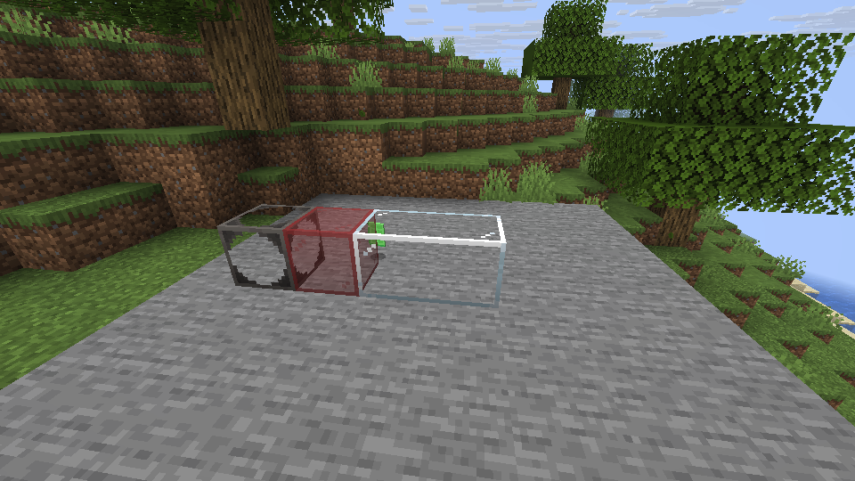
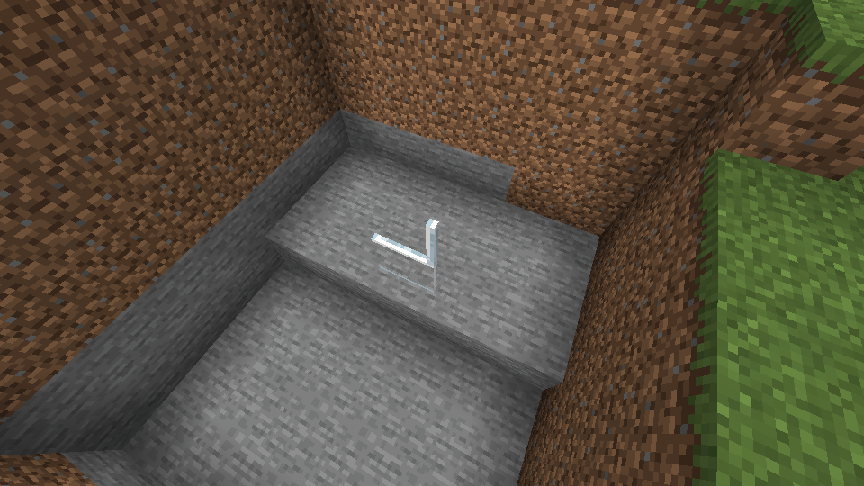

# Connected glass

Connected glass joins its texture to matching neighboring blocks. You can find clear, colored, seared, and scorched glass and panes in the **Tinkers' Construct Blocks** Creative tab.

*The two clear blocks on the right join into one surface. Different glass types keep their own borders.*

Place panes next to each other to make a window. Their shape changes with their neighbors, and stacked panes keep the exposed edge when their connections differ.

*The lower pane has an arm that the pane above it does not; its exposed top remains visible.*

Soul Glass can be walked through and slows movement. On Linux, representative glass and panes have been checked for Creative acquisition, placement, connected appearance, pane shapes, breaking, saving, and LAN synchronization. The full set has not been tested individually. Soul Glass's special view-blocking behavior and Windows play have not been verified.

Smeltery behavior, material-dependent anvils, and custom storage are separate work. See the [block guide](block-registration.md) for the rest of the registered building blocks.
