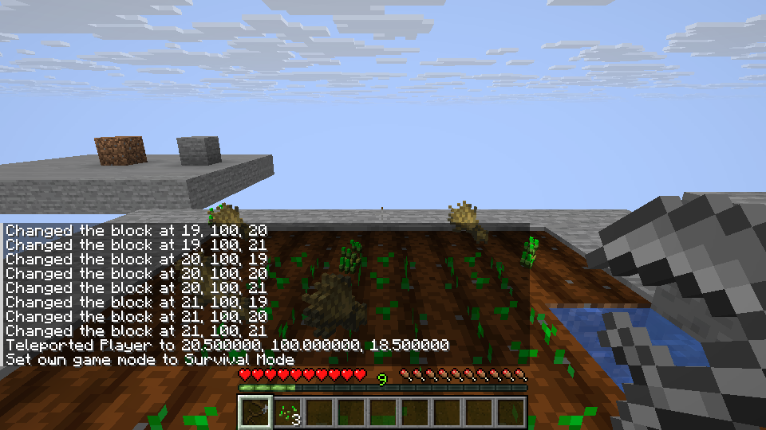
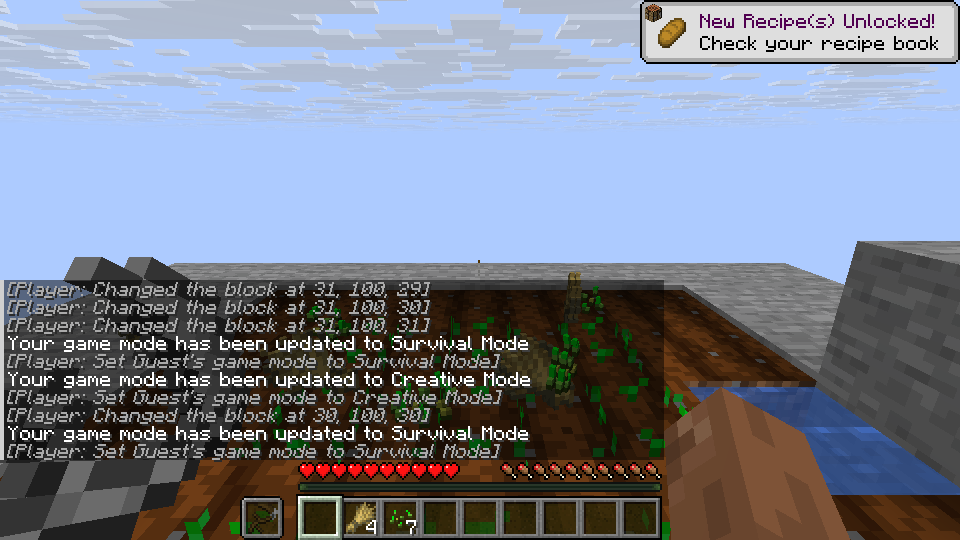

# Kama and Scythe crop harvesting

Kama harvests the clicked mature crop; Scythe uses its source 3×3×3 area.
Generated drops provide one seed for replanting. If no dropped item belongs to
the source seed tag, the crop is removed and all generated drops are released.
Each successful harvest consumes durability in survival, and a broken tool
stops further harvesting. Sneaking passes the interaction. The original item
tag packs must be available: if their seed tag is not resolved, harvesting fails
closed. Scythe also uses the existing block-breaking path for its source area.

On Linux, Kama wheat and carrots were harvested and replanted; an immature
wheat crop was retained. A mature torchflower crop with no seed in the pinned
source seed tag was removed and its seed dropped. Scythe harvested nine wheat
crops with nine durability loss, and its left-click area broke nine wheat
blocks with nine drops. Wheat has zero hardness, so that left-click test had no
wear with an unmodified Scythe, matching the source rule. A Scythe with three
remaining durability harvested three crops, retained its broken item and left
the other six crops. The world was saved and reopened. Hosted LAN covered Kama,
Scythe and guest off-hand harvesting.

The source Kama shears action and conditional Scythe Silky shears action are
not connected to block loot, and Silky acquisition is not implemented. Leaf
drops therefore do not yet claim source parity. Original berry/vine and other
special harvest interactions, area expansion, four-part survival assembly,
combat, armor and projectile features remain outstanding. Other crops,
multiplayer combinations and Windows have not all been individually tested.

The official Mixins CLI at `a2af5c0dd4117d51ecd70066ba7a00b4a2c10dab`
rejected a `HEAD` injection into
`horizon_items::items::LootContext<'_>::condition` with
`E_UNSUPPORTED_SIGNATURE` because the target has a generic random-source
parameter. The rejected injection was removed. A supported way to change only
the `minecraft:tool/can_shear` capability remains to be found; substituting a
shears item into the whole loot context would also change other conditions.
This is a restriction of the attempted target, not proof that every alternative
hook is unavailable.
