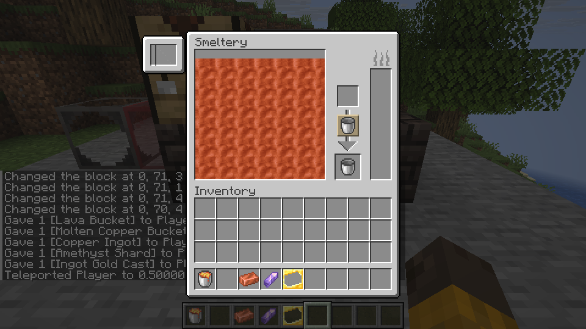

# Move fluids with buckets

Open a formed Smeltery or Foundry and place a filled bucket in the upper container slot. The machine transfers 1,000 mB into its tank and places the empty bucket in the lower slot. Shift-clicking a bucket in your inventory also moves it to the input. Take the returned bucket from the lower slot.

The copper is in the tank on the left. The lower slot holds the empty bucket returned from the input.

To fill a bucket, put an empty bucket in the upper slot. The lower slot receives a bucket of the fluid selected at the bottom of the tank. Click a fluid layer to select it. The button between the slots changes the transfer direction: automatic, empty containers, or fill containers. You can also use a bucket directly on the tank display.

Transfers require a full bucket's worth of space or fluid and an empty output slot. If a transfer cannot complete, the input remains in place. Close the screen to return containers left in its slots to your inventory. To fuel a Smeltery or Foundry, you can also use a lava bucket directly on its fuel tank.

The current implementation supports standard 1,000 mB buckets with registered fluid and item IDs. Other fluid containers and buckets carrying custom components are not supported; their data is not discarded. Representative Linux single-player and LAN bucket transfers have been tested. The fix for resuming a waiting bucket after Shift-clicking the output is awaiting verification, and Windows remains untested.

## Source assets

Bucket icons use the first frame of the original TConstruct fluid sprites and the Forge bucket-fluid mask. The reference assets are from [TConstruct e14bb5f](https://github.com/SlimeKnights/TinkersConstruct/tree/e14bb5f1794f561ff164f88f84b8b095191c8ecf) and [Forge 243490d](https://github.com/MinecraftForge/MinecraftForge/blob/243490d78001917c7e6ee6e94b45ef98776aa36f/src/main/resources/assets/forge/textures/item/mask/bucket_fluid_drip.png). Regenerating the snapshot with `tools/import_fluid_buckets.py` requires Pillow and those original sources; preparing game resources uses the checked-in snapshot and does not require Pillow.
