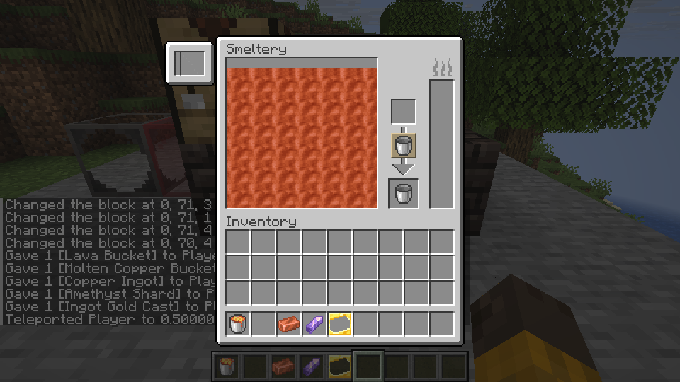

# Move fluids with buckets

Open a formed Smeltery or Foundry and place a filled bucket in the upper container slot. The machine transfers 1,000 mB into its tank and places the empty bucket in the lower slot. Shift-clicking a bucket in your inventory also moves it to the input. Take the returned bucket from the lower slot.

The copper is in the tank on the left. The lower slot holds the empty bucket returned from the input.

To fill a bucket, put an empty bucket in the upper slot. The lower slot receives a bucket of the fluid selected at the bottom of the tank. Click a fluid layer to select it. The button between the slots changes the transfer direction: automatic, empty containers, or fill containers. You can also use a bucket directly on the tank display.

Transfers require a full bucket's worth of space or fluid and an empty output slot. If a transfer cannot complete, the input remains in place. Close the screen to return containers left in its slots to your inventory. To fuel a Smeltery or Foundry, you can also use a lava bucket directly on its fuel tank.

In the local world, directly using a supported container on a fuel or ingot tank uses the same staged transfer as the machine's tank display. The tank must have room for the complete transfer or contain enough matching fluid; a rejected transfer leaves both sides unchanged. Direct world interaction with these additional containers still needs LAN and game verification.

In a formed Smeltery or Foundry, a local player can also use a supported container on a Seared or Scorched Drain to transfer fluid to or from its controller tank. This path requires the drain to belong to the currently valid structure. The direct drain interaction still needs game and LAN verification.

The container transaction supports standard 1,000 mB buckets with registered fluid and item IDs, as well as the supported bottle and copper-can cases. Unsupported container data is not discarded. Representative Linux single-player and LAN bucket transfers have been tested. The waiting bucket also resumed after Shift-clicking the output in representative single-player and LAN tests. Windows remains untested.

## Source assets

Bucket icons use the first frame of the original TConstruct fluid sprites and the Forge bucket-fluid mask. The reference assets are from [TConstruct e14bb5f](https://github.com/SlimeKnights/TinkersConstruct/tree/e14bb5f1794f561ff164f88f84b8b095191c8ecf) and [Forge 243490d](https://github.com/MinecraftForge/MinecraftForge/blob/243490d78001917c7e6ee6e94b45ef98776aa36f/src/main/resources/assets/forge/textures/item/mask/bucket_fluid_drip.png). Regenerating the snapshot with `tools/import_fluid_buckets.py` requires Pillow and those original sources; preparing game resources uses the checked-in snapshot and does not require Pillow.

## Copper Can GUI contents

Filled Copper Cans show a fluid overlay in inventory-style GUI icons and a
translated fluid-name/one-ingot tooltip when their untagged fluid is known to
the current world. Supported potion tags also provide the source potion name
in the tooltip. Advanced tooltips show the original fluid ID. Empty cans show
the source help text. The overlay crops existing Horizon still sprites to the
upstream MIT mask; missing sprites leave the original icon unchanged.

For supported potion tags with an explicit `CustomPotionColor` integer, the
icon also uses that color. Known base potions without extra effects use their
source-equivalent colors. Supported added effect mixes use the source float32
calculation; unsupported or oversized lists remain hidden. Malformed or unknown data, opaque wire patches, explicit item-model
overrides and unsupported tags remain hidden. This display does not change
container transfer behavior. World/hand/dropped-item contents rendering is
not implemented. In-game visuals, resource-pack transformations and LAN behavior
remain unverified for these additions.

The GUI fluid overlay is drawn after the base icon and can cover enchantment
glint in its fluid pixels. Automated tests do not exercise live injection,
icon composition, tooltip presentation or LAN synchronization.
