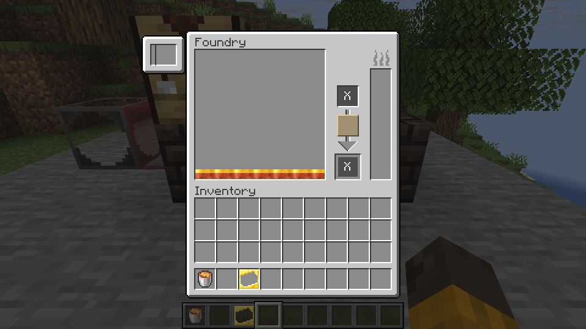
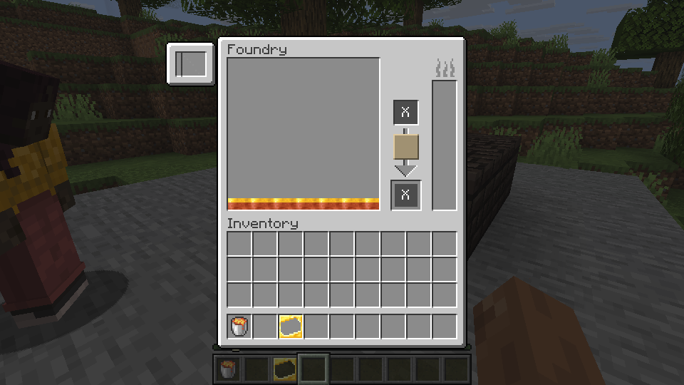

# Foundry

A Foundry melts ores into a primary fluid and collects their byproducts. Unlike a Smeltery, it keeps different fluids separate and does not make alloys.

## Try a small Foundry

In Creative, build a 3-by-3 floor of scorched bricks. Add one layer of walls, including the four corner blocks, and leave the top and the centre open. Put a Foundry Controller, Scorched Fuel Tank and Scorched Drain in the walls. Connect a Seared Faucet to the drain, with a Casting Table beneath it.

Use a lava bucket on the fuel tank. Open the controller and put a copper ore block in the input on the left. With the default source recipe it melts into 540 mB of copper and 60 mB of gold byproduct.

*The input is on the left. Copper and its gold byproduct appear as separate layers at the bottom of the fluid display.*

Click a fluid layer to move it to the bottom of the tank. Place an ingot cast on the casting table, select copper, use the faucet and collect the cooled copper ingot. The other fluid remains in the Foundry.

The ore, fluid selection, casting, wall repair and save/reload sequence was tested on Linux. A LAN test also checked shared input and guest casting. The screenshot below shows the LAN guest's view.

*The X marks indicate the two container slots are not available yet. Fill the fuel tank directly with a lava bucket instead.*

Only the representative copper ore path has been tested end to end. Other ores, larger structures, automatic transfer and fluid containers need further work or testing. The machine models and collision are not yet a complete match for the original. Windows has not been tested.
