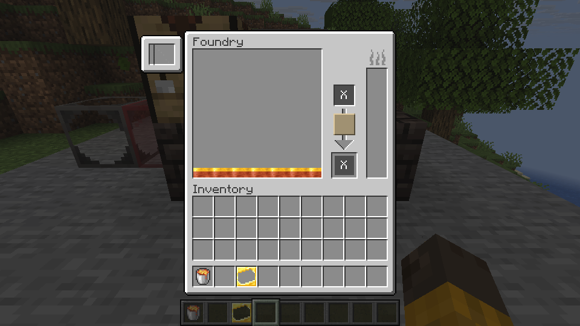
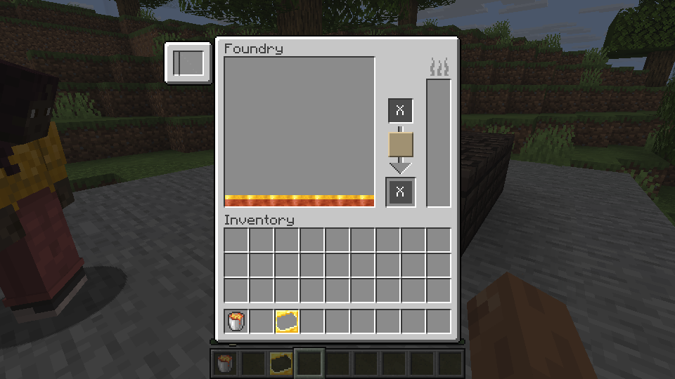

# Foundry

A Foundry melts ores into a primary fluid and collects their byproducts. Unlike a Smeltery, it keeps different fluids separate and does not make alloys.

## Try a small Foundry

In Creative, build a 3-by-3 floor of scorched bricks. Add one layer of walls, including the four corner blocks, and leave the top and the centre open. Put a Foundry Controller, Scorched Fuel Tank and Scorched Drain in the walls. Connect a Seared Faucet to the drain, with a Casting Table beneath it.

Use a lava bucket on the fuel tank. Open the controller and put a copper ore block in the input on the left. With the default source recipe it melts into 540 mB of copper and 60 mB of gold byproduct.

*The input is on the left. Copper and its gold byproduct appear as separate layers at the bottom of the fluid display.*

**Keep space free for byproducts.** The Foundry only waits for the primary output to fit. It adds byproducts in recipe order until the tank is full, and any remainder is lost. This matches the original Foundry, even if a configured primary output is zero.

Click a fluid layer to move it to the bottom of the tank. Place an ingot cast on the casting table, select copper, use the faucet and collect the cooled copper ingot. The other fluid remains in the Foundry.

The ore, fluid selection, casting, wall repair and save/reload sequence was tested on Linux. A LAN test also checked shared input and guest casting. The screenshot below shows the LAN guest's view.

*The X marks indicate the two container slots are not available yet. Fill the fuel tank directly with a lava bucket instead.*

Only the representative copper ore path has been tested end to end. Other ores, larger structures, automatic transfer and fluid containers need further work or testing. The machine models and collision are not yet a complete match for the original. Windows has not been tested.

The Fantastic Foundry guide includes a partial Scorched Tanks text page. It lists the supported tank capacities and fuel requirement; the original showcase, other fluid handlers, in-game display and LAN remain unverified or unsupported.

Shift-moving items from a player inventory into Smeltery or Foundry melting slots now fills empty slots one item at a time, leaving excess in the player inventory. This applies to local and guest quick-move paths; other click modes, existing oversized saved stacks, host integration, world and LAN behavior remain unverified.

A bounded ordinary left-click path splits a representable, non-Bundle carried stack into one item when placing it in an empty melting slot. The local path is single-player only and requires the live projection to match; the guest path applies only when one guest has that controller menu open the host has not opened its controller menu, and the last-sent guest page matches the current projection. Retained wire data on the held stack or compared page, or a saved item that fails exact NBT roundtrip, blocks this limited path; Bundles, occupied slots, other click modes, simultaneous guest viewers, and local-host LAN interactions continue through the previous paths and are not claimed to obey the one-item limit. Host integration, pickup sounds and menu callbacks, world/save and LAN are unverified.
