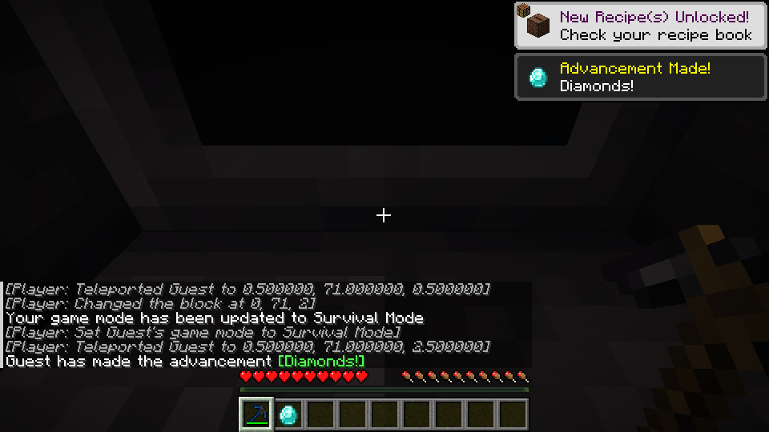

# Material harvest tier and source-effective blocks

This draft connects source material mining tiers to actual harvest/drop checks
and resolves the original `is_effective` block tags for supported tool
definitions. It reuses synchronized per-stack tool data and the existing
`Items::correct_for_drops` boundary. Existing vanilla resources and recipes
remain unchanged. Area mining is a separate follow-up.

On Linux, a pickaxe with a Flint head and Cobalt handle broke diamond ore
without a diamond drop. Replacing its head with Cobalt produced a diamond;
a Cobalt head with a Flint handle also produced one. The Cobalt result survived
save/reload. A LAN guest repeated the Flint-to-Cobalt head replacement and
received the diamond. A vanilla iron pickaxe still produced a diamond.

A Flint Mattock mined a source-effective oak log in 16 ticks and non-effective
oak planks in 66 ticks. After normal wear broke it, the same log took 206 ticks.
These are representative results, not tests of every tool or material.

Existing saved tools need regeneration or part replacement to acquire the new
synchronized fields. No automatic migration is added. Area mining and other
equipment-specific actions remain future work. Windows is unverified.

