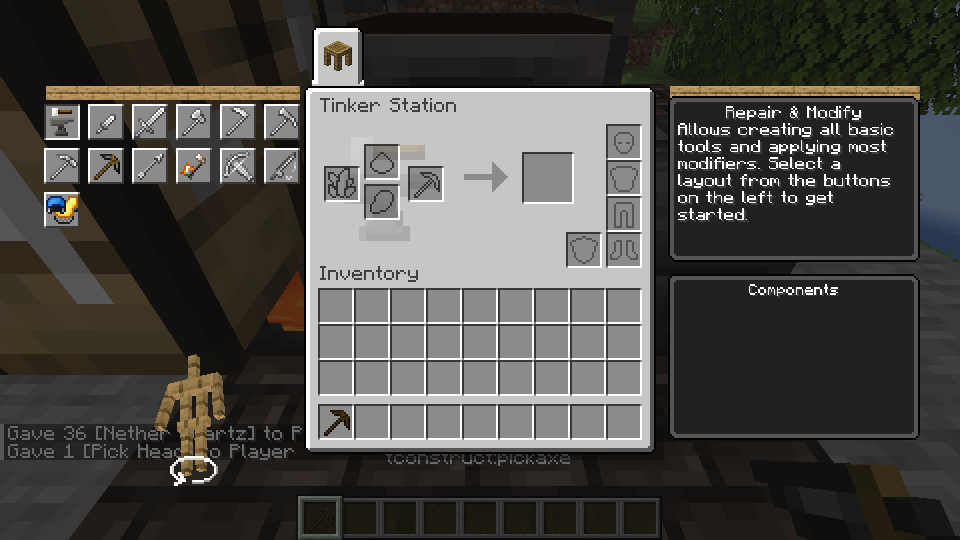
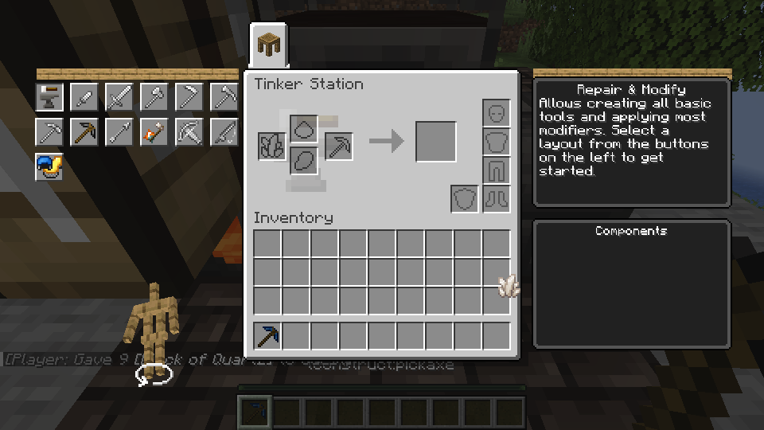

# Material stat trait follow-up

This draft covers the existing source-derived material trait dispatcher and the melee stat portions of four source modifiers at Tinkers' Construct `f4e77d43`: Lightweight (attack speed), Solid (attack damage), Pierce (attack damage), and Vintage (attack speed). Use their original `stat_boost` operations and levels, the existing material stat calculation and combat attribute paths; recalculate from base values during assembly, Creative generation and part replacement, preserving applied upgrades and avoiding double application.

Acceptance requires representative material/level combinations, source operation order, actual attack damage and cooldown, part replacement, saving/reloading, a Station-upgrade interaction and an ordinary LAN transaction. Group source-data and calculation checks; do not repeat every tool/material combination. The build and game checks are pending.

Only these melee-stat portions are in scope. Mining speed, draw speed, projectile velocity/damage, protection, movement, Pierce's mob effect, Vintage's extra slots and other modifier modules are not implied to work. Existing Preserved, Ductile, Jagged, Stonebound, Cultivated and vanilla behavior require representative regression checks. No new GUI, world generation or PlutoLib API is included.

The source melee stat modules covered in this unit are Cobalt Lightweight
(+8% attack speed per level), Invar Solid (+15% attack damage per level),
Bone Pierce (+0.5 attack damage per level), and Ancient Vintage (-10% attack
speed per level). The original melee/weapon tags gate their application.
The shared calculation rebuilds trait and Sharpness/Swiftstrike effects from
the material baseline rather than applying them repeatedly. Other modules of
these traits are still unimplemented. The official Mixins `a2af5c0dd4117d51ecd70066ba7a00b4a2c10dab` release transform and Linux client build passed. Representative gameplay used a temporary test datapack to attach each source trait to a flint head while retaining identical base materials: Solid level 1 changed damage 1.75 to 2.0125; Pierce level 2 changed it to 2.75; Lightweight level 2 changed speed 1.2 to 1.392; and Vintage level 1 changed it to 1.08. Solid and Pierce were also checked by attacking a test-tagged zombie; cooldown comparisons exercised Lightweight and Vintage. Sharpness plus Solid, part replacement, and save/reload passed. A LAN guest upgraded a command-supplied cobalt-head tool and retained its source Lightweight speed of about 1.296; partial and completed Sharpness and the block remainder were checked.

A separate temporary-datapack regression checked Preserved maximum durability and Ductile damage, broken retention, repair, part replacement and save/reload. The shared source operation order changes the tested Ductile damage from the previous implementation's 2.1875 to 2.21375. The saved, already-created tools do not automatically recalculate until a supported regeneration operation. These are representative Linux checks, not individual tests of every material or tool.

