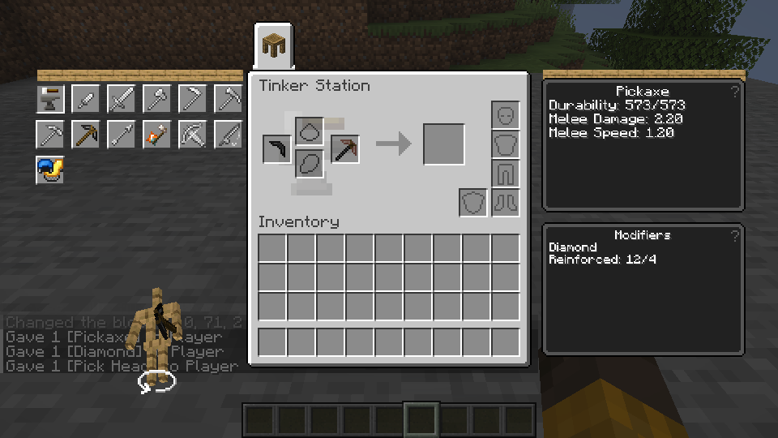

# Material trait expansion (in progress)

> **Provisional build:** Some effects and operations described below are unavailable or under verification. Earlier test results refer to their stated revisions; see [current limitations](provisional.md).

The screenshot uses supplied parts and upgrades in the Linux test world.

This unit follows the original Tinkers' Construct revision `f4e77d43f39ba1047bf93ae816b7e1beaab514c2` and the existing material-trait dispatcher.

Tool definitions with supported material stats now also contribute their fixed `tconstruct:traits` entries in module order. This resolves, for example, the Pickaxe's Pierce and the boots' Snow Boots or Bouncy traits; resolving a trait does not itself implement every effect. Check the combined fixed and material levels, part replacement and save/reload in the target build. Optional external traits and definitions without a supported material-stat module are not established by this change.

Traveler's Boots' Snow Boots flag now updates the existing player powder-snow walking state after local body synchronization and equipment changes, including while the boots are broken. The separate block-placement collision context receives the same predicate. The original vanilla leather-boots check remains included. These changes are not yet verified in a target build; check movement onto and through powder snow, block placement, crouching, equipping, removing, breaking and repairing the boots, and vanilla boots in local and guest play. Slime Boots bounce remains unimplemented.

Gold's Golden armor trait is included in the host Piglin-safe-armor check for worn TConstruct armor, while retaining the vanilla result. The original volatile flag is not removed merely because a tool breaks. This path needs target-build verification with gold and non-gold materials, removal, breakage, vanilla gold armor and separate local/guest players.

- **Tanned:** a leather trait limits ordinary durability loss to one point before Overslime and later wear modifiers. Source secondary modifier causes have a separate zero-loss rule; those modifier-driven actions are not yet connected.
- **Stringy:** a string trait adds String as a repair material, with the source repair value 140 per trait level before the existing material and repair multipliers.
- **Enhanced:** a Rose Gold trait grants one upgrade slot per level through the shared Station and Anvil transaction rules. A part replacement is rejected before consumption if the rebuilt tool would have negative free slots or invalidate Unbreakable's prerequisites.
- **Vintage armor attributes:** each equipped armor piece applies the original per-level movement-speed multiplier of -10% while unbroken and gravity multiplier of +10% through the separate equipment-change behavior. This is connected to the local equipment attribute path; handheld gravity, offhand attack-speed effects and LAN host behavior remain unverified or unimplemented. Test multiple pieces, removal, breakage and interactions with other attribute modifiers in the target build.
- **Heavy armor attributes:** each equipped piece applies -10% movement speed while unbroken using the original multiply-base operation and +5% gravity using the separate equipment-change behavior, per level. The local equipment path requires runtime verification; held-item effects and LAN host behavior are separate.
- **Featherweight armor movement:** a source armor-tagged piece adds 5% movement speed per level using multiply-base through the local equipment path. Its protection penalty and item-use speed effect are separate and remain unimplemented. Test the source tag, multiple pieces, equipment removal, breakage and interactions with Heavy; LAN host behavior is unverified.
- **Solid and Entwined armor movement:** Solid applies -10% movement using multiply-base while unbroken and +5% gravity using the separate equipment-change behavior per level; Entwined applies +10% movement using multiply-total per level while unbroken. This covers the local armor attribute path only. Entwined's unequip damage, Solid's armor protection, held-item attributes and LAN host behavior remain separate. Solid's Invar material requires its original external integration conditions. These effects need target-build testing.
- **Step Up:** String laces contribute the original +0.5 step-height addition per level while the armor is unbroken. The existing local player step-height attribute is used; the separate leggings upgrade recipe is not implemented. Verify String laces, one-block steps, removal, breakage, repair and LAN behavior on the target build. This does not implement Slime Boots bounce.
- **Vintage:** the Ancient material trait grants one ability slot per level through the same slot accounting. Its other original effects are separate; this change does not implement armor movement or gravity effects. The slot change has not yet been verified in game. Check that adding the trait increases free ability slots and that removing it is rejected when the remaining abilities exceed the available slots.
- **Gilded:** each original modifier level consumes one ability slot and adds two upgrade slots. The transaction uses the source recipe's default level range and tool tag. Extraction uses the existing crystal salvage path and rejects removal when the remaining upgrades would exceed the available slots. Verify repeated application with Gilded Blackstone, extraction with a wet sponge and sky slime crystal, rejection without consumption when slots are overfilled, and slot counts after reload. These paths have not yet been tested in game.

Representative Linux tests built a leather-binding pickaxe from supplied parts, checked ordinary melee wear and shield-before-durability, and retained its material and shield after reload. Supplied Stringy tools repaired from damage 50 to 4 using four String locally and for a LAN guest; a leather-binding tool rejected that repair. A supplied Rose Gold pickaxe used its extra slot, rejected an over-budget head replacement without consuming inputs, and accepted a replacement once the used slots fit. The #50 surplus-bottle correction also retained a supplied bottle's name and custom data in a game crafting transaction.

Glowing's source effect places light blocks through several distinct interaction paths and remains unimplemented; its explicitly identified wear bypass remains reserved for that future action. Source secondary modifier-caused actions, many other material effects, unrelated equipment and Windows remain open. The tests did not collect the supplied materials naturally or exercise every source tool.

The consolidated equipment candidate ports the existing fixed-trait #152,
Snow Boots #156/#158, Golden armor #161, Spiny ranged velocity #150,
Overwield ranged #102 and Raging melee #96 paths. These are source-level
integration candidates, not target apply or gameplay results. Raging melee uses
the acting player state rather than treating `lan_acting` as a guest-only
indicator; confirm both local and guest actors. Spiny's distinct self-damage
remains deferred. Test original tool tags, broken/equipped state, powder-snow
walking and placement, Piglin checks, conditional projectile scales and
cooldown/critical/secondary melee handling on the exact combined build.

The next integration ports Vintage/Gilded slot accounting and salvage from
#123/#124/#128/#165 while retaining the newer tank, slurping, spilling and
Blindshot guards. Speedy #139 is integrated for the three source leggings, with
45 redstone per level and source movement scaling; the equipment path and broken
state need target verification. Test Gilded levels, slot exhaustion, rejected
salvage without consumption, rebuilding, fluid abilities and partial Speedy
progress together, including save/reload and LAN. These are unverified source
candidates, not game results.
