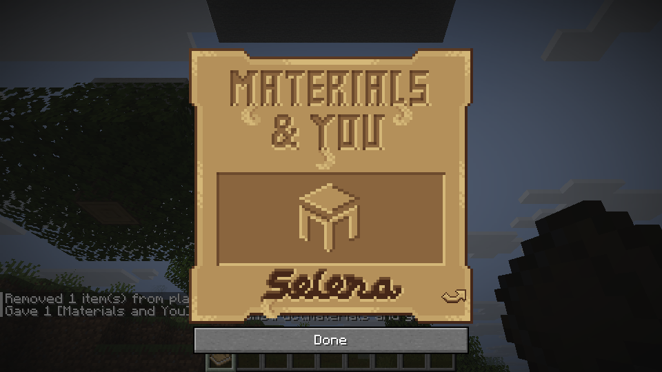
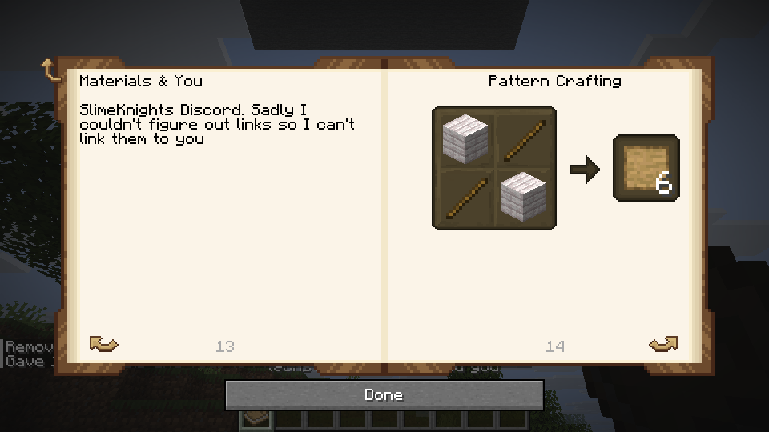

# Materials and You

This in-progress guide uses the original English Materials and You data and images from TConstruct revision `f4e77d43f39ba1047bf93ae816b7e1beaab514c2`. Craft it from a book and a pattern. The source-config-controlled starting-book advancement uses saved per-player progress.

Open the original cover and turn two-page spreads with the arrows or book controls. Chapter and page indexes link to the source text, illustrations, recipes and generated material and tool pages. Recipes cycle through loaded tag candidates and show their result count. Material pages show the part, its stats and its traits. A LAN guest requests the host-resolved pages. The Basic Armor section appears when its source item tag is populated.

The Tools chapter now includes the source's General, Ranged and Information group labels as navigable pages in its index. General and Ranged are shown when their respective source tags load at least one tool; Information leads into repair, part swapping, material swapping and recycling. This is a navigation adaptation of the source grouping, not a claim that every documented tool behavior is implemented. Representative General, Ranged and Information navigation and history were verified in a Linux creative fixture; a LAN guest also opened General and returned. Empty-tag behavior was source-checked but not exercised in game.

The Part Swapping page notes that armor casting swaps are limited: some materials, some damaged equipment and some modifiers are not handled. Station part swapping is a separate path. This note does not claim all other swaps work, and actual casting, save/reload and LAN are unverified.

The following differences from Mantle's original reader remain:

- Illustrated material panels use the source colors, part icons, stats, traits and available material actions. Long material stat groups continue onto additional pages; exact parity with the original panel and every material is not established. Some tool properties and long image descriptions continue onto later pages, and long index entries use shortened excerpts.
- Tool and part preview hover text uses the existing item tooltip renderer. The earlier tested tree supports source modifier showcase tooltips. Exact page-element placement and image scaling have not been verified for every source page.
- The Modifiers introduction now links the five source entries (Traits, Upgrades, Slotless Modifiers, Abilities and Defense Modifiers) using their actual paginated destinations. The five links and history navigation were verified in a Linux creative fixture; a LAN guest also opened the introduction and followed Upgrades. This does not establish the implementation of every modifier described.
- Recipe diagram inputs and outputs use the existing item tooltip renderer on hover, including the displayed tag candidate and the damage shown in the repair example. Representative input, output and repair tooltips were verified in a Linux creative fixture, including changing tag candidates; a LAN guest also saw input and output tooltips. Not every recipe was exercised.
- Material actions requiring unregistered fluid buckets or instrument-specific item components are omitted rather than represented with an incorrect item. Their source display remains incomplete.
- Part Chest and Tinker's Chest have registered blocks and recipes; earlier representative checks are described in [chest details](tinker-part-chests.md). The Tinker's Chest dye recipe remains available, but the placed block does not display its dyed color. The guide now notes that limitation on its chest recipe page. Other source text may describe features that this port does not yet implement; current-main guide layout and LAN display remain unverified.
- Other languages and the remaining guides are future work.

An initial English Puny Smelting reader uses the same source revision and existing reader. Its original book-and-grout recipe and introductory, Melter, Moving Fluids, Casting, Worktable and Further Reading text and images are included. Worktable and Further Reading are source-data additions checked by automated tests, not yet checked in game. The Worktable recipe diagram depends on the source recipe and resolved tags being present in the host snapshot. The Puny Armor chapter uses its own source tag and descriptions and is omitted when that tag is empty. The ten built-in entries follow source order; additional datapack entries are sorted by ID because the host snapshot does not retain tag order. Armor page rendering and full preview fidelity remain unverified. The sand-cast diagram supports its source alternatives and output counts; a combined Linux build verified representative sand and red-sand cycling locally and on a LAN guest. The Tier 2 ranged materials chapter selects visible materials with ranged stats that are not in the distant material tag. Its current material panels reuse the existing reader and have not been checked in game. The armor materials chapter selects visible tier 0–2 materials with armor stats that are not in the distant tag. Its panels split the supported armor stat types across pages; order is a deterministic adaptation and exact source parity and in-game rendering remain unverified. The complete generated book has not been measured against the LAN transfer limits (512 pages and 262,144 bytes). If either limit is exceeded, the host sends no book response and the guest retains its locally generated pages, which can differ from the host. The Tier 2 melee and harvest materials chapter uses the source tier, non-distant predicate and the Whitestone exception when the whitestone ingots item tag is populated; it reuses the existing panel and is not game-verified. The Slotless chapter includes its four source overview pages and Damage Tools illustration, but its individual modifier pages, tag-driven contents, recipes and source layout are not yet implemented. The Upgrades chapter similarly includes its five static source overview pages. Both chapters still lack tag-generated individual modifiers and recipe displays; other source page formats may be incomplete, and the source describes equipment and features that may not be implemented. The combined build also verified supplied book-and-grout crafting, cover and chapter links, representative illustrations and LAN guest Melter display. The omitted chapters, unregistered icons and configuration loading remain incomplete or unverified. The source data and art are covered by `third_party/tconstruct/LICENSE`.

Mighty Smelting now has its registered book item, source cover and English introductory pages through the existing local and LAN reader. Its source casting recipe uses a book and 250 mB of seared stone; acquisition has not been tested in the integrated game. The three Tier 3 material chapters select visible, non-distant materials with compatible stats using the current world snapshot and reuse the existing material panels. Empty chapters are omitted. The book warns that listing source data does not establish that every material, trait or acquisition route is implemented. Material ordering is a deterministic adaptation, and the new chapters, panel rendering and LAN transfer size remain unverified in game. A separately labelled partial Smeltery Basics section shows the original Controller, Alloying, Seared Chute, Seared Ladder and Seared Glass pages. The notice warns that structures, fuels, alloys, controller casts and chute automation are limited, entity melting is incomplete, and connected glass faces are unavailable. Other Smeltery pages, entity melting, broad-tool listings, ability and other chapters are not implemented. The new pages and original controller image have not been verified in game or over LAN. A separately labelled partial Tool Advice section includes the original Tool Tips and Designing Tools text; it visibly notes that the broad-tool list, tank page and material tip icon are unavailable, and that tool features may be incomplete. The Anvil recipe diagram depends on the source recipe renderer. The introduction, cover, LAN synchronization, casting acquisition and full book parity are unverified in game.

The source recipe consumes one book after 250 mB has filled a casting table and 89 cooling ticks have elapsed. The table now refuses to begin or complete a cast when an occupied input slot does not contain exactly one item, protecting externally inserted or changed stacks from whole-stack loss. Existing recipe revalidation and occupied-output checks still apply. Hopper transfers now target only the input on insertion and the output on extraction, move at most one item per transfer, and require an empty fluid tank; a pending recipe also blocks transfers conservatively. Oversized inputs from other paths must be reduced before casting. If an external insertion creates an oversized input during a pour, interacting with the table returns the excess and retains one item and the pending fluid; this recovery path is not game-verified. Source-recipe lookup and saved-state transitions are tested, but the integrated acquisition path and hopper behavior have not been verified in game. Transfers fail closed when live slots disagree with saved metadata or a component cannot survive the saved-item codec; third-party inventory providers and in-game callback behavior remain unverified.

New LAN guide requests carry a sequence number, and the client accepts a reply only when both the sequence and guide identity match the open screen. This prevents a delayed reply from replacing a later opening, including a reopening of the same guide. New hosts still answer legacy one-byte requests; an older host will not understand the new request, so a newer guest retains its locally generated pages. These compatibility and race paths have unit tests but have not been verified in a running LAN session.

The source permits book images without explicit dimensions. The reader falls back to atlas dimensions and preparation resizes oversized guide images for the host's 1024×512 GUI sprite limit, keeping the pinned originals unchanged. Missing sprites no longer hide their accompanying text. Representative Melter, Casting, Moving Fluids and Channel illustrations were verified in the combined Linux build.

The modifier chapter overviews remain incomplete. Puny includes the supported bonus-slot, ordinary and supported incremental upgrade recipe projections described below; Mighty includes supported ordinary ability recipes. Remaining tag-generated modifier pages are not rendered. The current pack snapshot captures raw modifier tags, but does not expose a complete source modifier registry against which required entries can be validated. Completing those pages needs ordered tag merging and registry resolution, modifier page content and translations, and modifier recipe selection with tool filters and the source's up-to-five-input display. A fixed built-in list would not honor datapack replacement, nested tags, optional entries or other registered modifiers. Those paths and the complete book's LAN transfer size remain unverified.

Puny Smelting showcase pages accept both source string and object item IDs. Gauge, Fluid Cannon and Casting Tank remain unregistered in this snapshot, so their icons may be missing until the items are available. Their source descriptions remain readable. A Linux creative fixture substituted stone for the unavailable source items and verified string/object forms and tooltip display locally and for a LAN guest; it did not verify the original icons or machine behavior.

The locally tested runtime corresponds to Git tree `f43c48bf04556085fa16967fdba1eee222ebbb8e` over commit `87d61cb5141511adbc5e8fe158e5cf4a16ccd692`. Linux representative checks covered a reset starting-book reward and reload without duplication, book-and-pattern crafting, cover, links on both pages, history back, a recipe link and tag-candidate cycling, source illustrations and tool previews, and long text with bold and italic styling. The source modifier icon tooltip was checked on hover. A temporary datapack populated the armor tag to inspect Traveler's Goggles; a separate host-only fixture verified that the guest received the extra armor chapter. Host and guest also showed the same styled page. The fixtures were removed after testing. These are not exhaustive checks of every page or platform.

The later local runtime tree `7eef3221b95cae12875527d7b94c1ea26806e567` passed the official Mixins transformation (revision `ddd9700b21997c95d95ac6ee5ecafe3830cf622a`) and the Linux target build. In the existing test world, the Wood panel showed its source color, head/handle/binding stats and Cultivated trait; the wooden part and Broad Axe hover names appeared. Wrapped values stayed with their labels after a layout fix. The same Wood spread was visible to the LAN host and guest, and cover, both chapter links, history back and representative long further-reading text were checked. The Puny Smelting recipe showed its registered inputs and the expected blank unregistered result. These checks use representative pages, not every material or model. The new test screenshots are local only and have not been published.

The following figures are from the earlier two-page runtime `87d61cb`, not the new local tree.

The crafting-grid texture is from Mantle 1.20 revision `17c287ad52f7b10154e07fa7570dc7bccd74ca2b`, under the MIT license in `third_party/mantle/LICENSE`.

The pinned guide JSON and images are ordinary files under `content/assets/tconstruct/book/`. The content overlay supplies the same paths to the reader and LAN host; resource preparation copies the original guide images into the GUI atlas. There is no separate guide ZIP to install. The `.hmod` content package and `.hnmod` native package remain separate, and this directory change has not yet been checked in a packaged game.

## Modifier book data groundwork

The package includes 59 pinned source modifier-tag files and 308 dynamic
modifier JSON definitions. On authoritative recipe reload, their raw resource
layers are captured in pack order; an enumerated file that cannot be read
makes that snapshot unavailable rather than silently incomplete. The snapshot
is cleared with the world and invalidated in parked dimensions on reload.
A tag resolver requires a complete, authoritative modifier registry and keeps
missing required entries and cycles as errors. A filename is not proof that a
modifier is registered: source static registrations, conditional definitions
and redirects still need a faithful registry implementation. No complete
registry or modifier pages are exposed by this groundwork. Manual original
pack directories retain their existing precedence and may lack these files.
Datapack reload, multiplayer synchronization, full Mixins integration and
actual book display remain unverified.

An isolated registry-composition helper now models the source's static-first
lookup and its single redirect pass over static and ordinary dynamic entries.
It requires an authoritative complete static ID set and an authoritative
classification of every highest-priority dynamic definition. The current host
provides neither: conditions, modifier deserialization and registration events
are not yet faithfully reproduced. The helper therefore has no production
consumer, and it must not be mistaken for a complete registry. Modifier tag
entries can resolve redirects to the target modifier object, so the existing
string-only tag resolver is not sufficient for displaying those entries.

A separate classifier models the source's order for unconditional redirects,
then the normal condition, then modifier deserialization. It requires the
caller to provide authoritative condition and deserializer results and returns
an error on unknown results. Conditional redirects are deliberately rejected:
the pinned source parses their conditions from the enclosing redirect object,
which needs further compatibility work. This helper is also not connected to
production and does not make the registry or modifier pages complete.

An unconnected tag helper can project IDs to canonical modifier identities
when supplied a complete authoritative registry. It preserves first-seen
ordering, deduplicates aliases, and treats an alias to the empty sentinel as
missing, as the source's tag lookup does. To avoid incorrect alias removal,
it currently rejects the snapshot if any modifier tag contains a remove
operation. It does not construct the registry or enable modifier pages. The
pinned TConstruct registration class alone cannot prove a complete registry:
other mods may register static modifiers through the registration event.

The bounded classifier now recognizes exactly two source-supported,
module-free shapes (the pinned Lustrous and Overslime Friend definitions),
unconditional redirects, and literal Forge true/false conditions. Any other
serializer or condition remains unknown, and one unknown prevents a complete
classification map. The two exact module-free shapes may also carry the literal
true condition, which the source loader ignores after evaluating. The full
pinned dataset contains many module-bearing
modifiers, so this is not a complete registry and is not connected to display.
Before production use, duplicate JSON object keys need rejection or verified
compatibility with the source parser; serde_json currently uses the last key.

Mighty Smelting's partial Smeltery chapter now includes four port-adapted text pages: features, a small structure example, controller operation and fluid-container operation. The chapter section names and order still follow pinned TConstruct `f4e77d43`, but these four page bodies are not verbatim source: the original diagram describes a different GUI, the original height limit differs from the current validator, and entity melting and some fluid-container paths remain incomplete. The source structure viewer, original GUI illustration, and other excluded pages are not implemented by this change. These pages and their layout have not been checked in game or over LAN.

The Melter advancement uses the pinned source's five requirement groups: placement of a Seared Melter, Table, Basin and Faucet, plus any one of the five specified heater or tank/gauge blocks. Its icon uses the host's `id` representation. The host's placed-block and block-state condition paths were inspected, and resource tests check the complete criterion and requirement sets. Actual placement events, progress persistence, packaged content and LAN behavior have not been tested for this addition.

The Mighty Smelting acquisition advancement preserves the pinned source's
inventory criterion and Melter parent; only its icon field is adapted for the
host. It depends on the separately staged Melter placement advancement. Static
resource tests do not establish gameplay, previously held items, save/reload or
LAN actor behavior, and this addition does not implement recipe unlocks.

Mighty Smelting's partial Smeltery section now includes a port-adapted Seared Fuel Tanks page. It describes the supported tank capacity and limited transfer endpoints, and notes that the source item showcase is unavailable and potion, piston and dispenser behavior are not game-verified. The new page and LAN display are unverified in game.

The Mighty Smelting partial Smeltery Basics section also includes Tinted Seared Glass. It describes the default wall/floor distinction and notes that normal crafting is not yet wired. Live display, light updates in existing worlds, and LAN remain unverified.

The Mighty Smelting Alloying page explains the source temperatures for lava, Blazing Blood and the molten netherite alloy. A following page describes the limited stock piglin barter route for Blazing Blood; vanilla netherite crafting remains separate. The guide display and actual progression remain unverified.

Fantastic Foundry now has a limited English reader entry and the source book-and-nether-grout crafting recipe. Its cover and opening text derive from TConstruct `f4e77d43`; the four Foundry basics pages are port adaptations, not the original GUI diagram or complete source book. They describe the rectangular structure, frame, supported fuel and basic controller operation. The alloyer, blazing blood, material and armor chapters, dynamic pages, structure viewer and many machine features remain omitted or incomplete. The item, crafting, page layout, direct interactions, and guest synchronization have not been checked in game. Host/guest may still differ when the existing book transfer limits are exceeded.

A package test checks the Foundry item declaration, recipe and selected reader assets in the native hmod. The Windows launcher runs the manual overlay before the content-based preparation step, which reads the same declaration. This is a static pipeline check, not an executed Windows prepare, host registration or gameplay test.

The partial Fantastic Foundry adds a byproducts page explaining the existing default copper/gold example and the tank-space limit. The text reflects the current modeled behavior; actual Foundry output, page display and LAN remain unverified.

### Mighty Smelting fluid-access pages

The partial Smeltery Basics chapter includes adapted Seared Drain and Seared
Duct pages. The Drain page explains the existing formed-wall faucet/casting
route, controller fluid selection, and supported held-container transfers.
The Duct page explicitly warns that the original filter slot and fluid display
are missing: the existing faucet route takes the controller's bottom fluid,
not a filtered fluid. No machine behavior is changed by these guide pages.

The original page fixtures are pinned to Tinkers' Construct
`f4e77d43f39ba1047bf93ae816b7e1beaab514c2`, under
`src/main/resources/assets/tconstruct/book/mighty_smelting/en_us/smeltery/`.
The adaptation deliberately omits claims of external-pipe integration and
drain-center fluid rendering. Reader selection, content packaging, and source
fixture identity are tested; full host build, actual page display, acquisition,
save/reload, and LAN remain unverified.

### Mighty Smelting: Seared Soul Glass

The source Smeltery showcase slot now exposes a bounded Seared Soul Glass page.
It explains the default wall-only structure role, existing pass-through/slowdown
resource rules, and the Soul Sand/Soil → Liquid Soul → Soul Glass → Seared Soul
Glass acquisition route. The pinned source identity and order are retained; the
text is adapted to describe this port and disclose unverified behavior.
Actual crafting/casting, passage through a formed wall, save/reload and LAN
remain unverified. Entity melting and the remaining guide pages are not added.

## Supported Puny bonus modifier pages

Puny Smelting's Slotless chapter now appends a partial, dynamic bonus-slot
view after the source overview pages. It projects the source bonus tag onto
this port's existing Station bonus registry, then uses the current
condition-filtered recipe snapshot, registered items, resolved item tags and
Station ingredient matcher. Each ordinary one-to-five-input, level-one,
no-slot-cost recipe shows its actual input alternatives, eligible tool types and gameplay
slot bonus. Text uses the existing paginated reader, chapter index and LAN
book response path. A missing snapshot or invalid required nested tag produces
no fabricated entries. Opening/requesting the book again reads fresh snapshots
after reload; a book already open is not refreshed in place.

This is an explicitly partial projection, not complete source modifier
registry resolution. Unimplemented modifier IDs are omitted even when a
source tag marks them required. It does not model external registrations or
redirect aliases. Unsupported recipe shapes, requirements and slot costs are
omitted. The remaining Puny modifier groups, remaining Mighty modifier
pages, source modifier artwork and source recipe layouts remain incomplete.
The displayed eligible types are not a promise that every existing tool state
can accept the modifier. Full client, in-game pagination and LAN visual checks
remain required.

## Supported ordinary modifier pages

Puny's Upgrades chapter and Mighty's explicitly partial Abilities chapter now
read source group tag directives and project them onto the Station's actual
ordinary-modifier support gate, excluding provisionally disabled modifiers.
They select current condition-filtered recipes with a supported level policy,
one to five input slots, upgrade/ability slot costs and optional
trait-level checks. The pinned source examples are Diamond, Emerald and
Netherite in Puny, and Glowing in Mighty. Entries depend on registered input
items and eligible tools, rather than a fixed list of placeholder pages.

Each entry shows its translated description, separate numbered input slots,
current item alternatives, slot costs, trait-level restriction and eligible
tool types. Repeated ingredients retain separate slots. Recipes with more
than three inputs identify the Anvil requirement. Modifiers occurring in
multiple source groups appear once in the generated chapter. Mighty's imported
source group metadata does not enable missing static overview prose.

Changing tag replacement/removal, recipes or item availability affects the
next open/request through the existing reader and LAN response. The displayed
tool types do not override checks against an existing tool's state. Other incremental recipe shapes, unsupported level policies and stack-sensitive ingredients, additional
requirements and unknown slot types are still omitted. Source registry,
redirect and external-registration completeness is not claimed. In-game
pagination and LAN visual validation remain outstanding.

## Supported single-point incremental upgrades

Puny's Upgrades chapter also generates incremental recipe pages from its source
group tags and current world snapshots. The selected gameplay registry excludes
provisionally disabled modifiers. Each displayed recipe must use a plain item
or tag input worth one progress point, the gameplay registry's fixed
points-per-level denominator, an explicit positive level cap and an explicit
one-upgrade-slot cost. Other or omitted costs are excluded because runtime
occupancy remains one slot per started incremental level. Shared Station tool and recipe-limit gates apply, including
Quick Charge's crossbow restriction and Hydraulic's fixed denominator/cap.

Pages show current input alternatives, points per level, maximum level,
upgrade cost and eligible tools. They explain that partial progress can span
operations and each operation stops at the next completed level. Pinned source
fixtures exercise Haste, Sharpness, Quick Charge and Hydraulic; supported
recipe and tag overrides affect the next open/request. A removed recipe or
unavailable input does not leave a static placeholder.

This is still a partial port-supported view. Point values other than one/four/nine, bulk recipes without a registered
leftover, unsupported absent/default level caps, changed effect
denominators and additional requirements are omitted.
Full source registry/redirect parity and in-game/LAN visual checks remain
outstanding. These pages do not change modifier acquisition or effect rules.

## Block-value incremental inputs and leftovers

The same partial Puny incremental view also accepts the source block values
of four or nine progress points per item. These entries require a registered
leftover item in the current item registry, the existing fixed effect
denominator and cap checks, and an explicit one-upgrade-slot cost. Pages show
the item value, input count from zero progress and the actual leftover item:
one leftover item is returned per unused point when crossing a level boundary.

Pinned Redstone Block/Haste, Quartz Block/Sharpness and Prismarine Bricks/
Hydraulic fixtures compare guide data to actual Station consumption with one
point remaining. A missing or unregistered leftover hides the bulk entry;
unsupported point multipliers remain omitted. No
new acquisition/effect behavior or complete source registry is claimed.

## Repeatable fluid modifier recipes

Puny's Tank upgrade and Mighty's Slurping, Spilling and Splashing abilities
can now show their source recipes without an explicit level field. These four
entries share the Station's repeatability limit and slot policy. They display
one added level per application, one upgrade or ability slot per level, and
the port's 32767-level ceiling rather than claiming a source-wide maximum.

Container alternatives use the actual Station stack matcher on newly created
empty registered items. Unknown containers are omitted even when a datapack
adds them to the tank tag. The page labels the empty-container requirement and
warns that filled or modified stacks may be rejected. The five separate input
slots and repeated bottle/channel/copper ingredients are retained, with the
Anvil requirement shown. Slurping's resolved charge tag and Splashing's native
staff/melting-pan restriction remain in effect.

Changed costs, trait-counting recipes, level ranges and unsupported ingredient
forms are omitted conservatively. This does not expand fluid effects, add
container acquisition or complete the source modifier registry. Pinned source
fixtures and focused Station/guide regressions cover these bounded cases;
full host, page layout, actual gameplay, save/reload and LAN validation remain
outstanding.

## Multi-input bonus recipes

Puny's partial bonus chapter now preserves up to five separate ingredient
slots. This includes the source Draconic and Recapitated skull recipes with
slimeball inputs, and Draconic's two Dragon's Breath plus three Dragon Scale
recipe. The skull/non-skull intersection and difference selectors still use
the current Station matcher and registered eligible tools. Repeated ingredients
are not collapsed into one inventory stack or one input slot.

Five-input recipes identify the Anvil requirement. If Dragon's Breath can be
consumed, the page explains that each one returns a Glass Bottle; the recipe
is omitted if the bottle output is not registered. Unknown ingredient forms,
changed slot costs, multi-level bonuses and other source modifier families
remain outside this view. Actual item acquisition, UI pagination, full host
integration, save/reload and LAN are not verified by these guide changes.

## Level-range upgrade and Gilded pages

The ordinary dynamic pages also cover the runtime-supported Step Up and
Necrotic level ranges in Puny, and Gilded in Mighty. Source Step Up adds one
level through level 2, Necrotic through level 5, and Gilded uses the current
runtime's default range of 1–32767. The guide reads explicit level numbers or
valid min/max overrides instead of treating every ordinary recipe as level 1.
A recipe beginning above level 1 states the prior installed level needed.

Each page shows the upgrade/ability slot cost per added level. Gilded also
states its existing two-upgrade-slot bonus per level; this is not a new gameplay
bonus. Runtime tool restrictions remain authoritative, including Step Up's
leggings-only filter. Recipes with different occupancy costs, malformed or
out-of-range level bounds, or trait-counting conditions are omitted.

Pinned recipes and focused production-planner regression cases were added.
Execution of those new checks, detailed review, full host validation and
in-game/LAN verification are deferred to the final batch.

## Modifier-crystal alternatives

The supported bonus, ordinary/ranged and incremental recipe pages now identify
one modifier-bearing crystal as an alternative to all listed ingredient inputs.
They use the current recipe's `allow_crystal` flag (default true) and require
the crystal item to be registered. False or malformed permission never creates
an advertised alternative. An empty crystal or one carrying a different
modifier does not qualify. This is added only to otherwise-supported recipe
pages; a crystal does not make an omitted ingredient recipe appear.

Ordinary and bonus crystals consume one input and add one modifier level under
the existing tool, slot and level rules, with no ingredient-container returns.
Incremental crystals add a full level's points while preserving prior partial
progress. Unlike ordinary ingredient top-ups, that path requires an additional
free upgrade slot even when partial progress exists, and the whole addition
must fit within the cap. It returns no bulk-input remainder.

This describes existing Station behavior, not new crystal extraction,
acquisition, registry or gameplay support. Focused guide-policy and Station
regressions cover permission/defaults, missing crystal registration, wrong or
empty crystals, partial progress and level caps. Full host, GUI and LAN
verification remain deferred.

## Slotless Blindshot guide

Puny's Slotless chapter now also projects current source modifier-group tags
onto supported incremental recipes. This exposes Blindshot's existing dirt
recipe: one point per dirt, ten points per level, no upgrade or ability slot
cost, and the current Station's default limit of 32767 levels when the recipe
omits a cap. The page labels that default as a port limit rather than claiming
the source recipe explicitly sets it. Valid explicit cap overrides are read
from the current recipe.

Only the runtime-authorized slotless family may omit the slot cost or level
cap. Other incremental recipes retain their explicit-cost/cap requirements.
Blindshot remains restricted to supported Longbow and Crossbow items even if
a pack broadens the tool tag. The page also states that the current modifier
extraction operation cannot recover Blindshot. Its crystal alternative follows
the recipe permission and registered-item checks already used by other guides.

Pinned source recipe/tag fixtures and focused regressions were added but not
run in this pass. This adds guide coverage, not new Blindshot gameplay or
acquisition behavior. Full host, GUI, save/reload and LAN checks remain deferred.

## Mighty broad-tool pages

Mighty Smelting's partial Broad Tools chapter now reads the source general
and ranged broad-tool groups. It includes Sledge Hammer, Vein Hammer,
Excavator, Broad Axe, Scythe, Cleaver and Longbow only when the current tool
item and all displayed component choices are registered, the current
recipe/definition yields inputs, and the loaded source page names that tool.
Current tag membership controls inclusion; source text is not a tool registry.
Javelin, external tool additions and the tank advice page remain omitted.

Seven pinned source descriptions/properties use the existing tool/part preview,
text overflow, group headings and chapter-index path. The required chapter
notice and a per-tool notice identify source capabilities as reference material,
not verified Horizon effect coverage. Missing per-tool notice suppresses those
pages. Normal broad-tool construction uses a Tinker's Anvil; the preview does
not prove every material's acquisition route or complete gameplay support.

Source fixture hashes, eligibility boundaries and reader wiring regressions
were added but not executed in this pass. This change adds guidance only;
full host, in-game layout, actual assembly, save/reload and LAN remain unverified.
