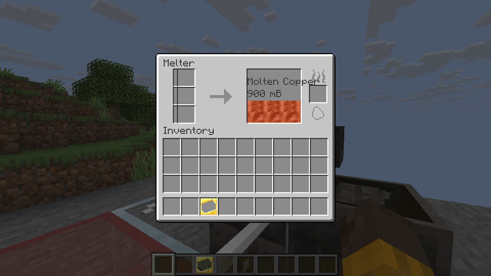
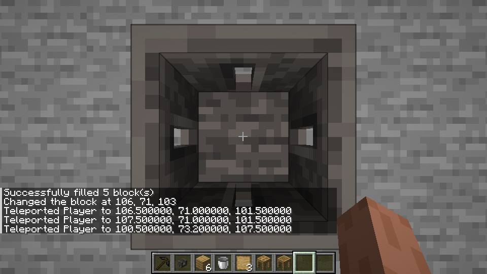
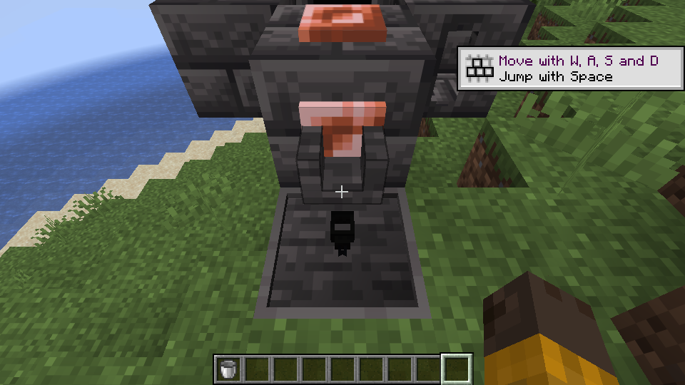

# Melting and casting

Use a Melter, a Seared Heater, a Faucet and a Casting Table or Basin to melt and cast supported materials. Place the heater directly below the Melter, and the faucet beside the Melter above the table or basin.

Open the Melter, put a supported fuel in the heater slot, and add material to the three input slots. For example, ten copper ingots produce 900 mB of molten copper.

Solid fuel consumption and Melter state are staged together. A fuel remainder returns to the heater only if it is itself valid heater fuel and fits; otherwise it drops at the heater, as in the source. If the Melter becomes unformed while fuel remains, that fuel burns down without heating or cooling its inputs; cooling resumes after it runs out. These additions need game, persistence and LAN verification.

The input slots are on the left, the heater slot is on the right, and the tank shows the stored liquid.

Place an ingot cast on the table, use the faucet, and wait for the copper ingot to cool. Use an empty basin to cast 810 mB into a copper block (nine ingots). Use the table or basin to collect the finished item.

The copper sequence, saving and reloading, and shared input and casting in LAN have been checked on Linux. Other materials and Windows have not received the same game checks.

Forge milk is supported as a machine-tank fluid for skull-melting lookup and milk bucket transfers. Milk-tag ingot casting now has a registered Cheese Ingot result; the source recipes are retained. Cheese Block is registered with 2×2 ingot conversions. Its source basin recipe requires the `forge:milk` tag; availability through the packaged source layers is under separate verification. With the native runtime active, players can eat the block in air, returning three ingots to the emptied hand or inventory. If a stacked block is eaten with insufficient inventory space, consumption is refused rather than dropping an item that another mod might cancel. Content alone leaves it inedible, preventing loss when the native hook is absent. Both foods restore hunger and saturation, but their source effect-removal behavior is not yet connected. Eating particles and sounds are not yet implemented; item stacks with custom components or damage and nonplayer eating are unsupported. Consumption and remainder are committed before advancement callbacks to avoid losing another item if a callback changes the hand. Full-inventory behavior and LAN remain unverified. Cheese Block uses source walk and jump factors, but its lighting and rendered inner planes are not yet verified in game. The original Forge milk sprite is staged for still and flowing milk. These paths have focused tests but have not been checked in game, persistence or LAN.

The implementation uses the original recipes, the original Melter ore-rate defaults and the source fluid textures where available. Fluids without a retained source texture use a generic visible texture; source animation metadata is now staged for fluid aliases, while the casting cooling fade remains unimplemented. Atlas animation and reload still need in-game verification.

Fluid-container interactions, redstone control and specialized recipe types remain separate work. For a tested small alloy setup, see [Smeltery and alloys](smeltery.md). The [Foundry](foundry.md) can also recover a byproduct from copper ore. The Faucet, Casting Basin and Casting Table use the original selection and collision shapes. A Linux game check covered all five Faucet directions, right-click targeting, the Basin and Table recesses, walking against one Faucet, and falling into the Basin and Table. The Melter screen still opened. Other machine shapes remain to be compared.

For acquisition from gathered resources and a fixture-free acceptance route, see [Survival progression](survival-progression.md).

## Filling a lantern

Seared and Scorched Lanterns hold 50 mB. Their source filling recipes transfer
10 mB on a Casting Table and up to 50 mB on a Casting Basin, limited by the
space remaining in the lantern. A different fluid must not replace fluid
already stored inside it.

A representative Linux Table test transferred 10 mB, left 990 mB in the source
tank, and retained the lantern's contents after restart. The Basin test did not
transfer fluid. One identified cause is an unresolved empty-cast tag referring
to an unregistered gold platform. The corrected entry checks the original tag
graph and accepts only an input proven not to belong to that empty-cast tag;
unknown membership and cycles still refuse the operation. Focused recipe and
tag tests pass, but a game rerun of the corrected Basin path is still pending.

The fluid animation manifest records the original `.mcmeta` entries from TConstruct
revision `f4e77d43f39ba1047bf93ae816b7e1beaab514c2`, including frame timing and
interpolation. Powdered snow has no source animation metadata. Both the manual
resource overlay and the content package stage metadata beside each alias.
Tests check packaging and values, not visible animation or resource reload.

### Smeltery machine metadata

Writes through the shared metadata store preserve unknown top-level fields in
the existing `tconstruct:smeltery` machine compound while replacing the
owned fields according to the current operation, including clearing omitted
optional `heat_codes`. For Smeltery and Foundry, unknown keys directly on the
native tank compound are also retained. Legacy `FluidName`, `Amount` and `Tag`
aliases omitted by a serialized update are not retained. Raw patch updates that
explicitly include them keep them, as before, and may leave stale aliases. Fluid entry fields, slot payloads, other legacy Forge formats, and
collisions with owned field names remain outside this protection. It cannot
restore data already lost. A non-compound existing machine value rejects an update; malformed owned
fields may still be normalized by their existing decoder. Client network
snapshots retain replacement semantics rather than merging old fields. Cached-host-type
fixture tests exercise the merge and the shared store; full host compilation,
real world save/reload, all interactions, and LAN remain unverified.

A tank containing a fluid ID with an unpaired UTF-16 surrogate cannot be
rewritten through the lossy native decoder. Store updates are rejected unless
the raw tank is unchanged. This preserves that identifier during those writes
but can pause all machine ticks. Client LAN snapshot replacement bypasses this
guard. Controller destruction is not protected and neither tank data nor
inventory drops are guaranteed. Other malformed or unknown nested data is
outside this check. Host integration and world/LAN behavior remain unverified.

On the Melter tick's preserving save, and other callers of the preserving
single-tank encoder, an unpaired UTF-16 surrogate in the old fluid ID rejects
the update rather than being rewritten lossily. This may pause those machines.
Other non-preserving transfer, destroy and client snapshot paths are not covered.
The cached-type fixture is not a full host, world, save/reload or LAN test.

For Smeltery/Foundry fuel draw and direct player fuel-tank interaction, the
native tank compound is patched on a staged copy: unrelated top-level fields
are retained as parsed NBT values, not necessarily identical bytes. They remain
when the tank empties or another fluid is inserted, so their meaning may become
inconsistent if they depended on the old fluid. Legacy `FluidName`, `Amount` and `Tag` aliases are dropped
as in the former serializer. An invalid UTF-16 fluid ID blocks that candidate
without consuming fuel or the held container. Other transfer, drop and old
Forge formats remain outside this limited change. Host/world/save/LAN behavior
is unverified.

Faucet transfers between supported tanks refuse to patch a source, target or
reserved packet whose fluid ID cannot be converted from UTF-16 without loss.
Their staged writes leave fluid and packet data unchanged on this refusal. If
an invalid source remains present, even an already reserved packet can wait
without pouring until the source is corrected or removed. Older casting table,
basin and cannon routes and broken/replaced blocks are outside this guard.
Fixture tests use mock world and atomic store behavior; host integration and
LAN remain unverified.

### Direct held-container Drain preservation (#379)

A held-container exchange through a formed Seared/Scorched Drain now patches
only the controller's validated native tank. Raw Smeltery/Foundry inventory,
item extensions, progress, fuel/heat state and other controller fields remain
unchanged instead of passing through a lossy full-state serialization. Saved
state is rechecked before persistence, and held inventory changes still happen
only after a successful save. The handled-container fallback from #684 remains.

Noncanonical tank/row extensions, tank aliases and lossy fluid identifiers
wait rather than being discarded. Current or stale retained wire-backed held
items are refused. This does not migrate opaque tank formats or broaden fluid
capabilities. The existing fixture adds both controller types, fill/drain,
raw item/controller preservation, unsafe states, creative behavior and failed
writes. Production interaction, patch, state and transfer code are used with
mock world/storage/structure. Tests were not run; actual host, world,
save/reload and LAN validation remain for the final combined pass.

### Native controller tank-row extensions during Drain use (#379)

The held Drain route now extends the prior canonical-tank-only guard: native
Smeltery/Foundry tank extensions and fluid-row extensions can survive fill/drain.
The preserving codec keys rows by exact fluid ID and full tag, retains their raw
fields when amounts or order change, and keeps top-level tank extensions even when
the tank becomes empty. New rows use the native encoding. Unrelated controller
inventory, heat, fuel and extension fields remain untouched.

Legacy aliases, malformed owned fields, lossy fluid IDs and duplicate fluid/tag
identities still refuse conversion. Removing an entire row carrying unknown fields
also refuses: silently dropping its metadata or attaching it to a different fluid
would be unsafe. A partial drain of such a row is supported. This codec is used by
held Drain interactions only; other machine/menu/Faucet serialization is unchanged.

Three codec cases and two production-route fixture cases were added for tagged
identity/reordering, overfull capacity preservation, partial fill/drain, empty/refill,
unsafe aliases/IDs, opaque-row removal and failed-save inventory retention. Fixtures
use mocked host/world/storage. They were not run; actual gameplay, reload, LAN and
combined integration remain for the deferred validation phase.

### Smeltery/Foundry mode and fluid-selection menu saves (#379)

Local menu clicks and guest menu buttons now preserve the controller's original
compound when changing container-transfer direction or selecting a fluid layer.
Only the tank is replaced using the preserving row codec; raw inventory/item, fuel,
progress and extension fields remain intact. The helper refuses unrelated decoded
state changes, conflicting controller tank aliases and unsafe row removal. Each
caller also rechecks its saved snapshot before persistence. Temporary container
slots, the local inventory projection and guest mode packets update only after a
successful save.

Three production codec/transfer cases plus local/guest wiring checks were added.
These are not full pointer, UI or guest packet execution fixtures, and no tests were
run. Direct carried-container interactions, generic slot writes and machine ticks
remain separate. Actual host/UI, reload and LAN behavior remain unverified.

### Direct carried-container controller clicks (#379)

Local and guest clicks on the Smeltery/Foundry tank now use the preserving
controller/tank codec before publishing a carried item, returned stack or cursor
packet. Both paths reject current/retained wire backing and recheck their raw save
snapshot. Selecting a fluid layer now stages a fill from that exact index and full
fluid tag, then debits only that identity in the original order. Multiple potion
layers with the same fluid ID no longer cause an otherwise valid selected fill to
be rejected as ambiguous. Local custom-color support and guest/network restrictions
remain in the existing container rules.

Added three exact-index codec cases and three extracted production-local-route
cases, plus guest wiring checks. World/storage are mocked; the guest packet handler
is not executed by this fixture. No tests were run. Actual host/UI, save/reload and
LAN, direct fuel/Melter clicks and other inventory paths remain separate/unverified.

### Direct Melter and fuel-tank menu preservation (#379)

Melter output clicks, its fuel-tank clicks and Smeltery/Foundry owned-fuel clicks
now share a native single-tank container planner. It retains tank extensions,
refuses legacy aliases/lossy IDs/malformed fields and current or retained wire-backed
carried items, and keeps the existing portable-container and potion restrictions.
Melter output commits replace only the nested tank in the original raw controller,
leaving item/inventory, fuel, progress and extension fields untouched. Fuel commits
retain native tank extensions instead of replacing the whole compound canonically.

Both exchange helpers recheck the target chunk, block and exact raw save before
writing; owned-fuel exchange also rechecks controller ownership. Returned slots are
published by the existing local/guest wrappers only after a successful commit.
Two planner cases, three extracted production-exchange fixture cases and wiring
checks were added. The fixture uses mocked world/storage/ensure behavior, covers
fuel and ingot capacities and failed persistence, and does not execute guest packets.
No tests were run. Actual host/UI, reload, LAN and generic inventory/tick writes
remain separate or unverified.

### Temporary fluid-container slot commits (#379)

The six local/guest temporary-container paths now use the tank-only preserving
controller codec: pickup, quick extraction to player inventory and quick insertion
from player inventory. They compare the original raw snapshot before writing and
retain the existing persistence-before-inventory ordering. Guest quick-extraction
failure still restores the original temporary-slot projection. Controller inventory,
progress, fuel and native fluid-row extensions are no longer canonicalized by these
tank-only changes.

Two production container-helper/codec cases and six-path wiring checks were added,
including output pickup followed by reprocessing. These are not complete local-menu
or guest packet execution fixtures. No tests were run. Normal melting-slot edits,
generic guest writes, machine ticks and actual host/UI/reload/LAN remain separate.

### Staged melting-slot inventory commits (#379)

Local quick-move, local pickup with rollback and guest quick-move now patch only
native slots/progress in the raw controller. Tank rows/extensions, fuel, heat,
scheduler fields and unknown controller fields remain untouched. The inventory
codec refuses resize, unrelated machine changes, non-reset progress edits, legacy
Items aliases, opaque saved slots and new wire-backed/unrepresentable stacks.
Opaque inventories wait because a live page projection cannot retain unknown raw
item fields. Relevant player inventories and the local pickup view/carried stack
are also guarded against retained wire backing.

Commits recheck chunk, block and raw save identity. Local pickup still rolls back
player inventory/cursor on failure, but restores its old live page only when the
original block/save and captured changed page remain in place, avoiding a stale
restore over a replacement. Three codec cases and local/guest wiring checks were
added; no tests were run. Full menu callbacks, gameplay/reload/LAN and generic guest
write rollback coordination remain unverified/separate. Machine ticking is unchanged.

### Held-container use on fuel/ingot tanks

Direct world-use on the eight Seared/Scorched fuel and ingot tanks/gauges now
uses the preserving single-tank planner. Native tank extensions survive; legacy
aliases, malformed owned values, lossy fluid IDs and retained-wire held items
wait rather than being rewritten. This is separate from the GUI exchange path.
After datapack preparation, the commit rechecks the loaded chunk, exact block,
raw tank, held count/damage/components/wire state, Creative state and local/LAN
mode. Only a successful save publishes held results or Creative drain gifts.

The Drain route fixture also extracts this production interaction. Added cases
cover all eight blocks, fill/drain, single/stacked containers, Creative behavior,
unsafe data, failed saves and ten preparation-time state changes. World storage,
initialization and callbacks are mocked. Tests have not been run in this batch;
full host, offhand mapping, save/reload and LAN remain unverified. The separate
comparator notification stack (#688) still needs combined integration.

### Liquid-fuel debit preservation

Melter and Smeltery/Foundry fuel acquisition stage the same strict raw-tank
debit before granting heat, duration or rate. Native extensions survive partial
and final consumption. Forge aliases (`FluidName`, `Amount`, `Tag`, `Tank`,
`Fluid`), lossy IDs, malformed owned values, tagged fuel, zero-sized requests
and insufficient amounts are rejected without rewriting the source tank.
Ambiguous sources are not migrated or silently canonicalized. A refused Melter
fuel source no longer exits the whole tick at the debit step; normal remaining
phase/cooling logic continues. The existing atomic machine/fuel save is retained.

Pure production-code fixtures cover partial/final debits and twelve refusal
cases; source checks cover both tick call sites and grant ordering. These added
cases are unrun. This is not full tick, host/world/LAN or legacy recovery proof;
other controller serialization and fuel-temperature display paths remain separate.

### Seared Melter held-use preparation snapshots

The world-use Melter branch captures its raw machine, clicked block, acting
hand and Creative/local/LAN state before datapack preparation. It rechecks that
snapshot before planning and again before transferring or opening the fallback
menu. Changes consume the interaction without touching newer state. Unchanged
unsupported or opaque containers still use the existing menu fallback.

The held-transfer planner now uses the strict preserving single-tank planner:
native extensions survive while controller `Tank`/`Fluid` aliases, nested tank
aliases, lossy IDs and retained-wire containers cannot be rewritten. The raw
inventory, heat/fuel fields and other machine data are copied unchanged.

The shared Drain fixture extracts the real Melter match-arm body, adapting only
module paths and supplying a small host wrapper. Added cases cover fill/drain,
stacked and Creative handling, save rejection, eleven preparation changes on
transfer and menu-fallback paths, aliases and unchanged opaque/empty hands.
These cases are unrun. Initialization, storage, menu opening, notifications and
acting-hand mapping are mocked; full host/world/LAN remain unverified.

### Solid Heater fuel and remainders

Melter ticks now stage a solid Heater debit only when the fuel and remainder
survive the native item codec without current or retained network wire patches.
Count, damage and components are retained. Existing burn duration and remainder
rules remain: only remainders burning for more than three ticks enter the Heater,
matching stacks merge up to the source/64 limit, and other remainders spill.
Before the machine save, the tick rechecks the loaded Heater chunk, exact block
and original fuel stack. Slot changes and remainder spill follow a successful
save; refused plans do not grant new fuel.

Pure production-helper tests cover component preservation, single/stacked fuel,
accepted/rejected/matching remainders, slot limits, zero counts and current/stale
wire patches. Wiring checks cover grant and commit ordering. These tests are
unrun; full Melter tick, host persistence, spill and LAN remain unverified.
