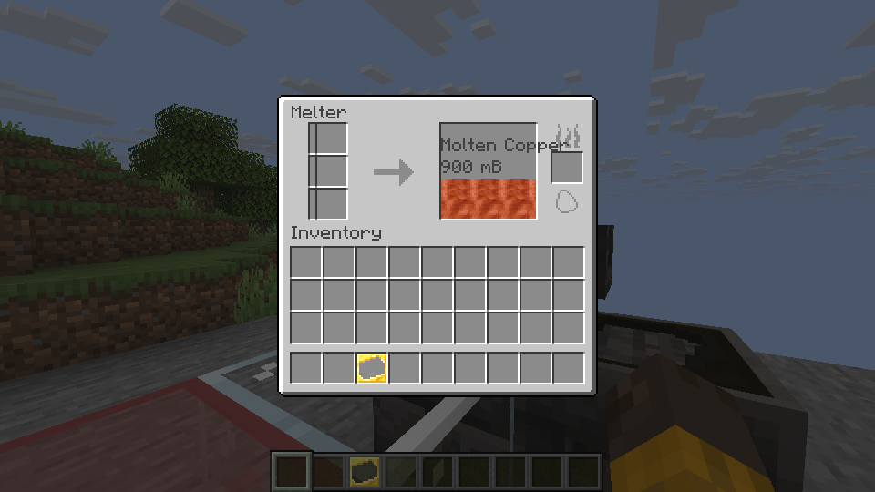

# Melting and casting

Use a Melter, a Seared Heater, a Faucet and a Casting Table or Basin to melt and cast supported materials. Place the heater directly below the Melter, and the faucet beside the Melter above the table or basin.

Open the Melter, put a supported fuel in the heater slot, and add material to the three input slots. For example, ten copper ingots produce 900 mB of molten copper.

The input slots are on the left, the heater slot is on the right, and the tank shows the stored liquid.

Place an ingot cast on the table, use the faucet, and wait for the copper ingot to cool. Use an empty basin to cast 900 mB into a copper block. Use the table or basin to collect the finished item.

The copper sequence, saving and reloading, and shared input and casting in LAN have been checked on Linux. Other materials and Windows have not received the same game checks.

The implementation uses the original recipes, the original Melter ore-rate defaults and the source fluid textures where available. Fluids without a retained source texture use a generic visible texture; animated fluid frames and the casting cooling fade are not yet implemented.

Fluid-container interactions, redstone control and specialized recipe types remain separate work. The larger Smeltery, Foundry and alloying are also separate. Machine collision shapes still need comparison with the source before they can be described as accurate.
