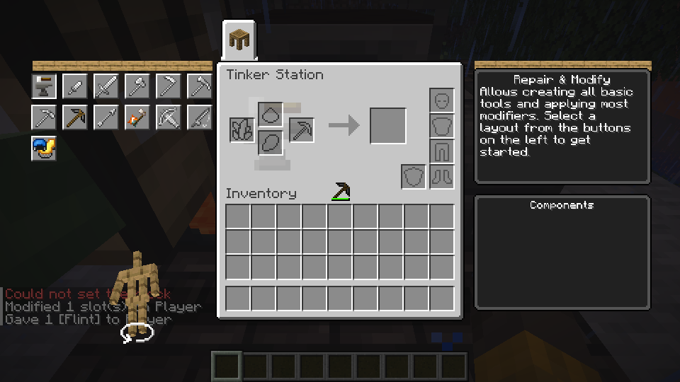
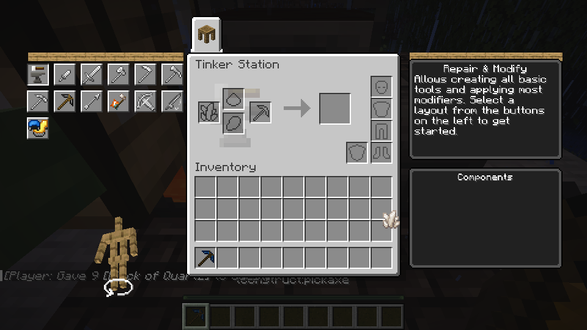

# Mining, durability and repair trait follow-up

Material mining, durability and repair traits use original Tinkers' Construct
revision `f4e77d43` with shared mining, wear and repair paths.

This unit covers the mining modules of Lightweight, Heavy, Vintage, Entangled,
Jagged, Stonebound and Maintained, plus Dense repair and durability prevention.
Overlord requires functional Overslime and remains unimplemented. Other modules
of these traits are not implied to be complete.

## Implementation and limits

Station and Creative regeneration store the original harvest-tagged tool's
Lightweight/Heavy/Vintage/Entangled stat and Jagged/Stonebound/Maintained levels on the item. A shared item boundary recognizes effective per-stack tool
rules for both the client and host; separate context hooks apply conditional
speed after mining efficiency and potion effects, before underwater/airborne
penalties. Materials and part swaps rebuild the stored values. Previously saved
tools need regeneration before these new fields are present.

Dense repair uses the original level ranges. Dense damage prevention rolls once
per durability point through the existing shared `durability_loss` path.
Original conditional wear formulas use the `multiply_all` durability multiplier;
the earlier melee calculation mistakenly included material percent and
`multiply_base` bonuses. The implementation corrects that multiplier for the existing
Jagged/Stonebound melee path too. Representative melee and repair regressions passed.

Original modifier priority runs Maintained before the percentage-based Jagged
and Stonebound effects; equal-priority effects retain source insertion order.
The synchronized custom tool data includes the generated mining rules because
the current network codec does not preserve the per-stack `minecraft:tool`
patch. Existing saved tools need a supported regeneration or part replacement
before the new fields are added. See [Harvest tiers and effective blocks](harvest-rules.md)
for representative tier, drop and LAN validation; not all tools and materials
have been individually tested.

## Representative Linux verification

The official Mixins `a2af5c0dd4117d51ecd70066ba7a00b4a2c10dab` transform
(173.42 seconds) and client/ctl build (134 seconds) passed. A temporary test
datapack placed the original trait IDs at selected levels on a flint head while
keeping the other tool materials identical. In the controlled stone test,
measured times included the same 5-tick post-break delay: baseline 18 ticks,
Lightweight level 2 at 17, Heavy level 2 at 15, Vintage level 2 at 22, and
Entangled at 10. Jagged level 3 changed from 18 fresh to 21 worn and 23 at damage 84/85; the broken tool was retained. Stonebound
changed from 18 to 17, and Maintained from 10 to 18. On dirt, a block ineffective
for the pickaxe, the baseline and Entangled both took 20 ticks.

Reversing material positions gave equal times for Maintained with Jagged (22
and 22 ticks) and Stonebound (17 and 17). Efficiency II was applied using a
test item modifier because the current vanilla enchant command rejected the
registered TConstruct item; with Haste and wear, baseline versus Jagged took
10 versus 11 ticks. A deterministic unit test also covers the operation order.
One Dense level 3 test prevented 10 of 12 wear points; after replacing that
head, four of four blocks caused ordinary wear. Dense reduced representative
repair from 51 to 42 durability restored. Jagged mining stayed at 21 ticks
before and after save/reload. A LAN guest mined stone in 7 ticks using a
command-supplied cobalt-head tool regenerated through the Station; ordinary
vanilla iron-pickaxe mining and the existing Jagged/Stonebound melee and
Cultivated/Preserved repair paths were also checked.

These are representative checks, not exhaustive tests of every material,
tool, effect combination or Windows. The selected mining traits' other modules,
applied mining modifiers, and Overlord/Overslime remain incomplete. Full
Mixins CI and independent review are still pending.

