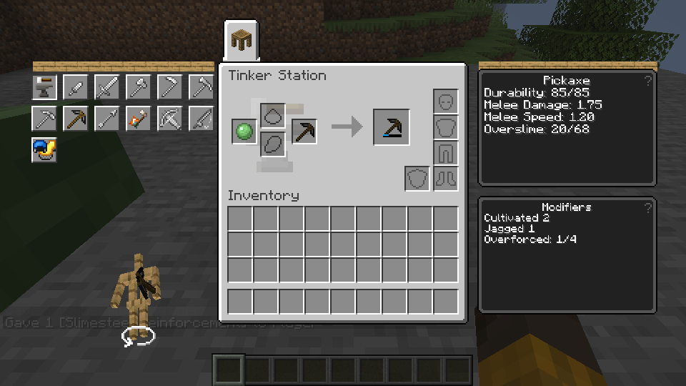

# Overslime and Overforced (in progress)

This Linux test used supplied ingredients and a supplied pickaxe.

The Station and both Anvils have an in-development path for applying and refilling Overslime using source slime ingredients. A slime ball restores 20 points for Earth, 50 for Sky, 60 for Ichor and 80 for Ender. Matching blocks restore more. The operation should consume only what fits and return empty bottles when a supported bottle is used.

Overforced uses four Slimesteel Reinforcements per level, up to five levels, with an upgrade slot for each started level. Partial progress contributes capacity. A Modifier Crystal carries one full level and retains any partial progress when extracted. The source recipe casts a consumed Obsidian Pane with 30 mB of molten Slimesteel on a Casting Table. The source alloy uses molten iron, Sky Slime and seared stone.

The added shield is spent before ordinary durability on the connected tool, armor and ranged wear paths. Overslime without a friendly modifier has source stat penalties; Overforced is a friend. The durability bar has a blue shield display while shield remains. The Glowing modifier and its special bypass are not implemented.

The source Casting Table recipe fills a glass bottle with 250 mB of the matching slime fluid. The four bottle items and their original artwork are registered, and the source Sky bottle casting recipe is covered by a lightweight catalog test. The container interface transfers 250 mB in either direction. Ichor bottles have the source drinking time, glass return, Levitation and Slowness. Earth, Sky and Ender drinking remains unimplemented because their source effects are not yet connected.

The crafting-table refill has representative Linux normal-click and shift-click checks, including unused bottle and empty bottle returns. Shift-click was also checked for a LAN guest, with supplied tool and bottles.

Linux tests with supplied ingredients checked a Station's partial Overforced application and Overslime refill (20/68), plus shield consumption ahead of Unbreakable on a pickaxe and two armor pieces. A LAN guest test checked both armor pieces and their shield changes. This is not yet a verified survival route: the source Slimesteel acquisition and casting chain and broader equipment and station coverage remain under test. The source traits and modifier effects outside these paths remain incomplete.
