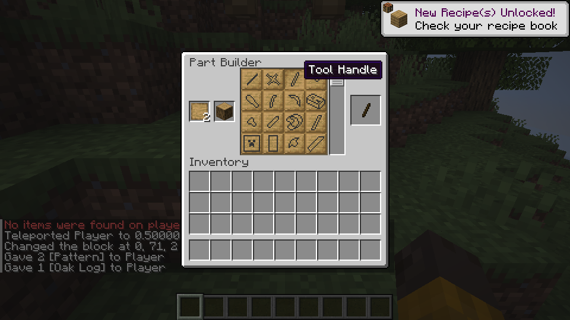
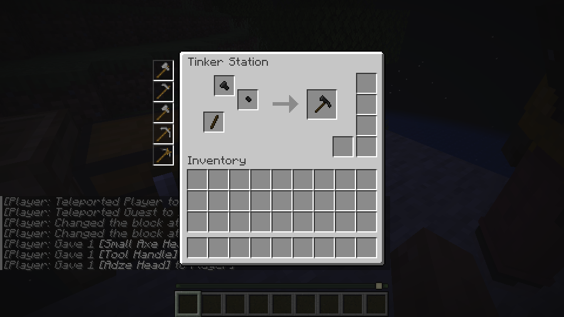

# Making parts and tools

Use a Part Builder to make parts, then assemble supported tools at a Tinker Station. The examples below were tested on Linux; the Windows launcher and gameplay remain unverified.

## Make a tool handle

In a creative test world, use the chat to get a Part Builder, patterns, and wood:

```text
/give @s tconstruct:part_builder 1
/give @s tconstruct:pattern 8
/give @s minecraft:oak_log 1
```

Place and open the Part Builder. Put a pattern and the log in the two input slots on the left. Choose **Tool Handle** in the middle, then take the handle from the result slot on the right.



*Choose Tool Handle in the middle; the handle appears on the right.*

## Assemble a tool

At a Tinker Station, select a supported tool and place its required parts in the input slots. Take the result from the output slot. A pickaxe made with a flint head and wooden parts has been tested through use, repair, head replacement, and saving on Linux.



*Select a tool to see its part layout. This example shows a mattock in a Linux LAN test.*

Tool-specific behavior, material traits, modifiers, and many recipes are still incomplete. Some test materials shown in development screenshots were supplied by commands or test data and may not yet be obtainable through normal gameplay.
