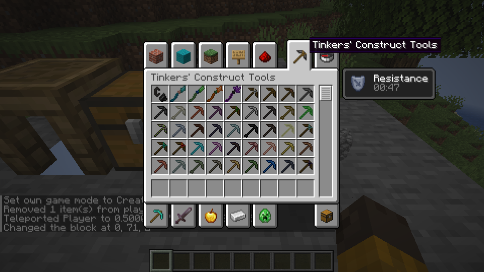
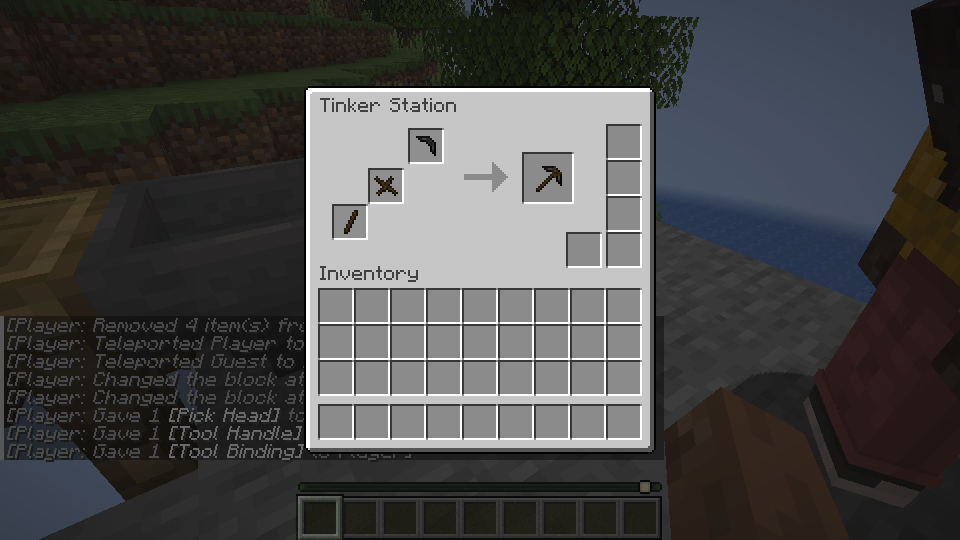
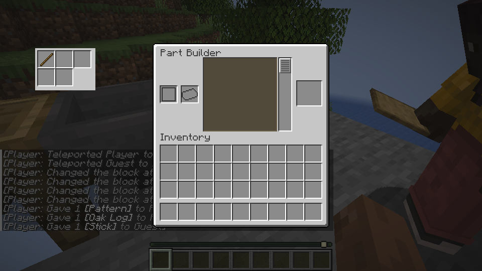
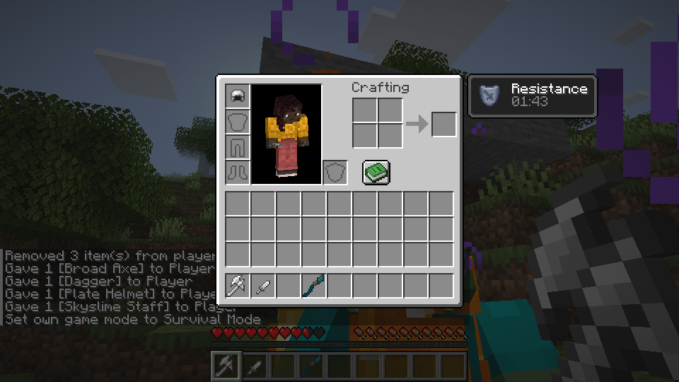
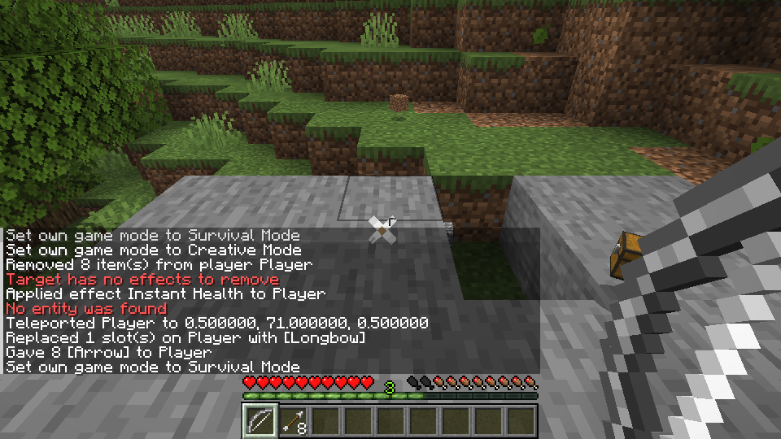

# Making parts and tools

Use a Part Builder to make parts, then assemble supported tools at a Tinker Station. The examples below were tested on Linux; the Windows launcher and gameplay remain unverified.

## Browse equipment in Creative

Open your Creative inventory and select the pickaxe tab at the top. Choose an item from the grid to put it on your cursor, then place it in your inventory. Scroll the grid to see more equipment and material variants.



*Select the pickaxe tab, then click an item in the grid. This image is from a Linux test.*

A wood pickaxe obtained here was tested for mining on Linux; a Plate Helmet was obtained and placed in the head slot. Many other tools and armor variants are registered for display, but their material stats and individual actions are still incomplete. Windows remains unverified.

## Make a tool handle

In a creative test world, use the chat to get a Part Builder, patterns, and wood:

```text
/give @s tconstruct:part_builder 1
/give @s tconstruct:pattern 8
/give @s minecraft:oak_log 1
```

Place and open the Part Builder. Put a pattern and the log in the two input slots on the left. Choose **Tool Handle** in the middle, then take the handle from the result slot on the right.


*Choose Tool Handle in the middle; the handle appears on the right.*

## Assemble a tool

At a Tinker Station, select a supported tool and place its required parts in the input slots. Take the result from the output slot. A pickaxe made with a flint head and wooden parts has been tested through use, repair, head replacement, and saving on Linux.


*Select a tool to see its part layout. This example shows a mattock in a Linux LAN test.*

Tool-specific behavior, material traits, modifiers, and many recipes are still incomplete. Some test materials shown in development screenshots were supplied by commands or test data and may not yet be obtainable through normal gameplay.

## Repair or replace a part

Open a Tinker Station and place a damaged supported tool and its repair material in the input slots. Take the repaired result. To replace a part, put the tool and a compatible replacement part in the station and take the result. A flint pickaxe repaired with flint and then given a wooden head has been tested on Linux.



*In this Linux LAN example, the station previews a pickaxe assembled from parts.*

## Use nearby storage

A Part Builder can show a connected container alongside its own slots. You can move items between the displayed storage and the station. A single chest, hopper, dispenser, and double chest were tested on Linux; the exact available operations depend on the container.



*The hopper's five slots appear beside the Part Builder inputs in this LAN example.*

## Other equipment

The resource preparation now registers additional source equipment IDs. A Linux test obtained a Broad Axe, Dagger, Plate Helmet, and Skyslime Staff with commands, displayed their icons, and placed the helmet in the head slot. Other acquisition paths, equipment behavior, and worn armor appearance remain incomplete or unverified. Materials, traits, modifiers, and tool-specific actions are still in development.



*In this Linux test, the Plate Helmet is in the head slot. The axe, dagger, and staff icons are in the hotbar.*

## Use a longbow

Hold the use button to draw a longbow, then release it to fire an arrow. Keep arrows in your inventory. Switching to another item before releasing cancels the shot.



Basic firing was tested on Linux. Material-specific draw speed, arrow speed and accuracy are not implemented yet.
