# Making parts and tools

Use a Part Builder to make parts, then assemble supported tools at a Tinker Station. The examples below were tested on Linux; the Windows launcher and gameplay remain unverified.

## Browse equipment in Creative

Open your Creative inventory and select the pickaxe tab at the top. Choose an item from the grid to put it on your cursor, then place it in your inventory. Scroll the grid to see more equipment and material variants.

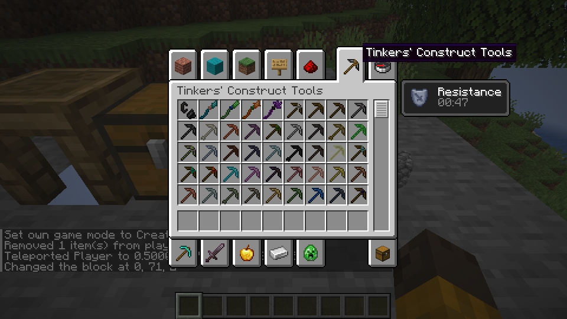

*Select the pickaxe tab, then click an item in the grid. This image is from a Linux test.*

A wood pickaxe obtained here was tested for mining on Linux; a Plate Helmet was obtained and placed in the head slot. Many other tools and armor variants are registered for display, but their material stats and individual actions are still incomplete. Windows remains unverified.

## Browse blocks in Creative

Open the Creative inventory and select **Tinkers' Construct Blocks** in the bottom row. Click a block to take it, then place it in your inventory. Scroll the grid to see more registered blocks.

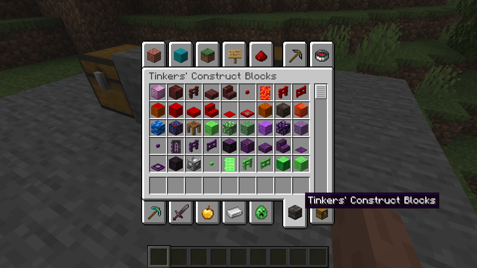

*The block tab is selected in this Linux test. Click a block in the grid to take it.*

The selection includes building blocks, slimewood shapes, and some workstation appearances. Some source behaviors are still missing; see [block registration](block-registration.md) for details.

## Place a workstation

Place a Part Builder or Tinker Station on the ground and open it to work with parts. The space between its legs stays open, so you can see the floor beneath it.

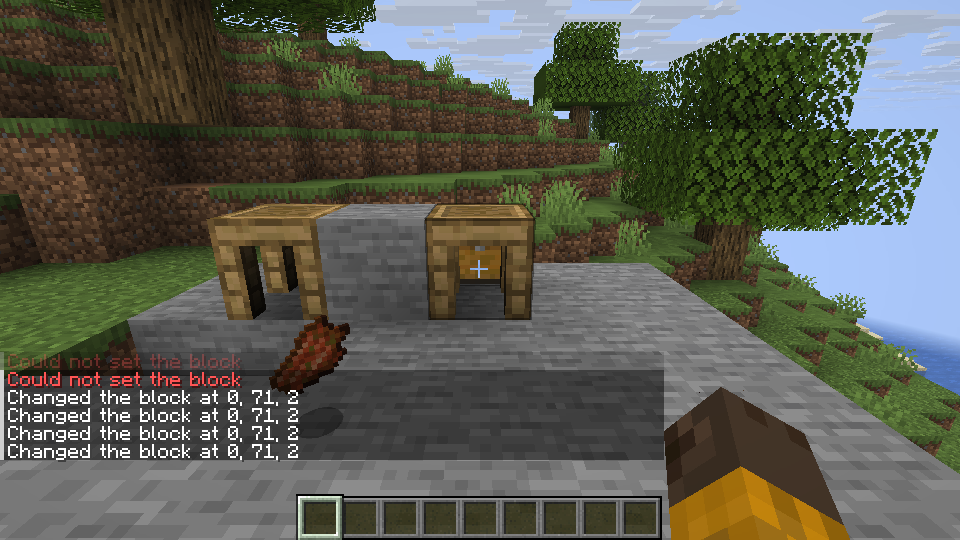

*The Tinker Station on a stone floor in a Linux test.*

## Make a tool handle

In a creative test world, use the chat to get a Part Builder, patterns, and wood:

```text
/give @s tconstruct:part_builder 1
/give @s tconstruct:pattern 8
/give @s minecraft:oak_log 1
```

Place and open the Part Builder. Put a pattern and the log in the two input slots on the left. Choose **Tool Handle** in the middle, then take the handle from the result slot on the right.

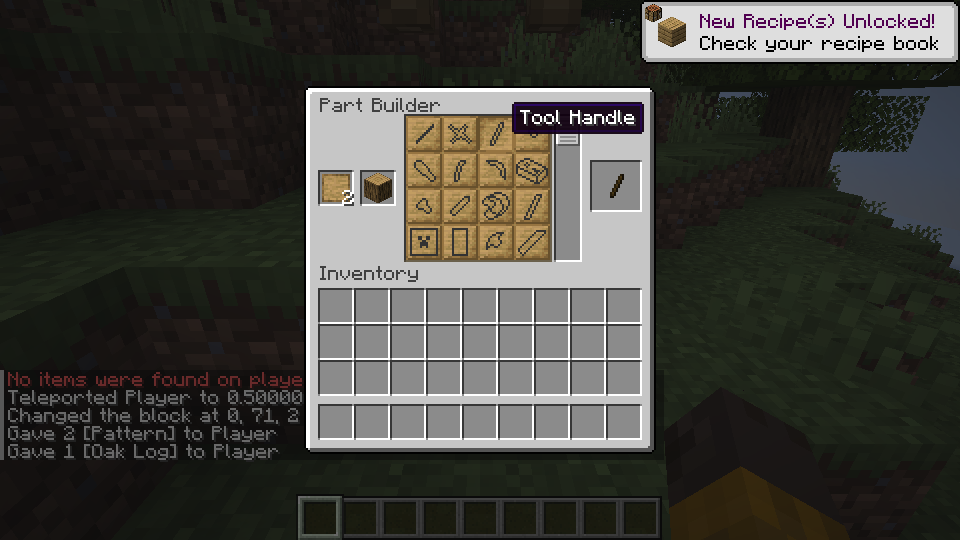

*Choose Tool Handle in the middle; the handle appears on the right.*

## Assemble a tool

At a Tinker Station, select a supported tool and place its required parts in the input slots. Take the result from the output slot. A pickaxe made with a flint head and wooden parts has been tested through use, repair, head replacement, and saving on Linux.

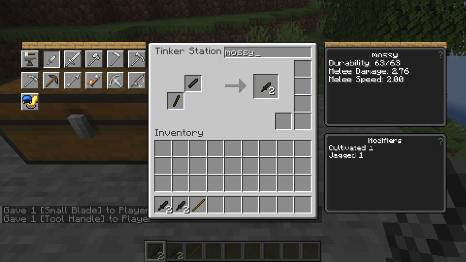

*Select a tool on the left and place its parts in the shown slots. For a new tool, enter an optional name above the result. This Linux example makes two daggers.*

Tool-specific behavior, material traits, modifiers, and many recipes are still incomplete. Some test materials shown in development screenshots were supplied by commands or test data and may not yet be obtainable through normal gameplay.

## Repair or replace a part

Open a Tinker Station and place a damaged supported tool and its repair material in the input slots. Take the repaired result. To replace a part, put the tool and a compatible replacement part in the station and take the result. A flint pickaxe repaired with flint and then given a wooden head has been tested on Linux.

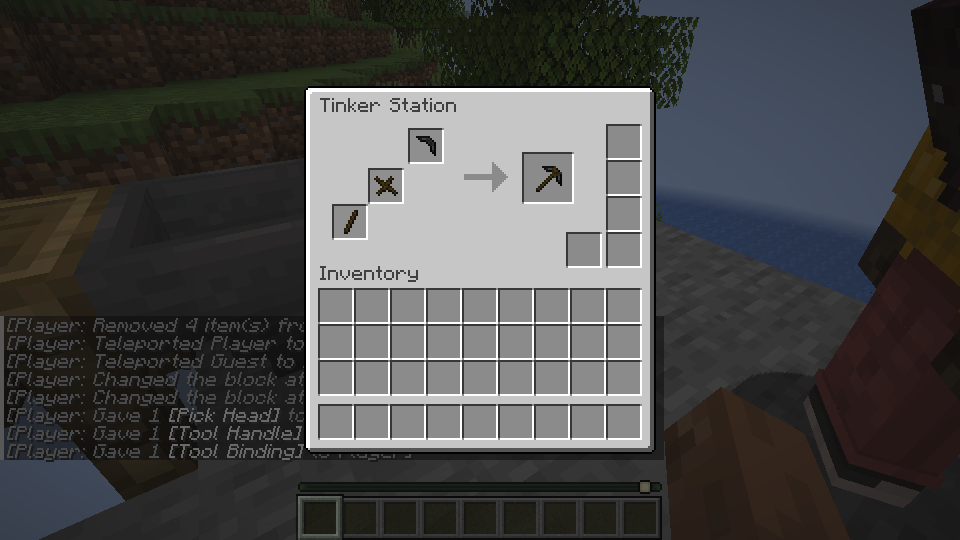

*In this Linux LAN example, the station previews a pickaxe assembled from parts.*

## Use nearby storage

A Part Builder can show a connected container alongside its own slots. You can move items between the displayed storage and the station. A single chest, hopper, dispenser, and double chest were tested on Linux; the exact available operations depend on the container.

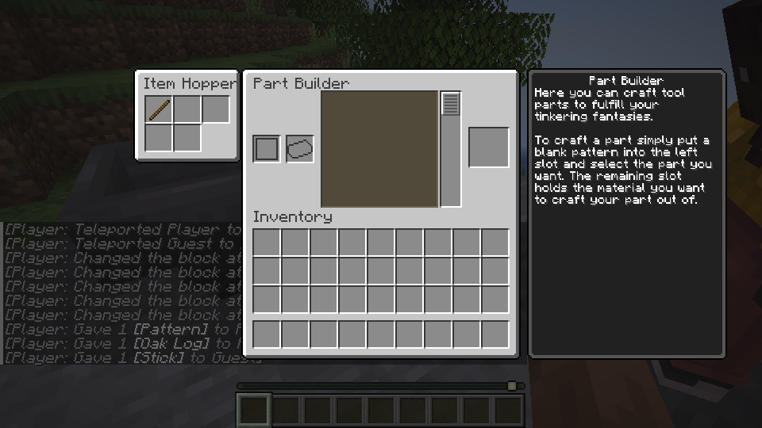

*The hopper's five slots appear beside the Part Builder in this Linux LAN example.*

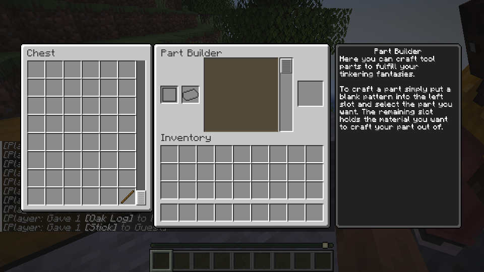

*Use the scrollbar beside a double chest to reach its last row. The panel on the right explains the selected part or material.*

## Other equipment

The resource preparation now registers additional source equipment IDs. A Linux test obtained a Broad Axe, Dagger, Plate Helmet, and Skyslime Staff with commands, displayed their icons, and placed the helmet in the head slot. Material armor mitigates damage and loses durability when hit; a broken piece stays in its slot but provides no armor or toughness until repaired at a Tinker Station. Representative repair, fire and LAN cases are described in [material armor damage and repair](armor-durability.md). Other acquisition paths, unique equipment effects, and worn armor appearance remain incomplete or unverified. Materials, traits, modifiers, and tool-specific actions are still in development.

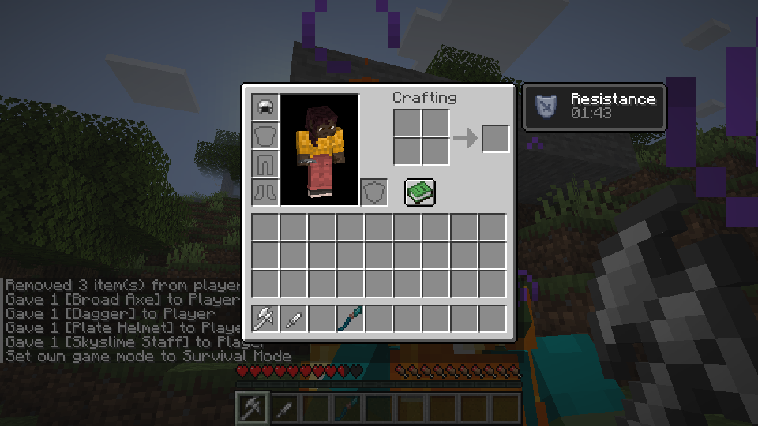

*In this Linux test, the Plate Helmet is in the head slot. The axe, dagger, and staff icons are in the hotbar.*

## Use a longbow

Hold the use button to draw a longbow, then release it to fire an arrow. Keep arrows in your inventory. Switching to another item before releasing cancels the shot.

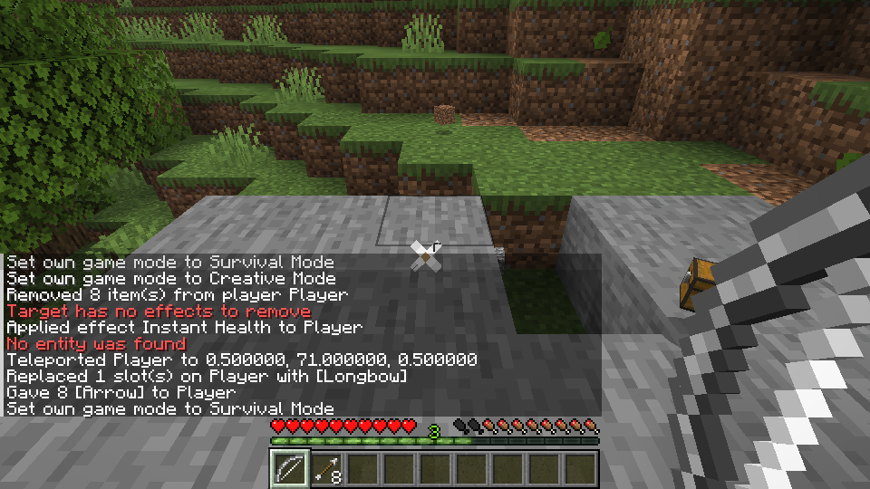

Material draw speed, arrow speed and accuracy affect Longbow shots. Representative shots, wear, repair and LAN use were tested on Linux; see [material projectile stats](projectile-stats.md) for the limits.

## Use a crossbow

Hold the use button to load an arrow, release the button, then press it again to fire. Different limb materials change how quickly the crossbow loads. Switching items before it is loaded cancels the charge.

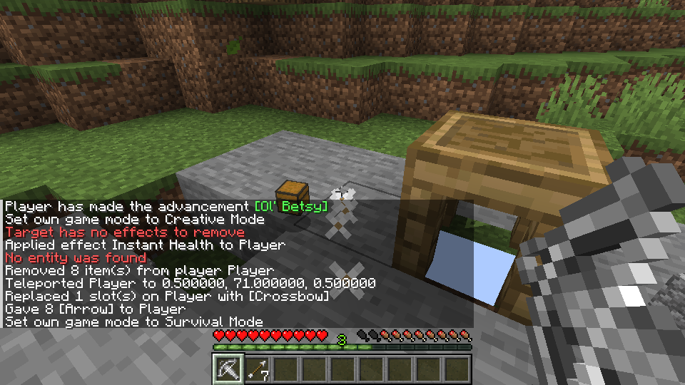

Crossbow arrows use material projectile speed and accuracy. Loading, firing, a three-arrow fan and a limb replacement were tested on Linux; firework rockets do not yet use these material stats.

Material bows lose durability when fired in survival. A broken bow stays in your inventory and cannot fire until repaired with a matching limb material at a Tinker Station. Creative firing does not consume durability. These behaviors were tested on Linux using command-supplied wood-material bows.

## Material traits

The materials used for a tool affect its traits. Wood's Cultivated trait increases material repair; treated wood's Preserved trait increases repair and maximum durability. Steel's Ductile trait increases durability, melee damage, and armor toughness. Flint's Jagged trait increases melee damage as the tool wears; stone's Stonebound trait reduces it as the tool wears. Replace a part at the Tinker Station to change the traits contributed by that part.

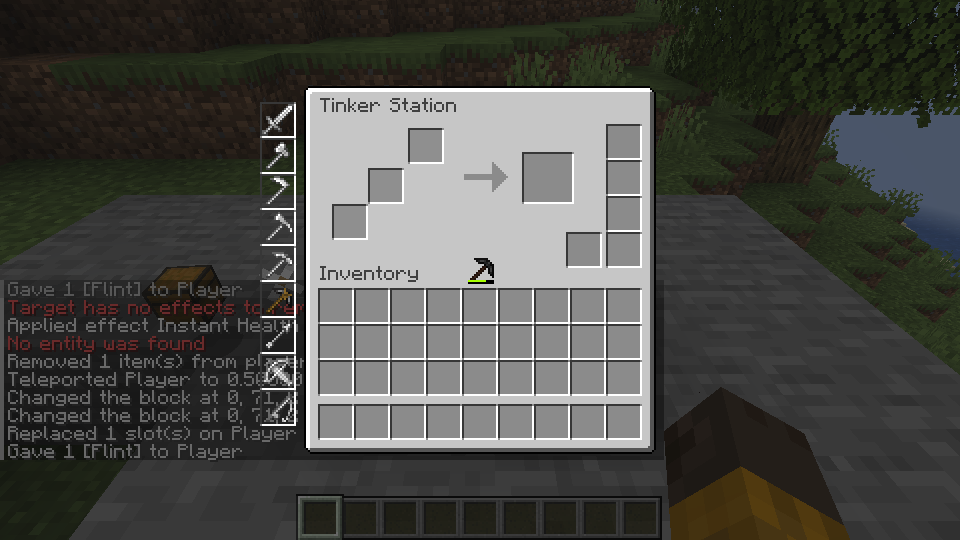

These effects were tested on Linux; some station tests used temporary test data. Previously saved tools do not automatically update their maximum durability or stat bonuses: rebuild the tool or replace a part to recalculate them. Representative mining effects of Jagged, Stonebound, Lightweight, Heavy, Vintage, Entangled and Maintained, plus Dense repair and wear reduction, were tested on Linux. Ductile projectile damage and other material trait modules remain incomplete. See [Mining and durability traits](mining-traits.md).

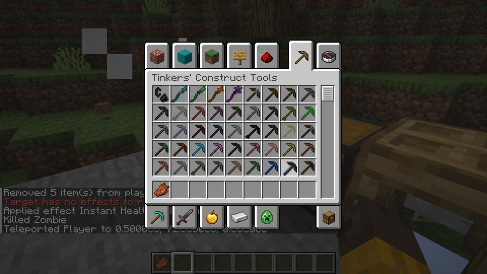

The Creative tab offers material variants for inspection. Some materials may not yet be obtainable during normal play.

## Upgrade a tool

Place a tool in the Tinker Station. Add quartz shards or quartz blocks for Sharpness, or amethyst shards or amethyst blocks for Swiftstrike, then take the result. A partial set of materials makes partial progress and uses an upgrade slot. A new level needs another slot. Excess material from a block is returned as shards.

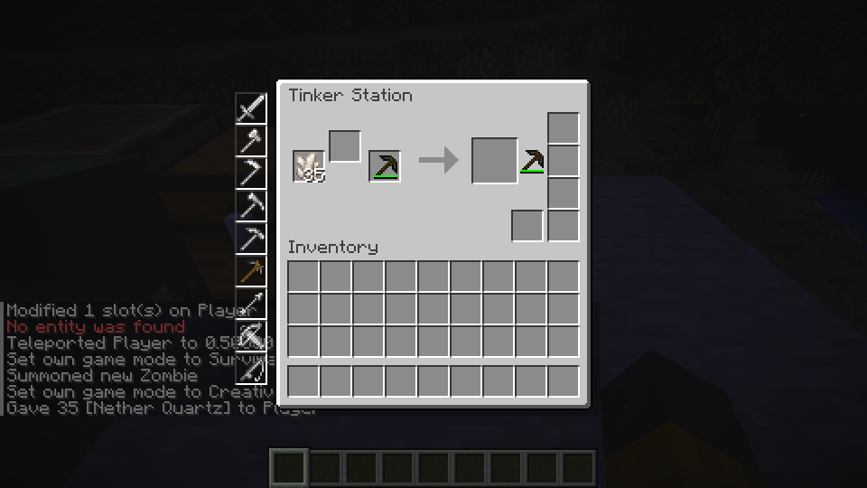

Put the tool and material in the input slots, then take the result on the right.

Sharpness needs 36 quartz per level, Swiftstrike needs 72 amethyst shards, and Haste needs 45 redstone dust. Blocks add multiple units and return unused material. Haste increases mining speed on harvest tools and chestplates. Partial additions use an upgrade slot.

### Early Smeltery crafting

Combine a clay ball, sand and gravel for two Grout, then smelt Grout into Seared Bricks. Four Seared Bricks make a Seared Bricks block. Use individual bricks and glass to craft an empty Seared Fuel Gauge, and combine the gauge with bricks to make a Melter. A Seared Heater beneath it supplies solid fuel. Craft a Seared Faucet and Casting Basin to pour the melted metal.

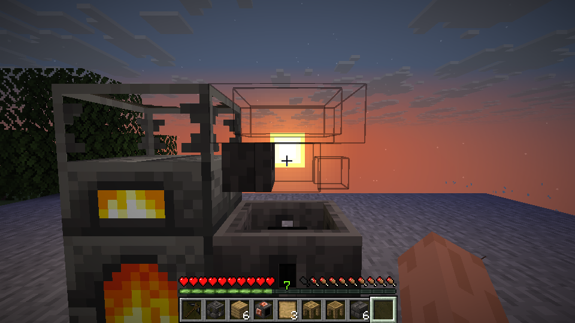

On Linux, a representative game test crafted the early equipment and cast a Controller using the preceding outputs; a LAN guest supplied the Melter inputs. The same equipment then produced Rose Gold blocks for a crafted and placed Tinkers' Anvil. The test recovered one mistakenly cast Copper Block with the vanilla recipe and refilled the Smeltery fuel before continuing. Vanilla raw materials, fuel, furnace and crafting table were test fixtures, and processing time was accelerated.

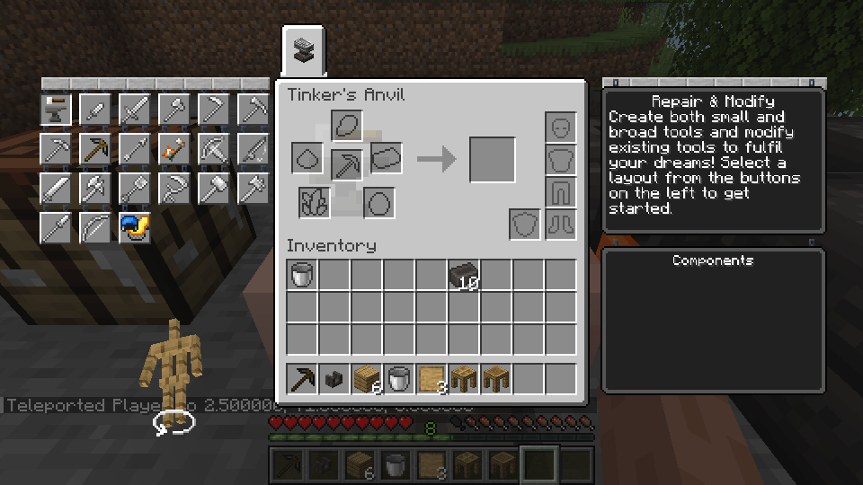

Cast molten copper over a Seared Bricks block in a basin to make a Smeltery Controller. This first implementation accepts the ordinary Seared Bricks cast; the original's other controller textures are not yet supported. A Smeltery can alloy copper and gold into Rose Gold for the blocks used in an Anvil. Nether Grout can be made from magma cream, gravel and soul sand or soul soil, then smelted into Scorched Bricks for the Scorched Anvil.


### Nether Cobalt

The in-development Cobalt ore generates in new Nether chunks, embedded in Netherrack. An iron-tier or stronger pickaxe can mine it for Raw Cobalt; Silk Touch retains the ore. A blast furnace can process the ore or raw material into Cobalt ingots, and Cobalt Shards into nuggets. A representative Linux run found and mined naturally generated ore in a newly generated Nether area using an iron pickaxe, then blasted the recovered raw Cobalt into an ingot. The test used a supplied pickaxe, blast furnace and coal; mining access was cleared in creative mode. A combined run also used natural Cobalt to cast parts and assemble a tool; see [Casting metal parts](#casting-metal-parts).

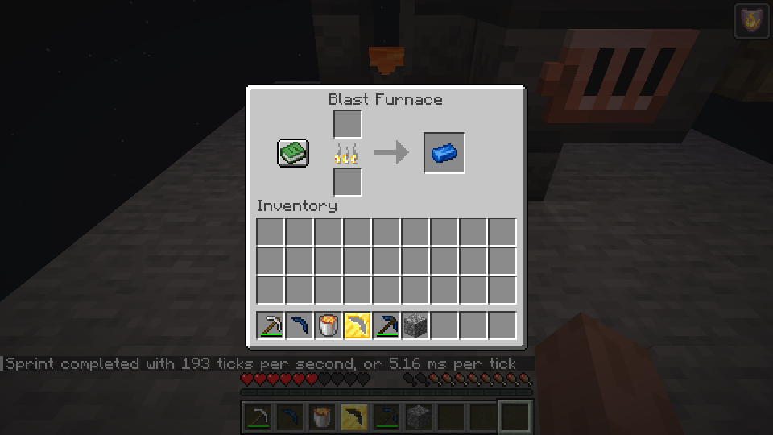

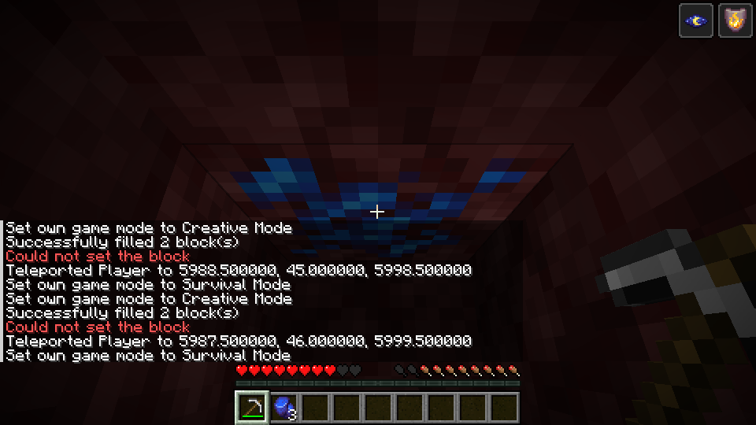

### Casting metal parts

Make a part-shaped cast, place it on a Casting Table, and pour an appropriate molten material into it. The source recipe determines the amount and resulting material. A gold cast is reusable; a sand cast is consumed.

A representative Linux run made a wooden Pick Head in the Part Builder, cast its reusable gold mold, and used naturally mined Cobalt to cast Pick Heads with both gold and sand molds. A Cobalt-headed pickaxe assembled at a Tinker Station remained usable after reload; a LAN guest saw its material in the Station. The Smeltery, fuel, gold, wood, pattern, blank sand cast and other tool parts were supplied as fixtures, and processing ticks were accelerated. A separate ordinary copper casting with a full inventory dropped its output on the ground. Composite material fluids and unsupported material predicates remain unavailable.

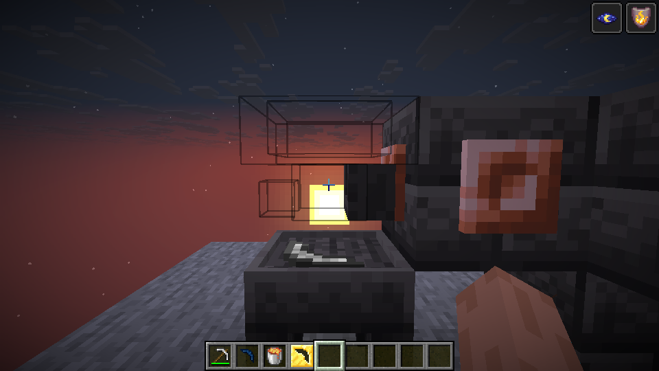

### Reinforced

Melt obsidian and cast an Obsidian Pane, then cast molten emerald over the pane to make an Emerald Reinforcement. Four reinforcements make one Reinforced level; partial progress uses an upgrade slot. Ordinary tool, armor and ranged weapon wear can be prevented. Extract and reapply Reinforced with a Modifier Crystal. Glowing and its modifier-caused wear are not implemented.

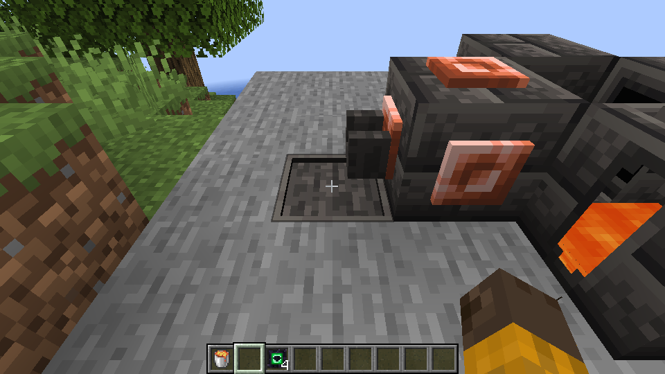

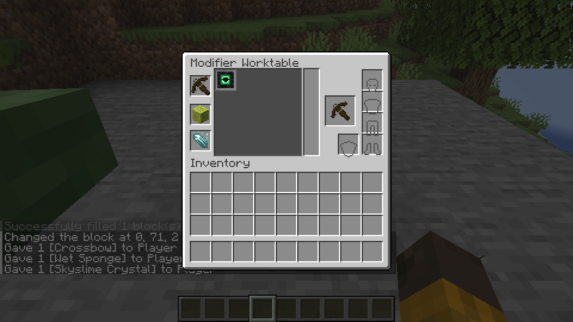

### Gem upgrades

Put one diamond or emerald with a compatible durable tool at a Tinker Station or Anvil. Each upgrade uses one upgrade slot and cannot be applied twice. A Modifier Worktable can extract the upgrade into a Crystal for another compatible tool.

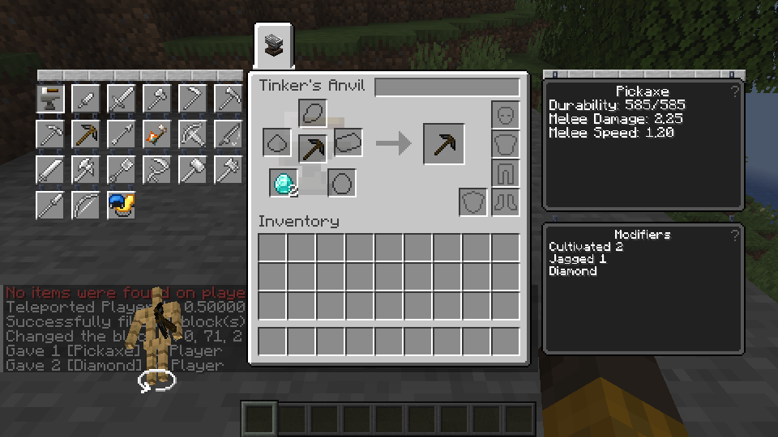

Representative Linux checks covered both gems on a pickaxe, duplicate and full-slot rejection, Crystal round trips and LAN guest application. Diamond improved a flint pickaxe's harvest tier and its arrow damage on a Crossbow. Emerald increased a sample repair amount and an armor helmet's toughness; a conditional mining test used temporary source-trait test data. A five-shot Longbow accuracy comparison is a small sample. Diamond armor wear and broken retention were also checked using a near-broken test fixture.

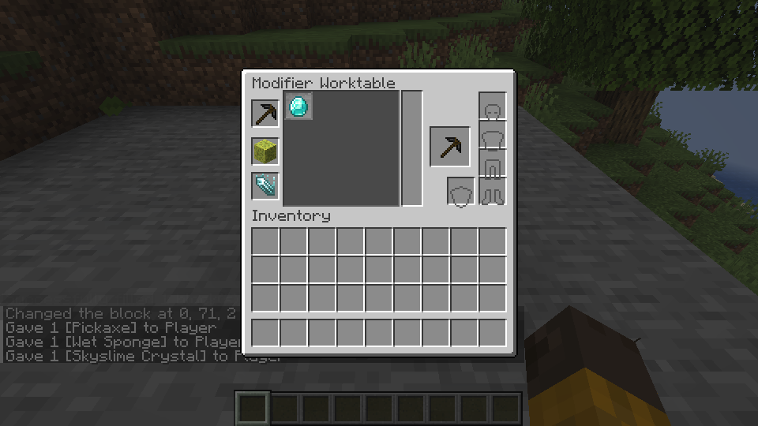

The advancement system and Emerald's conditional attack traits are not implemented. Other ranged tools and fireworks remain unsupported; Windows has not been tested.

The in-development ranged upgrades use magma cream for Quick Charge on Crossbows and target blocks for Trueshot on Longbows and Crossbows. Their partial levels and crystals use the same slots and Worktable flow. Linux tests covered both upgrades on a Crossbow at the Station and both Anvils, save and reload, Quick Charge crystal extraction and reapplication, and LAN guest Trueshot progress and ingredient recovery. Crossbow loading was faster after reapplying Quick Charge. A Longbow retained Trueshot after reload, and its measured lateral arrow velocity decreased between Trueshot I and II in a three-shot sample. Trueshot Crystal reapplication with partial progress was checked on all three stations. Wider spread sampling remains useful. Staffs, fishing rods and other ranged tools are not yet supported by this path.


## Netherite and Unbreakable

Netherite takes one Netherite Upgrade Smithing Template and one Netherite Ingot with a durable tool in a Tinker Station or either Anvil. It consumes one upgrade slot. The original modifier improves durability, mining, melee, armor toughness and knockback resistance, and Longbow/Crossbow projectile speed where those stats apply. A Netherite tool retains the original rare rarity and dropped-item protection in the supported paths.

To gain upgrade slots, use the source Writable (Writable Book), Harmonious (music disc), Forecast (diamond, emerald or Cobalt ore), and Recapitated (a non-dragon head) recipes on eligible equipment. Each adds one upgrade slot. Draconic, made with a Dragon Head, adds an ability slot; this is particularly useful for armor, which starts without one. These recipes follow the source equipment tags and one-time limits.

Unbreakable takes two Shulker Shells, Dragon's Breath and two Netherite Ingots in an Anvil. It requires Netherite and **five completed levels** of Reinforced and consumes an ability slot. The empty Dragon's Breath bottle is returned. Normal tool, armor and bow wear is prevented; the original modifier-caused bypass still applies. Glowing, the current bypass cause, is not implemented.

Both modifiers support extraction into and application from a Modifier Crystal. While Unbreakable remains on a tool, removing Netherite or enough Reinforced to invalidate its prerequisites is rejected; remove Unbreakable first. A Crystal uses one input slot, so it can be applied at a Station when the requirements and slots are met.

This branch has lightweight recipe and stat checks only. The new recipes, rarity, dropped-item protection, effective mining and combat, persistence and LAN have **not yet been verified in the game**. Advancement criteria remain unimplemented; other equipment and modifiers still have the limits described below.

## Extract a modifier

Craft a Modifier Worktable with seared blocks and matching source rock. Its legs retain the rock texture. Add a tool, a Skyslime Crystal and a wet sponge, then select a completed Sharpness, Swiftstrike or Haste level. Take the tool to receive the modifier crystal and a sponge. A partial level alone cannot be extracted.

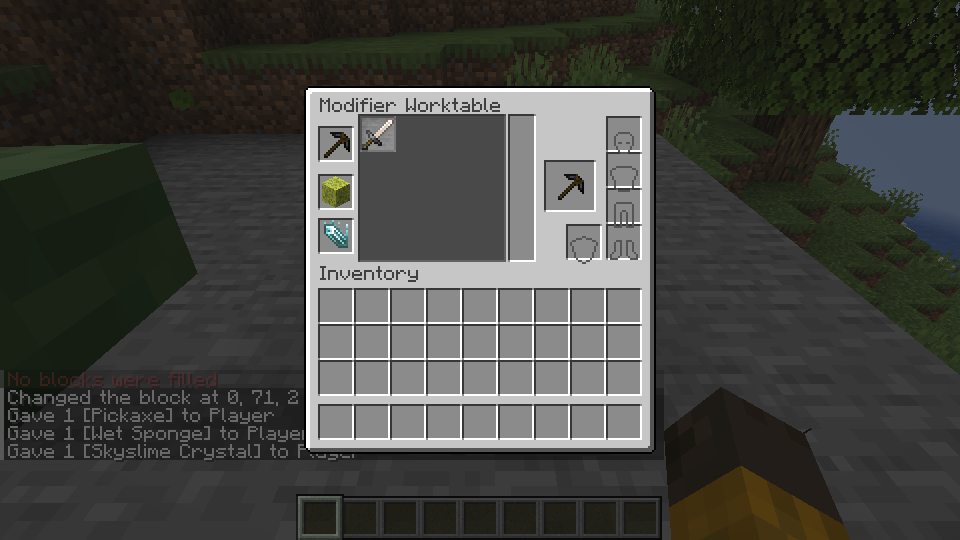

Apply one matching modifier crystal at a Station or Anvil to add a level. This uses a slot and preserves any partial progress already on the tool. The recipe, extraction and LAN guest flow have representative Linux tests; other modifiers remain unfinished.

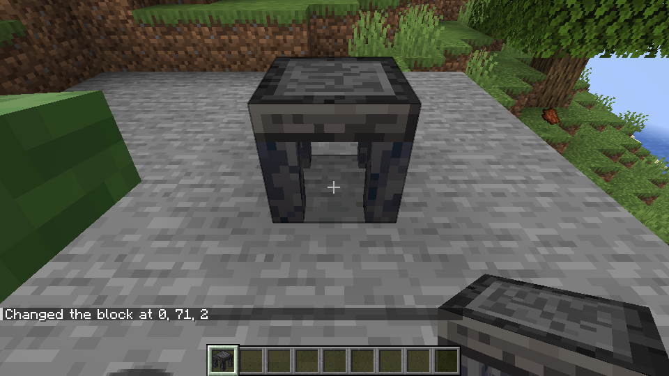

The Smeltery fuel gauge shows the available fuel. Hover over it for the fluid, temperature and amount; the small bar beside an input shows its heating state.

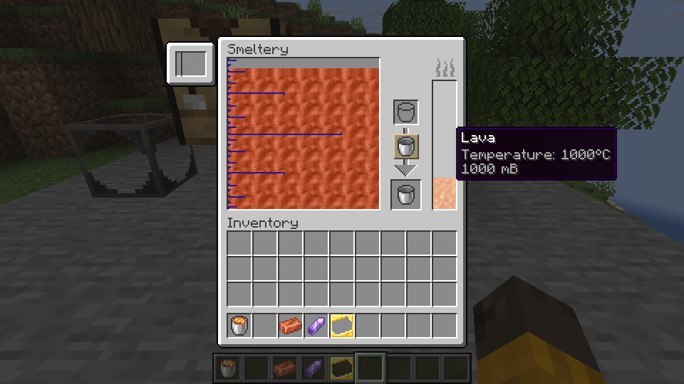

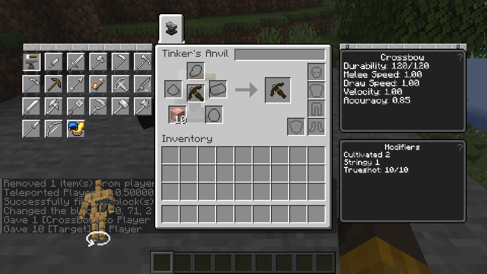

### Skyslime Crystals

Find Sky Geodes underground in newly generated overworld land, away from oceans, rivers and beaches. Mine a fully grown Skyslime Crystal Cluster with a pickaxe to obtain crystals; they work in the Modifier Worktable. Existing generated chunks do not gain new geodes. The budding blocks and smaller buds do not yet grow, so collect the clusters already present. Earthslime Geodes appear underground across the Overworld, Ichor Geodes high in the Nether, and Enderslime Geodes in the outer End. Their crystals can be made into crystal blocks or processed in a blast furnace. Earthslime crystals can also make an Arrow Head in the Part Builder. A representative Linux test covered these uses; crystal regrowth, many material traits and full world progression remain unfinished.

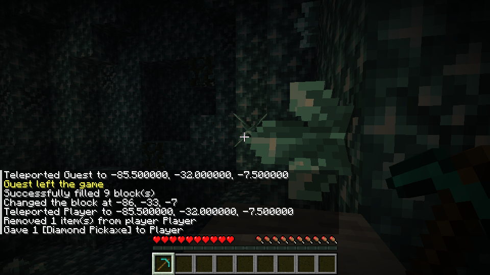

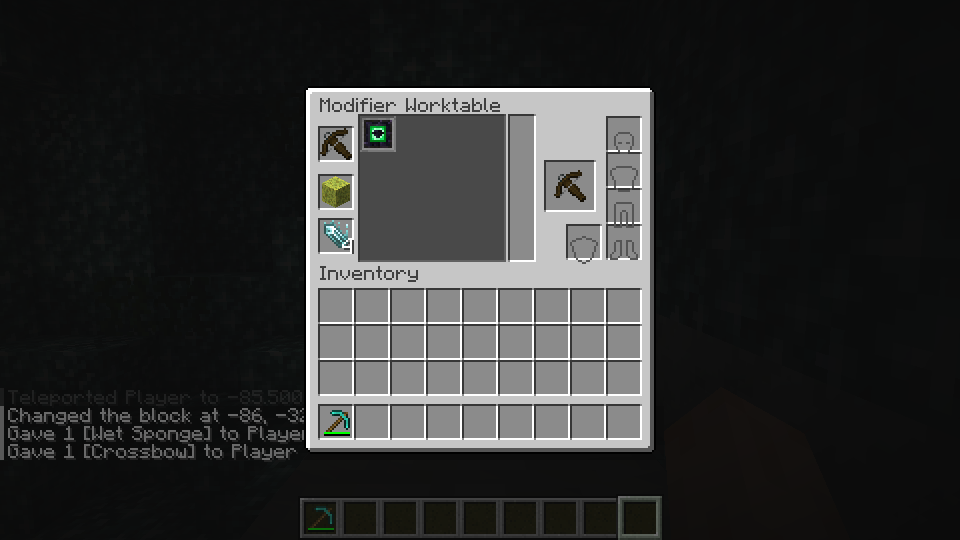

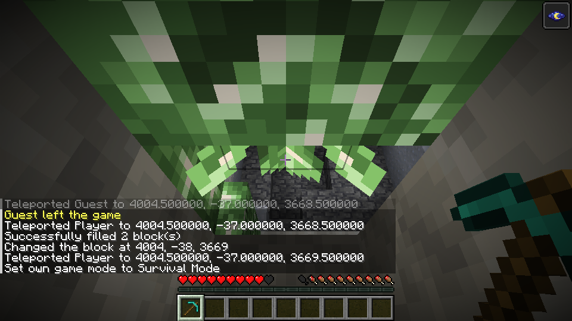

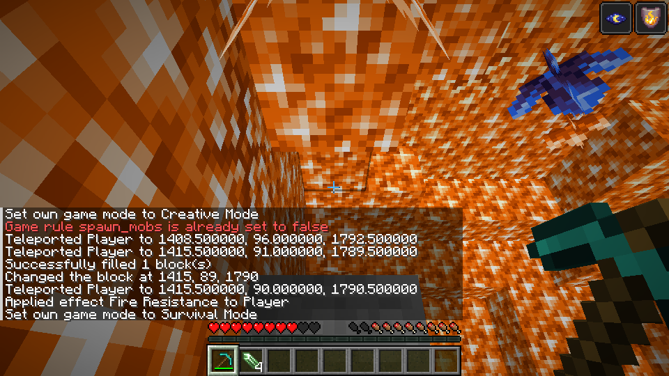

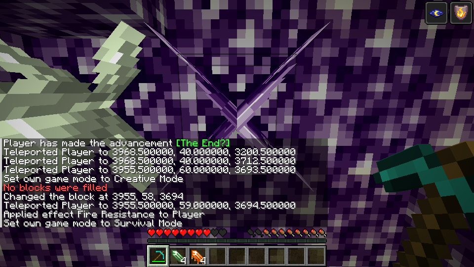

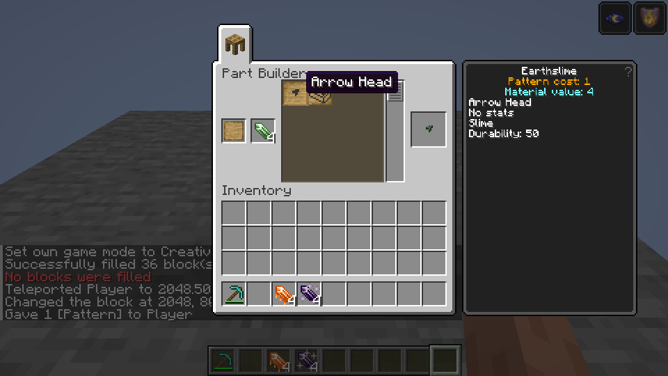
