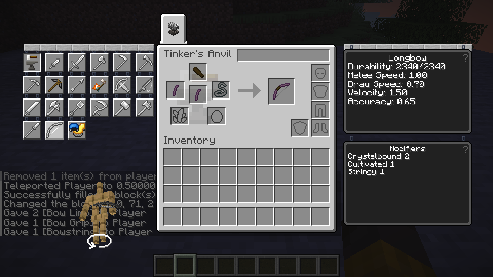

# Ranged material traits (in progress)

This unit connects source effects to the existing Longbow and Crossbow paths. The combined stat and firing arithmetic has lightweight tests and representative Linux game checks below.

| Trait | Source ranged stat effect per level |
| --- | --- |
| Lightweight | +0.03 draw speed and +0.03 velocity |
| Heavy | +0.10 accuracy |
| Featherweight | +0.05 draw speed and +0.05 accuracy |
| Entangled | +0.15 draw speed, once |
| Vintage | multiply total draw speed by `1 - 0.1 × level` |
| Crystalbound | +0.10 velocity for ranged tools and quantized horizontal arrow launch angle |
| Ductile | +0.25 projectile damage |

The source material data assigns these traits to Cobalt, Lead, Aluminum, Twisting Vine, Ancient, Amethyst Bronze (ranged parts) and Steel respectively. Some are compatibility or later-game materials; their natural acquisition is not established by this change.

These are selected modules, not the complete modifiers. Entangled damages the holder on actual equipment removal, including while not drawing; releasing an arrow alone is not removal. The pinned host's main-hand hotbar selection and inventory replacement paths do not share the existing armor/offhand equipment callback, so the authoritative local and LAN unequip paths still need a common safe hook. Crystalbound's sling and knockback angle restrictions, armor and movement effects, ammunition-specific effects and unsupported source tools remain open. Source: TConstruct revision `f4e77d43f39ba1047bf93ae816b7e1beaab514c2`, `ModifierProvider.java`, `DamageOnUnequipModule.java` and `RestrictAngleModule.java`.

Assembly and part replacement rebuild draw speed, velocity, accuracy and projectile damage from the material base and source trait levels. Existing Quick Charge, Trueshot, Diamond, Emerald and Netherite are applied in the same stat calculation; the resulting values feed draw timing and arrow creation. Existing saved bows must be rebuilt before these new values are present.

Official Mixins `ddd9700b21997c95d95ac6ee5ecafe3830cf622a` plan and transformation succeeded for runtime `9412c7068d41a81fdf3600ae1594d8965eb4dcf1`, and the Linux client/control build passed. The later merge commit `a61b11e5b7a237ab6718c22bbe86fe6fbe59ec50` has an identical tree. The ranged Rust harness passed 33 tests; this is representative validation, not every trait or platform.

In one reused test world, supplied Amethyst Bronze limbs, wood grips and string bowstrings were assembled into a Crossbow at a Station and a Longbow at an Anvil. Their actual shots were restricted to the expected source angles. A supplied wood Crossbow with its limb replaced by Cobalt changed measured arrow speed from approximately 2.838 to 3.129; its replacement stats survived save/reload. Quick Charge and Trueshot were separately applied to a supplied Amethyst Bronze Crossbow and retained its Crystalbound value; Trueshot survived reload. The parts and starting bows were fixtures, not naturally acquired materials.

Using supplied numeric stat data, both bows showed the expected differences in draw timing, projectile velocity and spread in a small sample. Against a stationary husk, projectile damage values 2 and 4 produced approximately 6.888 and 13.776 damage respectively. Both types hit and consumed durability; vanilla bow and crossbow firing were included in the draw regression. These comparisons do not independently prove each trait's damage effect.

A LAN guest applied Trueshot to a supplied Crossbow at a Scorched Anvil with partial progress and one returned excess target. In a separate LAN shot using supplied Crystalbound data, the host observed the guest's arrow restricted to −22.5°. This is one guest path, not all material combinations. Windows, other source traits and the remaining effects listed above are unverified or unimplemented.
