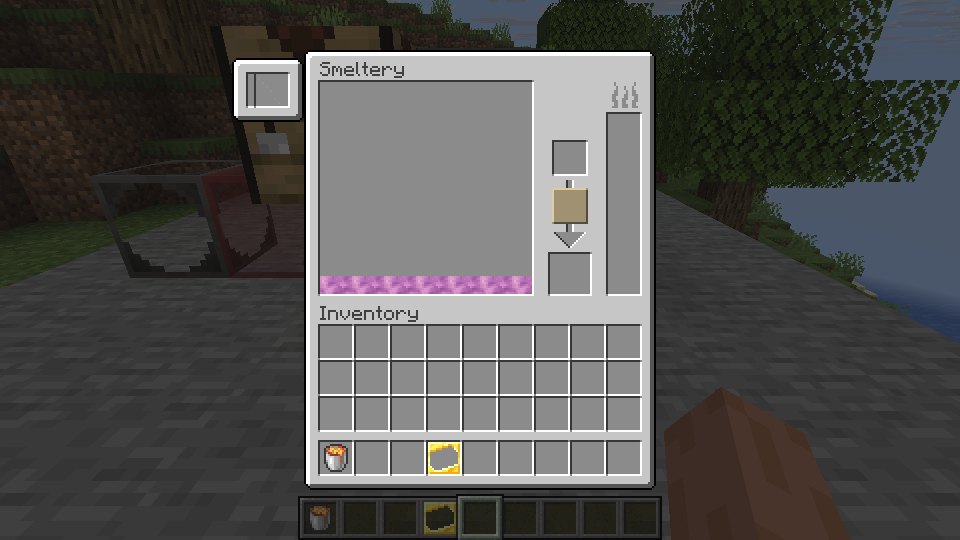

# Smeltery and alloys

Build a small Smeltery to melt materials and cast an alloy. In Creative, use seared bricks for the floor and walls, a Smeltery Controller, a Seared Fuel Tank and a Seared Drain. Leave the space inside empty and the top open. Connect a Seared Faucet to the drain by clicking the drain face, and place a Casting Table beneath the faucet. Faucet orientation follows the clicked face rather than the player's direction; clicking the top or bottom face sets it to face down. The normal-click placement path still needs in-game verification.

Fill the fuel tank by using a lava bucket on it. Open the controller and add a copper ingot to the input at the left. Once it melts, add an amethyst shard. The molten materials combine into amethyst bronze. Place an ingot cast on the casting table, use the faucet, and collect the cooled ingot.

The left panel holds the melting input. The fluid display shows the alloy in the controller.

This copper and amethyst sequence was tested on Linux in single-player and LAN. The single-player test also checked saving and reloading, and breaking and repairing a wall while an input was present. The two container slots in the Smeltery screen do not accept items yet; use the fuel tank directly. Other fluid containers are not supported yet.

Larger structures, other alloys, the Foundry and specialized recipes need further testing or implementation. Machine shapes and visuals are not yet a complete match for the original. Windows has not been tested.

Seared and Scorched Chutes connect adjacent hoppers to the formed controller's melting slots. A hopper facing a Chute inserts one item into the first empty melting slot; a hopper below a Chute can extract one item into an eligible hopper slot. The move is staged on both sides; after the native inventory callback it rechecks the structure and both snapshots before committing, and restores the hopper if the controller write fails. Opaque network component patches are conservatively refused. Representative b53 single-player hopper transfer and save/unload cases were tested; the updated callback guard, LAN and current host remain unverified.

Brewing stands can also turn a glass bottle plus Earth, Sky, Ender or Ichor Congealed Slime into the corresponding slime bottle, or a glass bottle plus a Magma Block into a Magma Bottle, when the required items are registered and no existing recipe overlaps. World reload, integrated host, multiplayer and gameplay have not been verified for these paths.

### Crafting tinted smeltery glass

Craft Seared or Scorched Tinted Glass by placing a Tinted Glass block in the
center of a crafting table, with four matching bricks above, below, left and
right. Each recipe produces one block. Both vanilla Tinted Glass and TConstruct
Clear Tinted Glass are accepted through `forge:glass/tinted`; ordinary clear
glass is not. The native tag combines the pinned Forge and TConstruct entries
and remains available for datapack additions or replacement.

These recipes restore crafting routes to existing blocks. Source recipe/tag
and package tests cover the two recipes and their registered endpoints; actual
crafting, tag reload, light blocking, machine-wall use, saves and LAN have not
been verified by these tests. Rendering and machine behavior are unchanged.

### Built-in tank to casting

A Faucet can draw from a registered Seared or Scorched fuel/ingot tank and pour into a casting table or basin when the source, faucet, and casting save data can be safely decoded. A changed or missing recipe, unknown source fields, unreadable target, or unloaded chunk causes this new route to wait rather than rewrite uncertain data. Source, target and faucet edits are staged together in memory. Existing behavior when the target is removed may discard the reserved packet, as in the source; this does not guarantee atomic disk or network persistence. Generic modded fluid handlers, live game, save/reload and LAN remain unverified. The route fixtures use real state types with a mocked world and recipe selector; they do not establish an integrated host build.

### Drain to built-in tanks

A Faucet can move untagged fluid or a supported vanilla potion from a formed Smeltery or Foundry Drain into built-in fuel and ingot tanks. The potion restrictions below also apply here: only a registered namespaced base Potion is allowed over the integrated/network path; color and custom effects require nonnetwork execution. The source structure and Drain ownership are revalidated; a stale controller, unloaded chunk, Duct, unsupported tag, unknown tank representation, or unreadable target waits without draining. The controller's original compound is retained and only its canonical tank is replaced. Initial and subsequent packets begin by transferring up to 10 mB, with controller, destination and Faucet changes staged together in memory. When the destination changes during a reserved packet, the existing Drain/Duct tick paths also preserve the raw controller compound and change only its canonical tank; unknown tank formats wait. Existing target destruction can discard a reserved packet. The route does not cover Duct filters or third-party handlers and has not been verified in the full host, a live world, save/reload or LAN; the state fixture uses a mocked world and structure detector.

### Built-in tank to Casting Tank

An untagged fluid from a built-in fuel or ingot tank can travel through a Faucet into a Casting Tank. The route stages source, output and Faucet data together, processes a supported container after fluid arrives, and updates the live slots only after the staged write succeeds. It rejects noncanonical saved tank data or live-slot mismatches; old Casting Tank and Cannon tick paths now also wait rather than overwrite noncanonical data when the source or target changes. Tagged fluid, generic handlers, full host build, live world, save/reload and LAN remain unverified. The route test uses real state/NBT types but a mocked world and container transfer, so it does not establish actual bucket integration or disk/network atomicity.

### Built-in tank to Fluid Cannon

A Faucet can supply a Fluid Cannon from a built-in fuel or ingot tank. This bounded route checks the saved source, Faucet and Cannon against the current machine state, then stages their changes together and updates the comparator. Cannon items remain unchanged. Unknown or noncanonical saves and tagged fluids wait; generic handlers remain unsupported. The real game, host-wide build, LAN and disk/network atomicity remain unverified. The source-state fixture uses a mocked world and store and does not verify Cannon firing.

The built-in tank → Casting Tank route also accepts registered vanilla potion fluid tags. Simple potion-name tags are allowed through the host network representation; supported custom color and effects require a nonnetwork execution path because the current item wire drops those fields. The host normally uses an integrated server even for singleplayer, so custom effects and color are not claimed as available in ordinary singleplayer. Each saved source, Faucet and target must round-trip; invalid UTF-16, unsupported effects, unknown potions and other tagged fluids wait. Networked Faucet packets and existing Casting Tank tick paths also reject metadata other than the supported simple potion tag. This safety restriction can suspend previously allowed tagged transfers. On the current remote renderer, the potion liquid can still appear in the generic fallback colour even when its saved tag is correct. Live game, host-wide build, save/reload and LAN behavior remain unverified.

### Casting Tank to casting blocks

A Faucet can draw untagged fluid from a Casting Tank into a Table or Basin. The source's saved data must match both live container slots; source, Faucet and target are staged together, and a changed source comparator is notified after a successful write. When a packet is reserved from the source, a waiting source container is processed on staged data; the source slots are published only after the combined write succeeds. The source, target, current recipe and Faucet are rechecked after processing. Already-reserved untagged fluid can finish if the source container fills the source with tagged fluid, but a new tagged reservation waits. The Drain destination is described below. Unknown data waits. Actual host integration, game, save/reload, LAN and disk/network atomicity remain unverified.

### Built-in tank to Drain

A Faucet can fill a formed Smeltery or Foundry through a Seared or Scorched
Drain, drawing from the eight built-in fuel/ingot tanks and gauges. Untagged
fluids and supported vanilla base-potion identity are accepted. Matching layers
are combined by exact fluid/NBT identity; other controller layers remain in
place, even if they are selected first. Capacity comes from the whole tank and
must match the current detected structure before filling.

Source tank, controller tank and Faucet packet changes are staged together.
Only the controller's tank is patched, retaining its other metadata. Unknown
source/tank representations, invalid Drain ownership, unloaded chunks and stale
structure capacity wait. A reserved packet can finish after a loaded source is
removed; an unreadable recognized source waits instead. Duct destinations
and generic handlers are not added here. Melter and Casting Tank support are described below.

Brief static review only. Focused route fixtures are added but not run in this
phase; full host build, gameplay, save/reload, LAN and atomic disk/network
persistence remain unverified.

### Melter to Drain

The Drain-input Faucet route also accepts a Seared Melter's internal tank.
It uses the Melter's 2,160 mB capacity and requires readable state with a
canonical tank. Only its tank field is patched: fuel, temperature, progress,
raw inventory items and unrelated machine metadata stay unchanged. Live slots
are not reserialized. Source Melter, destination controller and Faucet save
as one staged batch, retaining the same structure-capacity and fluid-tag limits.

This transfers already-stored fluid; it does not change fuel consumption or
melting recipes. The draft builds on the built-in tank-to-Drain route. Brief
static review only; regression cases are added but not run. Host integration,
gameplay, save/reload, LAN and disk/network atomicity remain unverified.

### Casting Tank to Drain

The Drain-input route also accepts a Seared Casting Tank source. A new Faucet
reservation can free room for its waiting input container. Container conversion
runs on staged state; the source fluid and slots, destination controller tank
and Faucet are saved together before live slots or comparator notifications
change. Ticks that only pour an existing packet do not reprocess the container.

The route retains distinct fluid/NBT layers and rechecks the source inventory,
saved data, blocks, loaded chunks, Drain ownership and current structure
capacity after container processing. Unknown or mismatched Casting Tank state
waits. A pending packet keeps its original identity if the source refills with a
different supported fluid. Untagged fluids and supported vanilla base potions
are accepted; custom potion colors/effects and Duct destinations are excluded.

Four source-specific fixture cases were added for later validation, using the
production Casting Tank loader and container/state code with a mocked world.
Tests were not run for this change. Build, gameplay, save/reload, LAN and atomic
disk/network persistence remain unverified.
