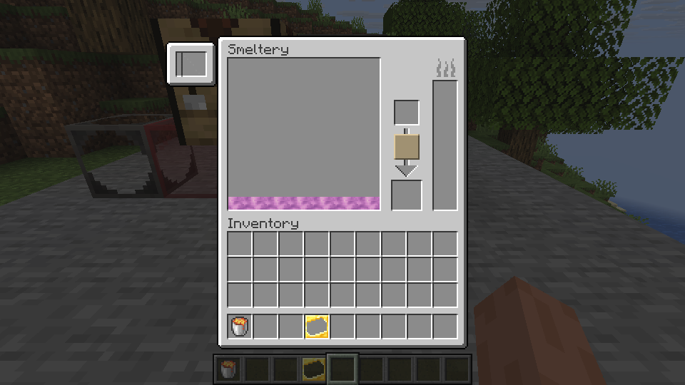

# Smeltery and alloys

Build a small Smeltery to melt materials and cast an alloy. In Creative, use seared bricks for the floor and walls, a Smeltery Controller, a Seared Fuel Tank and a Seared Drain. Leave the space inside empty and the top open. Connect a Seared Faucet to the drain and place a Casting Table beneath the faucet.

Fill the fuel tank by using a lava bucket on it. Open the controller and add a copper ingot to the input at the left. Once it melts, add an amethyst shard. The molten materials combine into amethyst bronze. Place an ingot cast on the casting table, use the faucet, and collect the cooled ingot.

The left panel holds the melting input. The fluid display shows the alloy in the controller.

This copper and amethyst sequence was tested on Linux in single-player and LAN. The single-player test also checked saving and reloading, and breaking and repairing a wall while an input was present. The two container slots in the Smeltery screen do not accept items yet; use the fuel tank directly. Other fluid containers are not supported yet.

Larger structures, other alloys, the Foundry and specialized recipes need further testing or implementation. Machine shapes and visuals are not yet a complete match for the original. Windows has not been tested.
