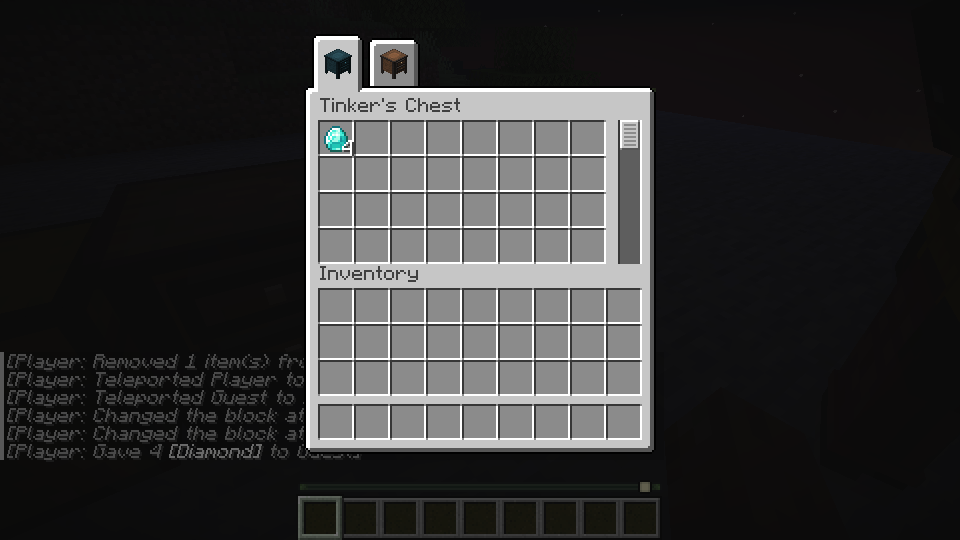
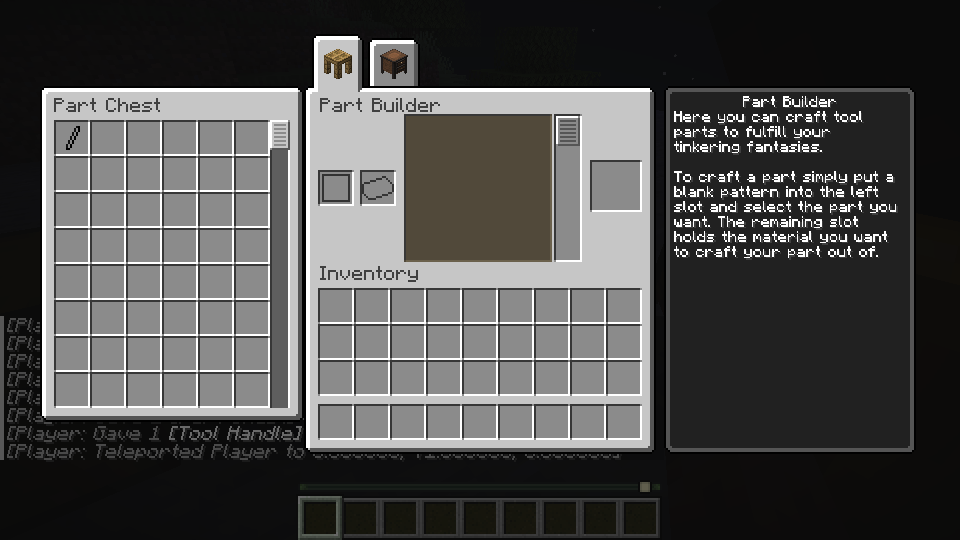
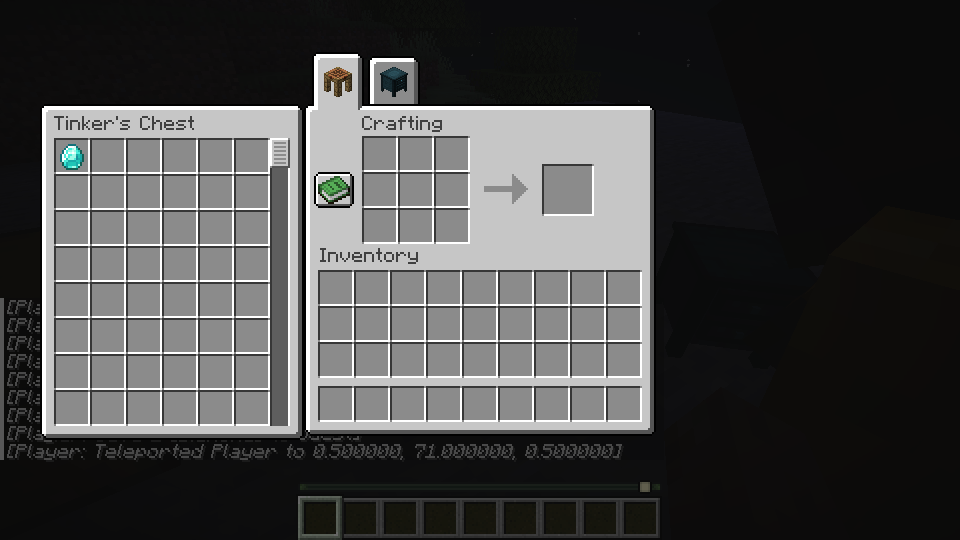

# Part Chest and Tinker's Chest

> Local Crafting Station grid persistence and representative normal and Shift result transactions passed on the provisional build; recipe-book auto-placement remains temporarily blocked. Earlier observations below refer to the revisions identified with them. See [provisional limitations](provisional.md).

This draft targets TConstruct revision `f4e77d43f39ba1047bf93ae816b7e1beaab514c2`. The Part Chest accepts tagged parts, holds at most eight identical item-and-component variants per slot, forbids duplicate variants in separate slots, and grows to 256 slots. The Tinker's Chest holds 64 slots of up to 16 items each. Both use their original shaped recipes, block models and textures; original assets are covered by `third_party/tconstruct/LICENSE`. The recipe ingredient aliases contain the pinned Forge tags' available vanilla entries and reference the original Forge tags when Horizon loads them. Forge-only datapack additions are not yet verified in Horizon's ordinary crafting tag loader.

Block and item registration, source recipes, storage serialization, direct local and LAN screens, and normal and shift-click transactions have draft connections. On the current development branch, the shared single-slot insertion uses PlutoLib’s inventory planner; TConstruct retains its own slot limits, part restrictions, complete component identity and transaction commit. The planner path has been checked in an isolated Linux test client, including representative LAN guest transactions (see below). The Part Builder has a paged adjacent chest view and uses the same insertion limits for crafted results. The source attaches this side inventory to the Part Builder and Crafting Station, not the Tinker Station.

The Crafting Station has a source recipe and nine-slot save and break boundaries. Draft local and LAN sessions use the host crafting engine and synchronize the input grid to the block. The source uses the vanilla crafting background; a draft side panel connects Part and Tinker's Chests and vanilla containers, including double chests, with scrolling, normal and shift-click transfers, and crafted-result distribution. Concurrent guest views have a draft update path. Direct and side screens also have draft hotbar, dropping, creative copying, double-click collection, drag preview and shift-double-click handling. A held part can be inserted directly into a Part Chest, as in the source. Tinker's Chest has draft item dye, stored color, world tint, pick-block, drop and LAN synchronization paths.

Lightweight tests cover source recipes, chest capacity and identity, pagination, slot overflow and break capacity, and save/restore with components. On Linux, runtime `956fbb697c9792d875db87da0967540fd3d02caa` passed the official transform and client build using Mixins `ddd9700b21997c95d95ac6ee5ecafe3830cf622a`. Later commit `97e9772210dda9976053a17f0250213734ca420b` changes ingredient resources, tests and documentation, not the runtime code; those resources were regenerated for the tests below.

With supplied materials, both chest recipes and the Crafting Station recipe produced their items. One crafted Tinker's Chest was placed and used; normal insertion, a 16-item slot limit with the remainder returned, Shift insertion, and custom data through save/reload were checked. A red-dyed chest retained its color after placement, reload and survival break/recovery. A Part Chest rejected a non-part, accepted a held part, and received a material-bearing Part Builder result when the player inventory was full. A LAN guest inserted into each chest directly or through adjacent Part Builder and Crafting Station screens; the other player or a reopened chest showed the result. A vanilla double chest beside a Part Builder passed LAN synchronization and a result race. The directory-based English guide also showed the same representative material page on host and guest after synchronization. Tests used the existing test world and supplied items; they do not establish natural material collection.

Full capacity, all drag, hotbar, drop and double-click combinations, every chest variant, concurrent Crafting Station result races, dedicated servers and Windows remain unverified. The control API's slot inspection does not report the Crafting Station's added side cells; their display was checked in game and their contents by reopening the chest.

On the newer host, TConstruct code `87ba0b0` and PlutoLib `5520a221655e9ea5b55b9ce32a46bca511c3ae71` were tested in an isolated Linux client with eight unrelated injections excluded, not as a production build. With supplied part and diamond stacks carrying custom data, both chest types passed host and LAN guest insertion, same-component stacking, different-component separation, per-slot limits and remainders, and save/reload of counts and custom data. The Part Chest rejected a non-part without consuming it. Guest reconnection was checked for both types, with the host and guest viewing the chest together during insertion. This test does not verify chest rendering or Crafting Station synchronization.

The provisional Linux product client built from code `ed70aa9baedc33c6613733c4f5e560420aede457` repeated local and LAN guest insertion, component separation, partial moves and remainders, Part Chest rejection, guest reconnection and save/reload using supplied items. Chest world tint and Crafting Station LAN were not part of that check. See [host update evidence](host-upgrade.md).
