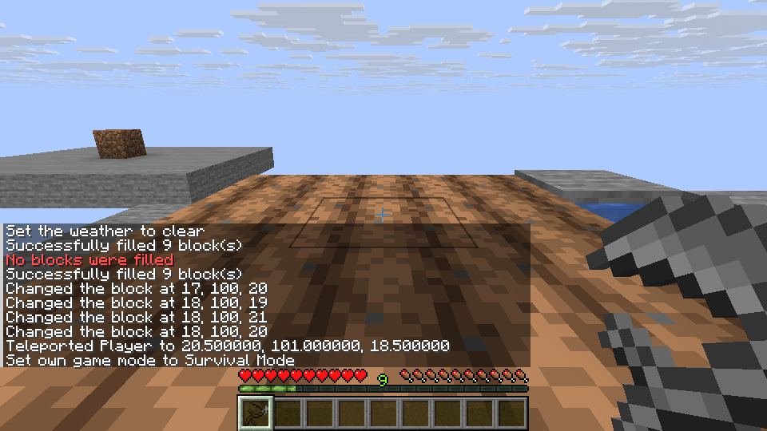
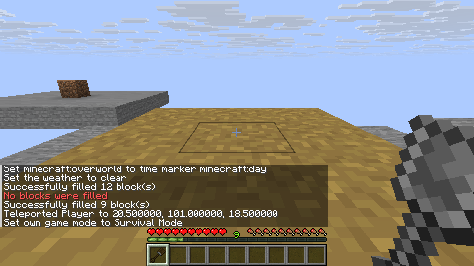
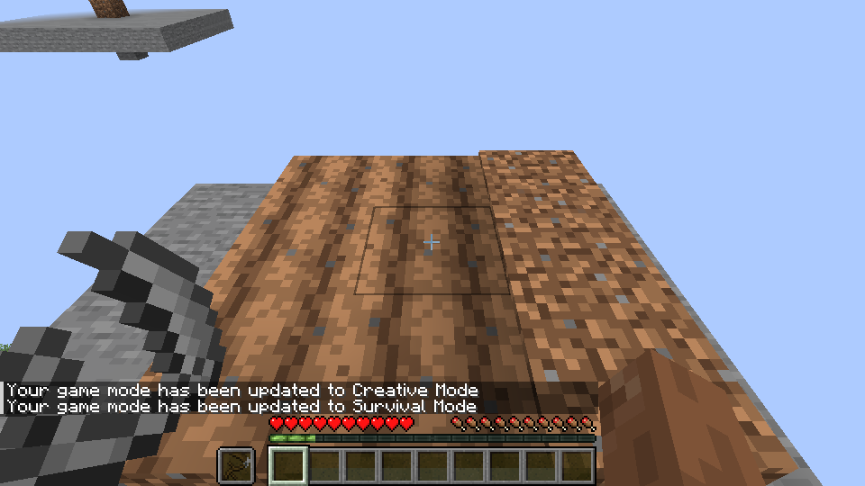

# Tool block transformations

The intended right-click actions are tilling with a Mattock, Kama or Scythe,
pathing with an Excavator, and stripping, scraping or wax removal with a Hand
Axe or Broad Axe. The implementation reads the held material tool and uses
Horizon's existing transformation rules for the target block. A tool that has
broken is kept and cannot keep transforming blocks.

Unexpanded Scythes use the source side-hit box; Excavators use the source
side-hit plane. Broad Axes follow the source tree or vertical non-tree area.
Each successful transformation consumes durability outside Creative. On a hosted
server the existing spawn-protection policy is checked for every candidate,
including tools in the off hand. Pathing also attempts the source behavior for
replaceable vegetation above the block. Client prediction ends the interaction
on a successful transform so that the other hand does not act as well.

**Verification status:** the official Mixins revision
`a2af5c0dd4117d51ecd70066ba7a00b4a2c10dab` was used for the full transform
and client/ctl build. On Linux, normal play verified all six tools, a Scythe
3×3 till, Excavator 3×3 pathing, Broad Axe trunk and branch stripping,
copper scraping and wax removal, replaceable and solid obstacles, a near-broken
Scythe, sneak pass-through and offhand use, vanilla hoe behavior and save/reload.
A non-operator on a dedicated server retained three protected blocks while six
permitted blocks were tilled, for both main and off hands. Hosted LAN checks
covered all six tools and sneaking pass-through in either hand. These results
are representative, not exhaustive material or multiplayer coverage.

Creative currently supplies four-part tools; their survival assembly remains
unfinished. Expanded modifiers, crop harvesting/replanting, Scythe attacks,
walking transformations and campfire extinguishing are separate unfinished
behaviors. Armor and projectile-specific actions and Windows verification also
remain open.
